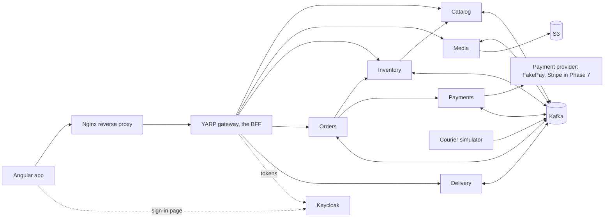

# newstore

newstore is a video platform with a store built in. Creators upload videos, and anyone can watch them for free, as on YouTube. Creators can also sell a limited number of copies of a video, on DVD, on USB or as a digital download. Each copy is numbered. When the last one sells, the video is sold out. A buyer of a DVD or USB copy can follow the courier live on a map until the copy arrives.

It's a home practice project, not a business. Its purpose is hands-on practice with the skills a senior ASP.NET Core backend developer is expected to have, and a chance to learn new ones.

> **Status:** Phase 0 (Foundation), Phase 1a (Buy the last copy) and Phase 1b (Checkout) done; Phase 1b's mock interview and sprint review are still to come. Phase 2 (Video pipeline) is next: its Stage 2 topics come first, then its plan. To start work or pick it up again, follow [`docs/getting-started.md`](docs/getting-started.md).

## Goals

newstore succeeds when its owner understands each hard part and can explain it in an interview:

- **The last copy:** 1,000 people try to buy the last 10 copies at the same moment. Exactly 10 sell, and every copy number is used once.
- **Video uploads:** large files go to S3 and are converted to a streaming format in the background.
- **Live tracking:** courier positions flow through Kafka and appear on the buyer's map in real time.
- **Microservices done properly:** each service owns its data, events are never lost (the outbox pattern), the checkout is a saga, and message handling is idempotent.
- **Running it the way production runs:** Docker, Kubernetes, AWS set up with Terraform, CI/CD, and Grafana dashboards.
- **Working in an Agile way:** a backlog of user stories, a Kanban board and short sprints.

## Non-goals

These are out of scope. Some may come later as stretch work.

- Real money: payments run in test mode, and creators are never paid out.
- Real delivery companies or real DVD manufacturing. Both are simulated.
- Comments, likes, subscriptions, recommendations and ads.
- Mobile apps, DRM and multiple regions.

## Anti-goals

The project fails, even if every feature works, if any of these happen:

- **Overselling:** copy 101 of 100 sells, or two buyers get the same copy number.
- **A lost event:** an order is paid but no copy is assigned, or a copy is assigned without a payment.
- **A surprise AWS bill.**
- **Weeks of setup with nothing working:** every phase ends with something that runs end to end.
- **Code that isn't understood:** every non-obvious choice has a recorded reason (see [Decision records](#decision-records)).

## Users

| Role | Can do |
|------|--------|
| Viewer | Browse and watch without an account. Sign in to buy copies, see owned copies and track deliveries. |
| Creator | Everything a viewer can do, plus upload videos, create editions and see sales. |
| Admin | Remove videos and block users. |

## Terms

- **Edition:** one format of one video that a creator sells, with a format (DVD, USB or Digital), a price and a fixed number of copies. One video can have several editions.
- **Copy:** one sold item of an edition. It has a number, for example "copy 37 of 100", and an owner.
- **Reservation:** a hold on one copy for one buyer. The buyer has 10 minutes to start paying. Once payment starts, the copy stays held until the payment finishes, for at most 45 minutes.
- **Order:** one buyer's purchase of one copy, from the reservation to a copy number, a failed payment or a refund.
- **Shipment:** the delivery of one physical copy from the warehouse to the buyer.
- **Courier:** the simulated driver who carries a shipment and reports its position.

## Requirements

Requirements are written as user stories with acceptance criteria. They are the starting backlog (see [How we work](#how-we-work)).

### Accounts

- **A-1** As a visitor, I can sign up and sign in.
  - Sign-in is handled by Keycloak.
  - A new account is a Viewer. Any viewer can become a Creator by opening a channel.
- **A-2** As an admin, I can block a user.
  - A blocked user can't sign in, and their videos are hidden.

### Videos

- **V-1** As a creator, I can upload a video.
  - MP4, MOV and WebM files up to 2 GB are accepted.
  - The upload goes straight from the browser to S3 and can resume after a dropped connection.
  - The video shows a status: Uploading, then Processing, then Published or Failed.
- **V-2** As the system, I convert each upload into a streaming format.
  - Output is HLS at 360p and 720p, plus a thumbnail.
  - Processing runs in the background and survives a service restart.
- **V-3** As a viewer, I can watch any published video for free without signing in.
- **V-4** As a viewer, I can browse videos, search by title or creator, and open a creator's channel page.
  - The list shows published videos, newest first, 20 per page.
  - Search matches words in the title or description, and the creator's channel name.
  - A channel page shows the channel and its videos, newest first.
  - Reads keep working when the cache is down.
- **V-5** As an admin, I can remove a video.
  - A removed video is hidden, and sales of its editions stop.

### Editions

- **E-1** As a creator, I can create an edition for my video, with a format, a price and a number of copies (1 to 10,000).
- **E-2** As a creator, I can't change an edition's price or number of copies once its first copy is reserved. I can end the sale early, and the unsold copies are withdrawn.
- **E-3** As a viewer, I can see each edition's price and how many copies are left.
  - The number left may lag behind real sales by a few seconds.
- **E-4** As a creator, I can see each edition's sales: copies sold, copies left and test revenue.
  - Copies sold and copies left come from Inventory.
  - Test revenue is the sum of the prices of the edition's completed orders.
  - The figures may lag behind real sales by a few seconds.

### Checkout

- **C-1** As a buyer, I can reserve a copy, and I have 10 minutes to start paying for it.
  - If I don't start paying in time, the reservation expires and the copy goes back on sale.
  - Once I start paying, the copy stays mine until the payment finishes, for at most 45 minutes.
  - A payment that succeeds after that is refunded, and the copy goes back on sale.
  - I can own at most one copy of each edition.
- **C-2** As a buyer, I can pay for my reservation.
  - Payment uses a fake provider first and Stripe test mode later.
  - Paying twice, or a payment provider retrying its callback, never charges twice or assigns two copies.
  - A declined card leaves the payment open, so I can try again until the payment session ends after 30 minutes.
- **C-3** As a buyer, I receive a copy number when my payment succeeds.
  - Numbers are assigned in payment order, from 1 with no gaps, so an expired reservation never uses up a number.
- **C-4** As the system, I never sell more copies than an edition has, even with 1,000 buyers at once.
  - A k6 load test proves it in CI.

### Library

- **L-1** As a buyer, I can see all my copies, with each copy's number and delivery status.
- **L-2** As the owner of a digital copy, I can download the original video file.
  - The download link works only for the owner and expires after 15 minutes.

### Delivery

- **D-1** As the system, I create a shipment when a physical copy is paid for.
  - At checkout, the buyer types an address and drops a pin on a map. The pin avoids the need for address lookup.
  - Every shipment starts from one warehouse, set in configuration.
- **D-2** As the system, I simulate a courier for each shipment.
  - The courier moves from the warehouse to the pin and reports its position every 2 seconds.
  - Time is sped up, so a delivery takes about 5 minutes.
  - Status moves through Preparing, Picked up, In transit and Delivered.
- **D-3** As a buyer, I can watch the courier move live on a map, along with the delivery status.
  - Updates keep arriving when Delivery runs as two or more instances.

## Architecture



### Services

Each service is an ASP.NET Core app with its own PostgreSQL database, accessed through EF Core. A service reads and changes only its own data. Other services learn about that data through its API or its Kafka events.

| Service | Owns | Job |
|---------|------|-----|
| Gateway (YARP) | user sessions, in Redis | The backend-for-frontend: signs the browser in, keeps its tokens on the server and forwards API calls with the user's access token. From Phase 4 it also limits request rates and adds correlation IDs. |
| Catalog | channels, video details, a read copy of editions | Browsing, search and channel pages. |
| Media | uploads, processing jobs, files in S3 | Upload links, FFmpeg conversion to HLS, download links. |
| Inventory | editions, stock, reservations, copies | Reservations and copy numbers. This is where the last copy is decided. |
| Orders | orders | Runs the checkout saga. |
| Payments | payment attempts | Talks to the payment provider and handles its callbacks idempotently. |
| Delivery | shipments, position history | Shipments, tracking and the SignalR hub for live maps. |
| Courier simulator | nothing | A worker that drives simulated couriers and publishes their positions. |
| Keycloak | users, service clients | Sign-in, and tokens for calls between services. It's off-the-shelf software, not our code. |
| FakePay | payment sessions, in memory | A stand-in for a hosted payment page until Stripe test mode in Phase 7. A test double, not part of the store. |

### The checkout flow

1. The buyer clicks Buy. Orders asks Inventory to reserve a copy and waits for the answer, so the buyer knows at once whether they got one.
2. The buyer clicks Pay. Orders asks Inventory to hold the reservation, then asks Payments for a payment, and sends the buyer to the provider's page.
3. The provider calls Payments back. Payments publishes "payment succeeded" or "payment failed", once per payment however often the callback comes.
4. On success, Orders asks Inventory to confirm the reservation. Inventory assigns the copy number and publishes "copy assigned". If the hold ran out first, Orders publishes "refund requested" instead, and Payments refunds.
5. On failure, Orders asks Inventory to release the reservation. A reservation nobody starts paying for expires after 10 minutes, and a held one after 45.
6. "Copy assigned" leads Delivery to create a shipment for a physical copy, or makes a digital copy downloadable.

Every event is published through a transactional outbox, and every consumer ignores messages it has already handled. Orders' calls to Inventory and Payments are commands that are safe to repeat: each carries an id Orders chose, so a retry after a lost reply still takes effect only once. A consumer retries a call that failed because the other service was down, without a limit, so a payment is never dropped while Inventory restarts.

### Cross-cutting

- **Sign-in and permissions:** the gateway is a backend-for-frontend (BFF). It signs the browser in to Keycloak with the authorization code flow and PKCE, keeps the tokens on the server, and gives the browser only an HttpOnly session cookie. It adds the user's access token to each API call it forwards. Each service checks the token itself and enforces its own permissions with ASP.NET Core authorization policies, for example "a creator can change only their own editions". A service that calls another sends its own token, from the client credentials grant, and the callee names the callers it accepts.
- **Caching:** Redis, through HybridCache, for catalog reads. Redis is also the SignalR backplane when Delivery runs as several instances.
- **Monitoring:** every service sends metrics, logs and traces with OpenTelemetry to an OpenTelemetry Collector. The collector forwards them to Prometheus, Loki and Tempo, and Grafana shows all three. A single purchase appears as one trace across every service.
- **Front door:** Nginx handles HTTPS and serves the Angular app, then passes `/api` and WebSocket traffic to the YARP gateway. Until Nginx arrives in Phase 4, the gateway serves the Angular app itself.

## Stack

| Area | Choice |
|------|--------|
| Backend | ASP.NET Core on .NET 10, EF Core with PostgreSQL |
| Messaging | Kafka in KRaft mode, with the Confluent.Kafka client |
| Frontend | Angular, Angular Material, Leaflet with OpenStreetMap, hls.js |
| Sign-in | Keycloak. AWS Cognito is an option once the system runs in AWS. |
| Gateway | Nginx reverse proxy, then the YARP API gateway |
| Storage | S3: LocalStack on the Mac, real S3 and CloudFront in AWS |
| Cache | Redis |
| Monitoring | OpenTelemetry, Prometheus, Loki, Tempo, Grafana |
| Testing | xUnit, Testcontainers, PactNet contract tests, k6 load tests, Playwright browser tests |
| Containers | Docker, Docker Compose on the Mac, Kubernetes with Helm (kind on the Mac, EKS in AWS) |
| Infrastructure | Terraform |
| CI/CD | GitHub Actions |

## Constraints

- **Cost:** everything runs free on the Mac, using Docker Compose for daily work and kind for Kubernetes practice. Real AWS is used only in short sessions. Each session runs `terraform apply`, deploys, tries things out, then runs `terraform destroy`. An AWS Budgets alert warns at $20 a month. To keep sessions cheap, Kafka runs inside the EKS cluster instead of on Amazon MSK.
- **Machine:** an Apple Silicon Mac with 32 GB of RAM. Every container image must run on arm64, and the full stack should fit in about 12 GB of Docker memory. Locally, one PostgreSQL server holds a separate database for each service.
- **SDK:** a .NET 11 preview SDK is also installed and `dotnet` uses it by default, so the repository pins .NET 10 with `global.json`.
- **Tools still to install:** kind, Helm, Terraform and k6. Each one is installed in the phase that first needs it. Node 26 is installed, for the Angular app. Playwright's browser is installed only in CI (the owner chose not to download Chromium on the Mac).
- **Repository:** newstore is its own git repository on GitHub, with its own CI, issues and board.

## Phases

Each phase ends with a working system and has a clear test for when it's done.

| # | Phase | Done when | Practises |
|---|-------|-----------|-----------|
| 0 | **Foundation:** the solution, Docker Compose with PostgreSQL, Kafka, Keycloak and Redis, one service with health checks and OpenTelemetry, and a CI pipeline that builds and tests | `docker compose up` starts everything and CI is green. | Project structure, Docker, GitHub Actions |
| 1a | **Buy the last copy:** Inventory with editions, reservations and copy numbers, the outbox and Kafka library, and Catalog with sample videos, browsing and search. No sign-in and no pages yet. | The k6 test with 1,000 buyers and 10 copies sells exactly 10, numbers 1 to 10 are each used once, expired reservations go back on sale, and the reserve call's p99 stays under 1 s on the Mac. | Concurrency, EF Core, transactions, Kafka, outbox, idempotency, caching |
| 1b | **Checkout:** Orders, Payments with the fake provider, the gateway, sign-in, plus Angular pages for browsing, a video, buying and "my copies" | A signed-in buyer buys a copy in the browser (CI's Playwright test), and the last-copy test passes through the gateway: the burst sells exactly 10 with a soft latency bound, and reserve p99 stays under 1 s on the Mac under a steady load. | Saga, JWT, authorization policies, API gateway |
| 2 | **Video pipeline:** uploads to S3, FFmpeg conversion to HLS, the player and digital downloads | An uploaded 1 GB file becomes playable, and a broken file shows as Failed. | S3 and presigned URLs, background services, resumable work |
| 3 | **Delivery tracking:** Delivery, the courier simulator, SignalR and the map | Buying a DVD shows the courier moving live until Delivered, including with two Delivery instances. | Real-time updates, SignalR scale-out, high-frequency events |
| 4 | **Front door and monitoring:** Nginx, rate limiting and Grafana dashboards for checkout and Kafka consumer lag | One purchase shows as a single trace through every service in Grafana. | Reverse proxy versus API gateway, rate limiting, OpenTelemetry |
| 5 | **Kubernetes:** Helm charts, health probes, configuration and secrets, autoscaling | The whole system runs on kind and the same tests pass. | Kubernetes, Helm |
| 6 | **AWS:** Terraform for the VPC, EKS, RDS, S3, CloudFront and ECR, plus a GitHub Actions deploy | `terraform apply` and a deploy give a working public URL, and `terraform destroy` leaves nothing billable. | AWS, IAM, Terraform, CD |
| 7 | **Hardening:** Stripe test mode, Pact contract tests, admin pages and the creator sales page | Contract tests run in CI, and a Stripe test payment completes a purchase. | Contract testing, third-party webhooks |

Watermarking each digital copy with its number and owner is stretch work after phase 7.

## How we work

The project runs as Scrumban, a mix of Scrum and Kanban:

- **Backlog:** the user stories above, as GitHub issues, with their IDs, for example "C-1", in the title.
- **Board:** a GitHub Projects board with the columns Backlog, Ready, In progress, Review and Done. At most three items can be in progress at once: raised from two on 2026-11-06 so that independent tasks can run in parallel. The limit still caps how many pull requests wait for review.
- **Code:** Claude writes the code and opens a pull request for each piece, with a walkthrough in its description. The owner reviews and merges it. `AGENTS.md` has the details.
- **Sprints:** two weeks each, with one sprint goal taken from the current phase. Each sprint ends with a short review and retro note in `docs/sprints/`.
- **Definition of Done:**
  - The acceptance criteria are met.
  - Tests pass in CI.
  - The feature's logs and traces show in Grafana (from phase 4 on).
  - This README, or a decision record, is updated.

## Decision records

Any choice with a real trade-off gets a short decision record in `docs/adr/`, stating the context, the decision and its consequences. Some decisions get comparisons instead of a single answer, because comparing is the lesson:

- **The last copy:** build at least two approaches, for example an optimistic concurrency token and a single conditional `UPDATE`. Run the k6 test against both and record the results.
- **The outbox:** write it by hand first, so its inner workings are clear, before considering a library.

## Repository layout

The starting layout. Change it, and record why, if a better one appears.

```
newstore/
├── README.md         this design
├── AGENTS.md         guidance for AI coding agents
├── compose.yaml      the local stack, so `docker compose up` works from the root
├── src/
│   ├── Gateway/
│   │   NewStore.Gateway: Auth/ (OIDC sign-in, session cookie in Redis, CSRF header), Proxy/ (YARP routes, access-token transform), Redis/
│   ├── Services/     one folder per service; Catalog: Channels/, Videos/, Editions/, Caching/, Seed/ (sample-catalog.json)
│   │                 Orders: Orders/ (buy, pay, my copies), Clients/ (Inventory and Payments), Saga/ (the handlers of Payments' events)
│   ├── Fakes/        stand-ins for outside services; FakePay: a hosted-checkout page and signed webhooks (not part of the store)
│   ├── Workers/      the courier simulator and other workers
│   └── Shared/       outbox, Kafka and OpenTelemetry setup
│       ├── Messaging/    NewStore.Messaging: the outbox, the relay, the idempotent consumer, topics
│       └── Contracts/    NewStore.Contracts: the events other services consume, one folder per producer
├── web/              the Angular app
│   src/app: auth/ (session state, CSRF header, guard), videos/, orders/, copies/, api/ (JSON types); the gateway image builds and serves it
├── compose.load.yaml overlay for the k6 load test: a short reservation TTL, FakePay's test endpoints and the k6 service
├── tests/            unit, integration, contract and load tests
│   ├── load/         k6 scripts and how to run them
│   ├── e2e/          Playwright: a new buyer signs up and buys a copy in the browser (CI only)
│   ├── Messaging.Tests/  the outbox, relay and consumer against real Kafka and PostgreSQL
│   ├── Orders.Tests/     buy, pay and the checkout saga against real PostgreSQL and Kafka, with stubs for Inventory and Payments
│   ├── Gateway.Tests/    sign-in, sessions and routing against real Keycloak and Redis
│   └── Shared/       NewStore.TestSupport: the app factory, span sink, and the PostgreSQL and Kafka servers every test project uses
├── .config/          dotnet-tools.json: the pinned `dotnet-ef` tool
├── deploy/           files Compose mounts, Helm charts and Terraform
└── docs/
    ├── getting-started.md   how to start or resume a phase in a fresh session
    ├── adr/
    ├── plans/        one implementation plan per phase
    └── sprints/
```

## Decisions so far

**Decided by the owner:**

- The concept:
  - Creators upload videos and choose how many copies of each edition to sell.
  - Watching is free, and buying is optional.
  - Physical deliveries can be tracked on a map.
- The technology areas to practise:
  - ASP.NET Core with EF Core, microservices patterns and async programming.
  - Kafka, an API gateway, a reverse proxy and authorization.
  - Docker, Kubernetes and AWS.
  - A frontend, CI/CD and Grafana.
  - Agile ways of working.
- Running costs: everything runs free on the Mac, and AWS is used only in short sessions that are torn down afterwards.
- Claude writes the code and presents it to the owner.
- Phase 1b, decided 2026-11-08:
  - Payments is its own service.
  - A reservation is held while the buyer pays, up to a hard limit of 45 minutes owned by Inventory. The provider's payment session lasts 30 minutes, and a payment that succeeds after the hold ran out is refunded.
  - Services call each other with client-credentials tokens, and each callee names the clients it accepts.
  - Creator is not a role: a creator is a user with a channel, and permissions compare the token's `sub` with the resource's `CreatorId`.
  - The browser sign-in path gets the deep walkthrough; the rest of the Angular app gets short ones.
  - The gateway is the BFF, following RFC 10017 (BCP 212).
  - One plan for the whole of 1b.
  - A message consumer retries a failure caused by a service being down without a limit, and dead-letters only a message that can never succeed.

**Proposed by Claude and open to change:**

- How code is presented: one pull request per piece with a walkthrough in its description, and a small hands-on change for each hard part.

- The services:
  - The split into services.
  - Inventory owns editions, and Catalog keeps a read copy.
- Purchases:
  - Keycloak handles sign-in.
  - A fake payment provider comes before Stripe.
  - Each buyer can own one copy per edition.
  - Copy numbers follow payment order.
  - Editions lock once their first copy is reserved.
  - Orders chooses the reservation id, so a retried reserve after a lost reply takes no second copy.
  - Orders' saga handlers call Inventory synchronously, and a refund is requested by an event, so it can't be lost between services.
  - FakePay is a separate small app, and its Decline button leaves the payment open.
  - The sample creators are Keycloak users with their catalog ids, and the sample videos have fixed ids.
  - L-1 shows no delivery status until Phase 3.
- Video and delivery:
  - Video limits: 2 GB, plus HLS at 360p and 720p.
  - Delivery uses a pin on a map instead of address lookup, one warehouse and sped-up couriers.
- Tools:
  - newstore gets its own GitHub repository.
  - Docker Compose for daily work.
  - The gateway serves the Angular app until Nginx arrives in Phase 4.
  - Playwright runs on the host, against the Compose stack, in its own CI job.
  - k6 gets user tokens through the password grant, which RFC 9700 forbids for real clients, so the load test creates that client itself and no other client allows the grant.
  - Helm for Kubernetes.
  - Kafka inside EKS instead of MSK.
  - A $20 budget alert.
- Ways of working: two-week sprints, a work-in-progress limit of three, and a hand-written outbox.
- Phase 1 is split into 1a, the last copy, and 1b, checkout, so each has a "done when" of its own.
