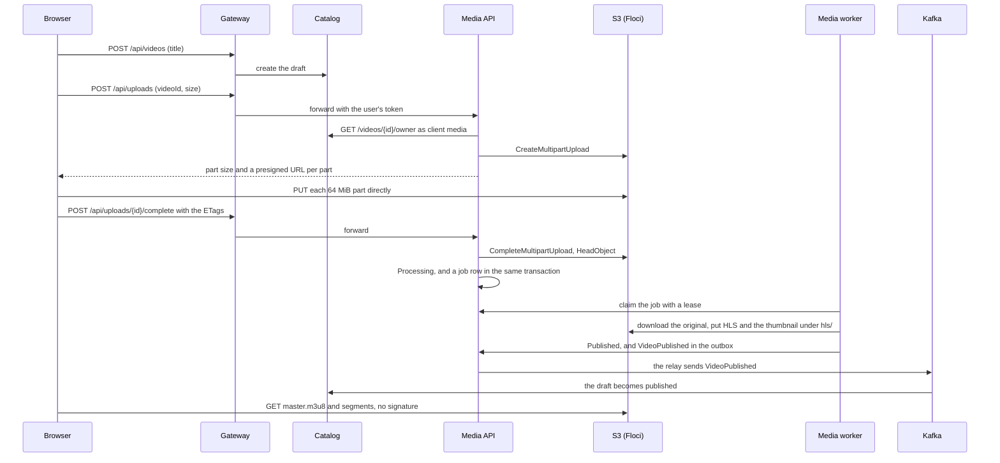

# Phase 2: Video Pipeline Implementation Plan

> **For agentic workers:** REQUIRED SUB-SKILL: Use superpowers:subagent-driven-development to implement this plan task-by-task. The `code-writer` agent (`~/.claude/agents/code-writer.md`) builds each task, and the main session reviews it before the owner sees the pull request. The tasks run in four waves, up to three at a time, each in its own git worktree and branch; see "Running tasks at once". Steps use checkbox (`- [ ]`) syntax for tracking.

**Goal:** A creator uploads a video of up to 2 GB straight from the browser to S3, resuming after a dropped connection; a worker turns it into HLS at 360p and 720p with a thumbnail; anyone plays it without signing in; the owner of a digital copy downloads the original through a 15-minute link. A 1 GB upload becomes playable and a broken file shows as Failed, in CI and on the Mac.

**Architecture:** Media is a new service with two roles from one project: the API (upload links, upload state, completion, download links) and a worker container that runs FFmpeg. The browser puts the file's 64 MiB parts directly to S3 through presigned multipart URLs and tells Media when it is done; Media checks the object and writes a job row in its own database. The worker claims jobs with a lease (`FOR UPDATE SKIP LOCKED`), so a job survives a restart, writes HLS to a public `hls/` prefix, and publishes `VideoPublished` through the outbox. Catalog creates the video as a draft and makes it visible when the event arrives. Media learns who owns a digital copy from Inventory's `CopyAssigned`, and signs a GET on the private original for that owner only. Locally S3 is Floci, behind the ordinary AWS SDK, so real S3 in Phase 6 changes only configuration.

**Tech Stack:** as Phase 1b, plus AWSSDK.S3 4.1.0, Testcontainers.Floci 4.16.0, the `floci/floci:2.4.0` image, FFmpeg from Ubuntu 24.04's archive in the worker image, and hls.js 1.7.4.

**Spec:** [`README.md`](../../README.md): Requirements V-1, V-2, V-3, V-4 and L-2, Architecture, Stack and the Phases table row 2. Also [`AGENTS.md`](../../AGENTS.md). The owner delegated the Phase 2 design choices on 2026-11-13 ("давай сам решай как лучше"); the main session took the recommendations of the options document (`.superpowers/sdd/2026-11-13-after-1b/phase-2-options.md`, a working file that is deleted when the phase ends) with the adjustments recorded there. This plan's pull request moves those decisions into the README (V-1, L-2, Architecture, Stack, Decisions so far), so the README is the design to argue from. The owner can change any decision in this pull request.

All paths below are relative to the newstore repository root, `example/newstore/`.

## What the design left open

The decisions of 2026-11-13, and the questions the options document could not settle, each have a home:

| Input | Where it goes |
|---|---|
| 1. Local S3: Floci, not LocalStack or MinIO | Task 1 checks every point we rely on before any production code, and writes ADR 0018. If Floci fails a check, Task 1 stops and reports; the fallback is LocalStack with an auth token, which needs the owner's account and is their call. |
| 2. Upload: presigned multipart, 64 MiB parts, the browser calls complete, after a reload the creator picks the file again | Task 2 (Media's API), Task 7 (the browser). Task 1 checks whether the ETags `ListParts` returns can complete an upload; Task 2 follows the result. |
| 3. Processing: a worker container from the Media project, a jobs table with a lease, three attempts for a transient failure, a permanent failure fails at once | Task 5, ADR 0020 |
| 4. Statuses: Media owns the upload and processing, Catalog owns visibility; Uploading, Processing, Published, Failed and Expired; no `VideoFailed`; Catalog creates the draft; `media` client on Catalog's owner endpoint; the seed's HLS sample | Tasks 2, 3 and 5; ADR 0019 |
| 5. Playback from a public `hls/` prefix, originals private, a 15-minute presigned download, ownership from `CopyAssigned` | Task 2 (the bucket policy), Task 3 (the URLs), Task 6 (downloads), Task 7 (the player); ADR 0021 |
| 6. Bytes go browser to S3; Kestrel's limits stay | Task 2 pins the default with a test |
| 7. FFmpeg from the distribution's archive; which distro the `aspnet` image is; the license | Task 1 measures, Task 5 builds, ADR 0020 records |
| 8. Fast tests on every pull request, a separate nightly and manual 1 GB job; samples made by FFmpeg | Tasks 2 and 5 (fast), Task 8 (1 GB) |
| 9, 10. Ports and memory | Global Constraints; Task 1 measures Floci and FFmpeg |
| 11. Abandoned uploads: Media aborts them and marks them Expired; an S3 lifecycle rule waits for Terraform in Phase 6 | Task 2 |
| 12. V-5: no files are deleted in Phase 2 | Nothing deletes an object, except a completed upload whose size is wrong (Task 2) |
| Can a presigned PUT fix the body size? Does `response-content-disposition` work? CORS with `ExposeHeaders: ETag`, Range, anonymous read? | Task 1, as contract tests |
| Can Playwright's Chromium play H.264? | No: Playwright's docs say "Chromium does not have all the codecs that Google Chrome or Microsoft Edge are bundling" ([browsers.md, "Media codecs"](https://github.com/microsoft/playwright/blob/v1.64.1/docs/src/browsers.md)). Task 8 plays the video in the `chrome` channel. |
| Can FFmpeg read a large MP4 over HTTP? | Not needed: the worker downloads the original to its own disk first. |
| Parameters of the Testcontainers LocalStack and MinIO modules | Moot: Testcontainers for .NET ships a Floci module, `Testcontainers.Floci` 4.16.0 ([source at 4.16.0](https://github.com/testcontainers/testcontainers-dotnet/blob/4.16.0/src/Testcontainers.Floci/FlociBuilder.cs): port 4566, credentials `test`/`test`, waits on `/_floci/health`). |
| #92, the move to .NET 11 | Still waits for a GA Npgsql provider; Phase 2 stays on .NET 10. |

Found while writing this plan, and checked:

- **The .NET 10 `aspnet` image is Ubuntu 24.04, not Debian.** "Starting in .NET 10, the default container image tags reference Ubuntu images. Additionally, Debian-based images are no longer provided." ([Default .NET images use Ubuntu](https://learn.microsoft.com/dotnet/core/compatibility/containers/10.0/default-images-use-ubuntu)).
- **Ubuntu 24.04's FFmpeg is 7:6.1.1-3ubuntu5, in `universe`, unchanged in the public archive since 2024-04-06** ([Launchpad API](https://api.launchpad.net/1.0/ubuntu/+archive/primary?ws.op=getPublishedSources&source_name=ffmpeg&exact_match=true&distro_series=https://api.launchpad.net/1.0/ubuntu/noble), queried 2026-11-13). Its security fixes ship only through Ubuntu Pro's ESM Apps: the latest notice, [USN-8915-1](https://ubuntu.com/security/notices/USN-8915-1) of 2026-10-12, lists `7:6.1.1-3ubuntu5+esm15` for noble in `esm-apps`. ADR 0020 records what that means for a worker that parses untrusted files.
- **Floci checks signatures only when asked.** `FLOCI_SERVICES_S3_ENFORCE_AUTH` defaults to `false`; when it is `true` Floci verifies SigV4 signatures, presigned URLs included, and allows an unsigned request "only when a policy or ACL grants public access" ([Floci S3 docs at 2.4.0, "Signature Verification"](https://github.com/floci-io/floci/blob/2.4.0/docs/services/s3.md#signature-verification)). Compose and the tests turn it on, so a URL signed for the wrong host fails here as it would on AWS.
- **Floci's `memory` storage holds an object in one byte array, at most about 2 GiB**, and the disk-backed modes stream to disk; multipart uploads in progress "do not survive a restart" (same page, "Storage"). Compose uses `persistent`.
- **Floci's standard image has bash and coreutils but no curl or grep** ([Docker Images at 2.4.0](https://github.com/floci-io/floci/blob/2.4.0/docs/configuration/docker-images.md)), so its Compose health check reads the status line with bash alone.
- **Two Floci bugs that would have broken this design were fixed before 2.4.0:** bucket CORS headers were never applied ([#72](https://github.com/floci-io/floci/issues/72), closed 2026-04-03), and with enforce-auth the CORS preflight was signature-checked, so "no presigned browser upload can work" ([#2412](https://github.com/floci-io/floci/issues/2412), closed 2026-09-15). Task 1's tests pin both.

## Global Constraints

`AGENTS.md` binds every step. This section adds what is specific to Phase 2.

- **Every walkthrough has at least one Mermaid diagram** of the flow the task adds or changes (a sequence diagram for calls, a state diagram for statuses, a flowchart for a decision), with a few sentences under it. The owner asked for this at Sprint 3's retro; pull request #112 adds the rule to `AGENTS.md`, and this line makes it bind Phase 2 whether or not #112 has merged. Each task names its diagram.
- **Every task names the roadmap topic to read before reviewing it**, in `~/Dev/stdy/roadmap/stage-2-video-pipeline/`: 01 S3 and presigned URLs, 02 Background processing and resumable work, 03 Large files and streaming. **Every walkthrough ends with three interview questions its code answers**; the task lists them.
- **Package versions**, added to `Directory.Packages.props` by the task that first needs them. Each was checked on 2026-11-13 and is GA:
  - AWSSDK.S3 `4.1.0`: the latest on [nuget.org](https://api.nuget.org/v3-flatcontainer/awssdk.s3/index.json), published 2026-11-12, Apache-2.0, depends on AWSSDK.Core `[4.1.0, 5.0.0)`. Task 1.
  - Testcontainers.Floci `4.16.0`: the same version as the project's other Testcontainers modules ([nuget.org](https://api.nuget.org/v3-flatcontainer/testcontainers.floci/index.json), published 2026-10-08, MIT). Task 1.
- **npm**, pinned exactly in `web/package.json`: `hls.js` `1.7.4`, the `latest` dist-tag on [npm](https://registry.npmjs.org/hls.js) (published 2026-10-28, Apache-2.0, ships its own types). Task 7.
- **Images:**
  - `floci/floci:2.4.0`: the latest release ([GitHub releases](https://github.com/floci-io/floci/releases/tag/2.4.0), 2026-10-31; Floci releases on the 15th and the last day of each month, so a 2.5.0 may appear during this phase and Dependabot will offer it). Docker Hub lists `linux/arm64` and `linux/amd64` images for the tag ([tag API](https://hub.docker.com/v2/repositories/floci/floci/tags/2.4.0)). The standard image is enough: the `-compat` variant only adds Python and the AWS CLI. Task 1.
  - The worker image is `mcr.microsoft.com/dotnet/aspnet:10.0.15` plus `apt-get install ffmpeg`. The apt package is not pinned to a version, because the archive replaces old versions; CI checks the version and the build flags instead (Task 5). No other new image.
- **.NET stays on 10:** SDK 10.0.404, runtime 10.0.15, the Microsoft.AspNetCore.* packages 10.0.15. #92 waits for the Npgsql provider.
- **Ports:**

  | Port | What |
  |---|---|
  | 8106, 5106 | Media in Compose, Media with `dotnet run` |
  | 4566 | Floci, the local S3, for the browser and the Mac. Containers use `floci:4566`. It is Floci's own port, outside the 81NN scheme, like Keycloak's 8180. |
  | none | The worker publishes no port; Compose probes its `/health/ready` inside the container. |

- **Memory limits:** `floci` 512m, `media` 512m, `media-worker` 2g with `cpus: "4"`, the one-shot `media-migrate` 1g. The long-lived services' limits add up to 8.75 GiB (5.75 GiB today plus 3 GiB); the one-shot jobs exit before their services start. Task 1 measures Floci and FFmpeg and may lower these; it never raises the sum past 12 GB without the main session.
- **ADR numbers,** assigned here so parallel tasks can't collide: 0018 Task 1 (local S3 and the upload path), 0019 Task 3 (who owns a video's state), 0020 Task 5 (processing in a worker), 0021 Task 6 (playback and downloads).
- **Sign-in:**
  - A new confidential Keycloak client `media` (service accounts only, secret `media`) with an audience mapper for `catalog`. The `gateway` client gets an audience mapper for `media`. Task 2 adds both to `deploy/compose/keycloak/newstore-realm.json`.
  - Media's audience is `media`, and its `Auth:UserClients` is `["gateway"]`.
  - Catalog's owner endpoint accepts the clients `inventory` and `media` (Task 3).
- **Problems** keep the rule: `type` is `urn:newstore:problem:<slug>`.
- **Data:** IDs from `Guid.CreateVersion7()`, enums stored as strings, every "now" from `TimeProvider` cut to whole microseconds (`TimeProviderExtensions.GetUtcNowToMicrosecond`, one copy per service, as Orders and Inventory have). A SQL statement that compares with "now" takes it as a parameter, never `now()`, so tests move time.
- **Storage layout:**

  | What | Key | Who reads it |
  |---|---|---|
  | Bucket | `newstore-media` | |
  | An original | `originals/{videoId}/{uploadId}` | only through a presigned URL |
  | HLS of an upload | `hls/{videoId}/{uploadId}/master.m3u8`, `…/v0/index.m3u8`, `…/v0/seg_000.ts`, `…/v1/…`, `…/thumbnail.jpg` | anyone |
  | The seed's sample | `originals/sample.mp4`, `hls/sample/master.m3u8`, `hls/sample/thumbnail.jpg` and its variants | as above |

  - The bucket policy grants `s3:GetObject` to `"Principal": "*"` on `arn:aws:s3:::newstore-media/hls/*` only. Before it, `PutPublicAccessBlock` sets `BlockPublicAcls` and `IgnorePublicAcls` to true and `BlockPublicPolicy` and `RestrictPublicBuckets` to false: a new bucket blocks public policies on AWS ([Block Public Access](https://docs.aws.amazon.com/AmazonS3/latest/userguide/access-control-block-public-access.html)). Floci 2.4.0 reports that default but does not enforce it on a new bucket; it does enforce an explicit block (ADR 0018, Task 1's contract tests). So the order (the block settings, then the policy) is proven only on S3, in Phase 6.
  - CORS: `AllowedOrigins` from `Media:Storage:CorsOrigins` (`http://localhost:8100`, `http://localhost:4200`, `http://localhost:5100`), methods `PUT`, `GET`, `HEAD`, headers `*`, `ExposeHeaders: ["ETag"]`, `MaxAgeSeconds` 3000. The browser can't read a part's ETag otherwise: ETag is not a CORS-safelisted response header ([MDN](https://developer.mozilla.org/en-US/docs/Glossary/CORS-safelisted_response_header)).
  - Content types: `.m3u8` `application/vnd.apple.mpegurl` ([RFC 8216](https://www.rfc-editor.org/rfc/rfc8216)), `.ts` `video/mp2t`, `.jpg` `image/jpeg`. `Cache-Control`: segments `public, max-age=31536000, immutable`, playlists and the thumbnail `public, max-age=300`. A new upload gets new keys, so nothing public is overwritten in Phase 2.
  - Catalog builds a public URL as `Catalog:MediaBaseUrl` + `/` + path. In Compose and `dotnet run` that base is `http://localhost:4566/newstore-media`; in Phase 6 it becomes the CloudFront domain.
- **Settings:**

  | Setting | Value |
  |---|---|
  | `Media:Uploads:PartSize` | 64 MiB (tests use 5 MiB, S3's minimum for every part but the last) |
  | `Media:Uploads:MaxSizeBytes` | 2 GiB = 2,147,483,648. V-1's "2 GB" is read as 2 GiB. |
  | `Media:Uploads:PartUrlLifetime` | 1 h |
  | `Media:Uploads:AbandonAfter` | 24 h after creation |
  | `Media:Uploads:ExpirySweepInterval` | 5 min |
  | `Media:Processing:PollInterval` | 2 s |
  | `Media:Processing:Lease` | 2 min, renewed every 30 s |
  | `Media:Processing:MaxAttempts` | 3 |
  | `Media:Processing:RetryPause` | 30 s, doubling to a 10 min cap |
  | `Media:Processing:JobTimeout` | 60 min |
  | `Media:Downloads:LinkLifetime` | 15 min |

- **Accepted files:** extensions `.mp4`, `.mov`, `.webm` with content types `video/mp4`, `video/quicktime`, `video/webm`; after upload, ffprobe's demuxer must be `mov,mp4,m4a,3gp,3g2,mj2` or `matroska,webm`, with a video stream and a positive duration.
- **The FFmpeg commands.** The starting point is roadmap topic 03's command, which was run and verified on the Mac with FFmpeg 9.0.2. Four changes, each run on the Mac with FFmpeg 9.0.2 while writing this plan: `-map 0:v:0` (the first video stream), `scale=-2:<height>` (keeps the aspect ratio: a 720x1280 portrait source gave 202x360 and 406x720), audio only when ffprobe finds an audio stream (`-var_stream_map "v:0 v:1"` otherwise), and the input whitelists (`-format_whitelist mov,matroska` accepted MP4, MOV and WebM samples and refused a concat script with "Format not on whitelist"; the whitelist options are in [ffmpeg-formats](https://ffmpeg.org/ffmpeg-formats.html#Format-Options)). Task 1 runs the same commands with Ubuntu's 6.1.1.

  ```text
  ffprobe -v error -protocol_whitelist file -format_whitelist mov,matroska
          -print_format json -show_format -show_streams <source>

  ffmpeg -nostdin -y -protocol_whitelist file -format_whitelist mov,matroska -i <source>
         -map 0:v:0 [-map 0:a:0] -map 0:v:0 [-map 0:a:0]
         -filter:v:0 scale=-2:360 -b:v:0 800k -filter:v:1 scale=-2:720 -b:v:1 2800k
         -c:v libx264 -preset <Media:Processing:X264Preset> -pix_fmt yuv420p
         -g <gop> -keyint_min <gop> -sc_threshold 0 [-c:a aac -b:a 128k -ac 2]
         -f hls -hls_time 6 -hls_playlist_type vod -hls_flags independent_segments
         -master_pl_name master.m3u8 -var_stream_map "v:0,a:0 v:1,a:1" | "v:0 v:1"
         -hls_segment_filename <out>/v%v/seg_%03d.ts <out>/v%v/index.m3u8

  ffmpeg -nostdin -y -protocol_whitelist file -format_whitelist mov,matroska
         -ss <min(5, duration / 2)> -i <source> -frames:v 1 -vf scale=-2:360 <out>/thumbnail.jpg
  ```

  `gop` is `round(6 × fps)`, from ffprobe's `avg_frame_rate` (30 when it is `0/0`): topic 03's rule that `-g` equals `hls_time` times the frame rate. The preset is `medium` (x264's default) unless Task 1's measurement sets it.
- **ADR 0018 wins over this plan** where Task 1 measured something different (the preset, Floci's storage settings, whether part URLs sign `Content-Length`, the SDK's checksum setting, the 1 GB sample's command). The task that adopts such a value says so in its walkthrough.
- **Local-only credentials,** each the name it belongs to: Floci's access key `test` and secret `test` (Floci accepts the key `test` or keys created in its IAM, and refuses others: "Signature Verification"), region `us-east-1`; the Keycloak client secret `media`; the database role `media/media`. They appear only where AGENTS.md allows.
- **No browser on the Mac** for tests: Playwright runs in CI only. The owner's by-hand check uses the owner's own browser.

## Running tasks at once

| Wave | Tasks, at the same time | Owns the Compose stack on the Mac | Issue |
|---|---|---|---|
| A | 1 The spike: local S3 and FFmpeg | Task 1 | #115 |
| B | 2 Media and resumable uploads ‖ 3 Catalog: drafts and `VideoPublished` ‖ 4 The gateway routes | Task 2 | #116, #117, #118 |
| C | 5 The worker ‖ 6 Downloads ‖ 7 The web app | Task 5 | #119, #120, #121 |
| D | 8 Phase 2 done | Task 8 | #122 |

- A wave starts when every task of the previous wave has merged. Each task starts from that `main`, in its own worktree, on branch `phase-2/<slug>`. The slugs are `s3-spike`, `media-uploads`, `catalog-drafts`, `gateway-media`, `worker`, `downloads`, `web-video` and `done-2`.
- **Merge order inside a wave.** Task 4 merges after Task 2, because the gateway's Compose service needs `media` to exist. The other tasks merge in any order.
- **Shared files.** Tasks add lines to these and change nothing else in them:
  - `NewStore.slnx`, `Directory.Packages.props`, `compose.yaml`, `deploy/compose/postgres/init.sql`, `deploy/compose/keycloak/newstore-realm.json` and `.github/workflows/ci.yml`;
  - Media's `Program.cs` (Tasks 5 and 6 each add the lines marked for them in Task 2);
  - `AGENTS.md` (ports, credentials, Commands);
  - the README's Repository layout;
  - new files under `src/Shared/Contracts/`.
- **Migrations.** Task 2's initial migration creates every Media table, those Tasks 5 and 6 use included, so no two parallel tasks generate a migration for the same context.
- **After each merge,** the other tasks of the wave run `git merge origin/main`, resolve the additive conflicts, build, test and push. No rebase and no force-push. The main session diffs every shared file for removed lines after such a merge.
- **The Compose stack.** Only the task named above runs `docker compose` on the Mac. The other tasks verify through Testcontainers, and CI's `compose-smoke` verifies their Compose changes. A task whose project references change runs `docker compose build <service>`, which builds without starting the stack.
- **Docker memory.** A Floci container is small (the project claims about 13 MiB idle; Task 1 measures it), and FFmpeg tests use CPU rather than memory. Three tasks' Testcontainers runs plus the Compose stack still fit; Task 5's FFmpeg tests are the slowest.

## Review Focus

1. **The creator reloads the page halfway through a 1 GB upload.** They pick the same file again, only the missing parts go up, and the video completes. Picking a different file is refused before a byte is sent. Tests: `State_lists_uploaded_parts_and_urls_for_the_rest` (Task 2), `Resume_uploads_only_the_missing_parts` and `Resume_refuses_a_different_file` (Task 7).
2. **A part URL expires during a slow upload.** The browser asks for fresh URLs and carries on instead of failing. Tests: `State_returns_fresh_urls_for_the_missing_parts` (Task 2), `Refreshes_part_urls_after_a_403` (Task 7).
3. **The worker is killed while FFmpeg runs** (a restart, an out-of-memory kill). Another claim takes the job after the lease, and the video is published once. Tests: `Expired_lease_is_taken_over_by_another_worker` and `Stopping_the_worker_releases_the_job` (Task 5).
4. **A real phone video:** portrait, or with no audio track. It plays, with its aspect ratio. Tests: `Portrait_video_keeps_its_aspect_ratio` and `Video_without_audio_is_published` (Task 5).
5. **Complete is sent twice** (a double click, or a retry after a lost reply). One job, one `VideoPublished`, and the second call returns the current status. Test: `Complete_twice_creates_one_job` (Task 2).

## File Structure

```
newstore/
├── compose.yaml                     + floci (Task 1); media, media-migrate (Task 2); media-worker (Task 5); gateway → media (Task 4)
├── deploy/compose/postgres/init.sql + media (Task 2)
├── deploy/compose/keycloak/newstore-realm.json   + client media, gateway audience media (Task 2)
├── src/Shared/Contracts/Media/VideoPublished.cs   (Task 3)
├── src/Shared/ServiceDefaults/Security/           + Policies.Clients, AddClientsPolicy (Task 3)
├── src/Services/Media/                            (Task 2, then 5 and 6)
│   NewStore.Media.csproj  Program.cs  Dockerfile (targets api, worker)  appsettings*.json  Properties/launchSettings.json
│   MediaDbContext.cs  MediaOptions.cs  Problems.cs  TimeProviderExtensions.cs
│   Storage/     StorageOptions.cs  MediaStorage.cs  StorageSetup.cs  ObjectKeys.cs  StorageHealthCheck.cs  IObjectStore.cs (5)
│   Uploads/     Upload.cs  UploadContracts.cs  UploadService.cs  UploadEndpoints.cs  UploadExpiryService.cs
│   Clients/     CatalogClient.cs
│   Processing/  ProcessingJob.cs (2); ProcessingOptions.cs  JobQueue.cs  JobRunner.cs  ProcessingWorker.cs
│                FfmpegRunner.cs  Ffprobe.cs  HlsEncoder.cs  MediaInfo.cs  PermanentProcessingException.cs (5)
│   Downloads/   DigitalCopy.cs (2); CopyAssignedHandler.cs  DownloadEndpoints.cs  DownloadOptions.cs (6)
│   Seed/        MediaSeeder.cs (2, 5)  sample-videos.json (5)
├── src/Services/Catalog/            + draft videos, POST /videos, /me/videos, VideoPublishedHandler, URLs (Task 3)
├── src/Gateway/Proxy/ProxyExtensions.cs           + Media and the new Catalog routes (Task 4)
├── web/src/app/studio/              studio.component.ts  uploader.ts (Task 7)
├── web/src/app/videos/              + video-player.component.ts, thumbnails (Task 7)
├── tests/Media.Tests/               S3Server.cs  EmulatorContractTests.cs (1); MediaFixture.cs, upload tests (2);
│                                    SampleVideos.cs, processing tests (5); download tests (6); LargeUploadTests.cs (8)
├── tests/e2e/video.spec.ts          (Task 8)
├── .github/workflows/nightly.yml    the 1 GB job (Task 8)
└── docs/adr/0018 … 0021
```



The browser talks to the gateway and to S3, and the file's bytes never pass through ASP.NET Core. Media keeps the state of the upload and the job; the worker is the same project in another container. Catalog learns about the publication through the outbox and Kafka, as in Phase 1.

---

### Task 1: The spike: local S3 and FFmpeg

Branch `phase-2/s3-spike`. Issue #115. Owns the Compose stack in wave A. Read: topic 01 (S3 and presigned URLs), and topic 03's FFmpeg section.

The spike settles every open point before production code. Its checks become contract tests that stay: they prove the emulator behaves like S3 in each place this phase relies on, and a later Floci upgrade that changes one of them fails CI. **If a check fails** after the one documented knob for it has been tried, stop and report to the main session with the output. Do not switch emulators: the fallback, LocalStack with an auth token, needs the owner's account and their decision.

**Files:**
- Create:
  - `tests/Media.Tests/NewStore.Media.Tests.csproj`, `AssemblyFixtures.cs`, `S3Server.cs`, `EmulatorContractTests.cs`
  - `docs/adr/0018-local-s3-and-the-upload-path.md`
- Modify:
  - `Directory.Packages.props`: AWSSDK.S3, Testcontainers.Floci
  - `NewStore.slnx`
  - `compose.yaml`: the `floci` service and the `floci-data` volume
  - `.github/workflows/ci.yml`: `compose-smoke` checks Floci is ready
  - `AGENTS.md`: port 4566 and Floci's credentials

**Interfaces:**
- **Produces, in `tests/Media.Tests`** (namespace `NewStore.Media.Tests`):

  ```csharp
  // One Floci container per test assembly: [assembly: AssemblyFixture(typeof(S3Server))].
  public sealed class S3Server : IAsyncLifetime
  {
      public const string Image = "floci/floci:2.4.0";
      public const string AccessKey = "test", SecretKey = "test", Region = "us-east-1";
      public Uri InternalUrl { get; }   // http://127.0.0.1:<mapped port>
      public Uri PublicUrl { get; }     // http://localhost:<mapped port>: the same container under another host name
      public IAmazonS3 CreateClient(Uri serviceUrl);   // ForcePathStyle, AuthenticationRegion = Region, the test credentials
      public Task<string> CreateBucketAsync(string prefix, CancellationToken ct);   // a new, lower-case, unique bucket
  }
  ```

  The container is `new FlociBuilder(Image)` with `FLOCI_SERVICES_S3_ENFORCE_AUTH=true` and `FLOCI_SERVICES_UI_ENABLED=false`, plus the storage settings Step 2 settles on. Two host names for one port let a test sign a URL for one host and send it to the other.
- **Compose `floci`:**

  ```yaml
  floci:
    image: floci/floci:2.4.0
    environment:
      FLOCI_STORAGE_MODE: persistent
      FLOCI_STORAGE_PERSISTENT_PATH: /app/data
      FLOCI_SERVICES_S3_ENFORCE_AUTH: "true"
      FLOCI_SERVICES_UI_ENABLED: "false"
    volumes: [floci-data:/app/data]
    ports: ["127.0.0.1:4566:4566"]
    healthcheck:
      # No curl or grep in the image: bash reads the status line. $$ stops Compose from interpolating.
      test: ["CMD", "bash", "-c", "exec 3<>/dev/tcp/127.0.0.1/4566 && printf 'GET /_floci/health HTTP/1.1\\r\\nHost: localhost\\r\\nConnection: close\\r\\n\\r\\n' >&3 && read -r status <&3 && [[ $$status == *' 200 '* ]]"]
      interval: 5s
      timeout: 3s
      retries: 10
    deploy: { resources: { limits: { memory: 512m } } }
  ```

  The storage settings follow the [Docker Compose page at 2.4.0](https://github.com/floci-io/floci/blob/2.4.0/docs/configuration/docker-compose.md); the `$$` escape is the [Compose spec's](https://github.com/compose-spec/compose-spec/blob/main/12-interpolation.md).

- [x] **Step 1: The contract tests**

Each test makes its own bucket, configures it through the SDK (`PutCORSConfigurationAsync`, `PutPublicAccessBlockAsync`, `PutBucketPolicyAsync`) with the values in Global Constraints, and talks to S3 the way the browser will: a plain `HttpClient` with no AWS credentials.

- `Part_urls_signed_for_the_public_host_upload_a_multipart_file`: client `InternalUrl` creates the multipart upload; a second client on `PublicUrl` presigns three part URLs (5 MiB, 5 MiB, 2 MiB) with `Verb = PUT`, `UploadId`, `PartNumber` and `Protocol = Protocol.HTTP`, because the protocol "Defaults to https" ([GetPreSignedUrlRequest source](https://github.com/aws/aws-sdk-net/blob/main/sdk/src/Services/S3/Custom/Model/GetPreSignedUrlRequest.cs)). Assert each URL's host is `localhost`, each PUT is 200 with an `ETag`, and after `CompleteMultipartUpload` (internal client, the PUT ETags) `HeadObject` reports 12 MiB.
- `Url_signed_for_another_host_is_refused`: presign with the internal client, send it to `localhost`: 403.
- `Expired_url_is_refused`: `Expires` 2 seconds ahead, wait 4: 403.
- `Cors_preflight_allows_a_part_put_and_exposes_the_etag`: `OPTIONS` on a part URL with `Origin: http://localhost:8100` and `Access-Control-Request-Method: PUT` is 200 or 204 with `Access-Control-Allow-Origin: http://localhost:8100`; the PUT itself with that `Origin` answers `Access-Control-Expose-Headers` containing `ETag`; a preflight from `http://evil.test` gets no `Access-Control-Allow-Origin`.
- `Listed_etags_complete_the_upload`: put three parts, ignore their ETags, `ListPartsAsync`, complete with the listed ones. Assert the object exists with the right size.
- `Signed_content_length_fixes_the_part_size`: presign a part with a `Content-Length` header. If the URL's `X-Amz-SignedHeaders` includes `content-length`, a PUT one byte shorter is 403. If the SDK does not sign it, the test asserts what it found and ADR 0018 says the size is checked only after completion.
- `Anonymous_reads_only_the_hls_prefix`: with the bucket policy, an anonymous GET of `hls/x/master.m3u8` is 200 and of `originals/x/y` is 403.
- `Range_read_is_206`: anonymous `Range: bytes=0-99` on an `hls/` object is 206 with `Content-Range: bytes 0-99/<size>`.
- `Download_url_sets_the_file_name`: a presigned GET with `ResponseHeaderOverrides.ContentDisposition = "attachment; filename=\"trip.mp4\""` answers that `Content-Disposition` ([GetObject's `response-content-disposition`](https://docs.aws.amazon.com/AmazonS3/latest/API/API_GetObject.html)).
- `Abort_removes_the_upload`: after `AbortMultipartUpload`, `ListParts` throws `NoSuchUpload`.
- `[Fact(Explicit = true)] Floci_takes_a_1_GiB_multipart_upload`: 16 random 64 MiB parts through part URLs, complete, `HeadObject` is 1 GiB. It is explicit, so CI's normal run skips it ([xUnit v3 `--explicit`](https://xunit.net/docs/getting-started/v3/microsoft-testing-platform)); Step 3 runs it.

Run `dotnet test --project tests/Media.Tests`. Expected: each test passes or fails, and each failure is a finding.

- [x] **Step 2: Settle each failure, or stop**

For a failing check, try only the knob named for it, then rerun:
- Part PUTs refused over checksums: set `AmazonS3Config.RequestChecksumCalculation = RequestChecksumCalculation.WHEN_REQUIRED` (the SDK's default is `WHEN_SUPPORTED`: [ClientConfig source](https://github.com/aws/aws-sdk-net/blob/main/sdk/src/Core/Amazon.Runtime/ClientConfig.cs)).
- The container can't write `/app/data` in `persistent` mode: use `FLOCI_STORAGE_MODE=memory` in the tests only, and keep `persistent` in Compose.
- `Listed_etags_complete_the_upload` fails: Task 2 takes the fallback in its Step 3 instead (the browser reports each part's ETag to Media). That is not a stop.
- `Signed_content_length_fixes_the_part_size` fails: not a stop; record it.

Anything else that fails is a stop. Expected: every contract test passes. Commit: `test(media): S3 contract tests against Floci 2.4.0`.

- [x] **Step 3: Measure on the Mac**

1. **Floci in Compose:** add the service, `docker compose up -d --wait floci`. Record `docker image inspect floci/floci:2.4.0 --format '{{.Architecture}}'` (expected `arm64`) and idle memory from `docker stats --no-stream`.
2. **Floci under load:** run `Floci_takes_a_1_GiB_multipart_upload` (`dotnet test --project tests/Media.Tests --explicit only --filter-method "*Floci_takes_a_1_GiB_multipart_upload"`), then read the test container's peak with `docker exec <container> cat /sys/fs/cgroup/memory.peak`. If the peak is over 70% of 512m, raise the limit and say why.
3. **The worker's base image:** `docker run --rm mcr.microsoft.com/dotnet/aspnet:10.0.15 cat /etc/os-release` (expected Ubuntu 24.04), then in one container: `apt-get update && apt-get install -y --no-install-recommends ffmpeg && ffmpeg -version`. Record the version line and whether `configuration` has `--enable-gpl` and `--enable-libx264`.
4. **The commands in that image:** run the ffprobe, HLS and thumbnail commands from Global Constraints on three samples made with `lavfi` (`testsrc2` 1280x720 with a `sine` track; no audio; 720x1280 with audio). Expected: `master.m3u8` with two `EXT-X-STREAM-INF` lines, `RESOLUTION=640x360` and `1280x720` (202x360 and 406x720 for the portrait one), and a thumbnail. Also the concat script from the plan's check is refused with "Format not on whitelist".
5. **The 1 GB sample:** make it on the Mac and record its size and time. Start with the line below; if the file is under 1 GiB (1,073,741,824 bytes, so it is at least 1 GB in either unit), raise `-t` and record the final command:

   ```sh
   ffmpeg -nostdin -y -f lavfi -i "testsrc2=size=1920x1080:rate=30" -f lavfi -i "sine=frequency=440:sample_rate=48000" \
     -vf "noise=alls=20:allf=t" -t 240 -c:v libx264 -preset ultrafast -b:v 36M -maxrate 36M -bufsize 72M \
     -pix_fmt yuv420p -c:a aac -b:a 128k -shortest large.mp4
   ```

6. **Encode time:** in a container limited like the worker (`--memory 2g --cpus 4`, the same image with FFmpeg installed), run the HLS command on `large.mp4` under `time`, then `cat /sys/fs/cgroup/memory.peak`. If the encode takes over 10 minutes, run it again with `-preset veryfast` and choose; the chosen preset becomes `Media:Processing:X264Preset`.

Commit: `chore(compose): Floci as the local S3`.

- [x] **Step 4: ADR 0018, CI, AGENTS.md, pull request**

1. **ADR 0018, local S3 and the upload path.**
   - The decision: Floci 2.4.0 behind AWSSDK.S3 (`ServiceURL`, path style), with signature checks on; presigned multipart with 64 MiB parts; part URLs signed for the host the browser uses, by a second client that never sends a request; the browser calls complete; after a reload the creator picks the file again, and Media lists the parts with `ListParts`.
   - Alternatives, from the options document's sources: LocalStack, whose single image needs an auth token ([blog, 2026-03-05](https://blog.localstack.cloud/localstack-single-image-next-steps/), [auth token](https://docs.localstack.cloud/aws/getting-started/auth-token/)) and whose repository is archived; MinIO, archived on 2026-04-25 with no published binaries ([github.com/minio/minio](https://github.com/minio/minio)); SeaweedFS, not checked for arm64 or notifications; one presigned PUT (no resume); bytes through the API (against V-1); S3 event notifications instead of complete ("at least once", only to SNS, SQS, Lambda or EventBridge: [Event Notifications](https://docs.aws.amazon.com/AmazonS3/latest/userguide/EventNotifications.html)).
   - Every check of Step 1 with its result, and every number of Step 3, in one table.
   - AWS advises not to complete from a listing: "maintain your own list of the part numbers" ([multipart overview](https://docs.aws.amazon.com/AmazonS3/latest/userguide/mpuoverview.html)). Say which path Task 2 takes and why, and that real S3 is first tried in Phase 6.
   - Consequences: an upload in progress does not survive a Floci restart; the lifecycle rule `AbortIncompleteMultipartUpload` comes with Terraform; the contract tests guard upgrades; Floci is young (created 2026-02-18) and these tests are the evidence we have, not its claims.
2. **CI `compose-smoke`:** `curl --fail --retry 30 --retry-delay 2 --retry-all-errors http://localhost:4566/_floci/health` after the stack starts.
3. **AGENTS.md:** the port row for 4566 ("Floci, the local S3. Containers use `floci:4566`."), and Floci's `test`/`test` in the credentials line.
4. **Walkthrough diagram:** a sequence diagram of one part's journey: presigned by the public-host client, preflight, PUT, ETag read by the browser, and where a wrong host fails. Interview questions:
   - "How would you test code that uses S3 without an AWS account, and what can an emulator not prove?"
   - "Why must a presigned URL be signed with the host name the browser uses?"
   - "What does a CORS preflight check, and why does a multipart upload need `ExposeHeaders: ETag`?"

---

### Task 2: Media and resumable uploads

Branch `phase-2/media-uploads`. Issue #116. Owns the Compose stack in wave B. Advances V-1. Read: topics 01 (multipart, resume, the complete call) and 03 ("Буферизация и стриминг загрузки"). The resumable upload gets a deep walkthrough: explain it request by request, show the test that proves the resume, and suggest one change for the owner to try (make `PartSize` 5 MiB in `appsettings.Development.json`, upload a 20 MB file, and watch the four PUTs in the browser's network tab).

**Files:**
- **Create:**
  - `src/Services/Media/` as in File Structure, except the files marked (5) and (6), with launch settings on 5106 and the `migrate`/`seed` commands of ADR 0005
  - a migration, `Initial`, with every table below
  - `tests/Media.Tests/`: `MediaFixture.cs`, `FakeCatalog.cs`, `UploadTests.cs`, `ExpiryTests.cs`, `MediaStartupTests.cs`
- **Modify, adding lines only:**
  - `NewStore.slnx` (no new package: Task 1 added AWSSDK.S3)
  - `tests/Media.Tests/NewStore.Media.Tests.csproj`: the ProjectReference to the Media project and to `NewStore.TestSupport`
  - `tests/Media.Tests/AssemblyFixtures.cs`: `PostgresServer` and `KafkaServer`, next to Task 1's `S3Server`, as in `tests/Catalog.Tests/AssemblyFixtures.cs`
  - `compose.yaml`: `media`, `media-migrate`
  - `init.sql`: the `media` role and database
  - `newstore-realm.json`: client `media`; the `gateway` client's `audience-media` mapper
  - `ci.yml`: Media is ready
  - `AGENTS.md`: ports 8106 and 5106, `media/media` and the `media` client secret
  - the README layout

**Interfaces:**
- **Options,** namespace `NewStore.Media`:

  ```csharp
  public enum MediaRole { All, Api, Worker }      // "Media:Role"; All runs both in one process (dotnet run, tests)
  public sealed class StorageOptions              // "Media:Storage"
  {
      public required string ServiceUrl { get; set; }        // Compose: http://floci:4566
      public required string PublicServiceUrl { get; set; }  // Compose: http://localhost:4566, the browser's host
      public string Region { get; set; } = "us-east-1";
      public string? AccessKey { get; set; }                 // null: the SDK's default credentials (an IAM role in Phase 6)
      public string? SecretKey { get; set; }
      public string Bucket { get; set; } = "newstore-media";
      public List<string> CorsOrigins { get; set; } = [];
  }
  public sealed class UploadOptions { long PartSize; long MaxSizeBytes; TimeSpan PartUrlLifetime; TimeSpan AbandonAfter;
      TimeSpan ExpirySweepInterval; }             // "Media:Uploads", defaults from Global Constraints
  ```

- **Storage:**

  ```csharp
  public sealed class MediaStorage   // singleton
  {
      public IAmazonS3 Client { get; }        // ServiceUrl: every request Media sends
      public IAmazonS3 PublicSigner { get; }  // PublicServiceUrl: presigns only, never sends a request
      public string Bucket { get; }
      // The adapter sets the SDK's Expires from the real clock, because the SDK computes X-Amz-Expires from its own clock.
      // The API's expiresAt still comes from TimeProvider.
      public Task<string> PresignPartAsync(string key, string s3UploadId, int partNumber, long partLength, TimeSpan lifetime);
      public Task<string> PresignDownloadAsync(string key, string fileName, TimeSpan lifetime);   // used by Task 6
  }
  public static class ObjectKeys { Original(Guid videoId, Guid uploadId); HlsPrefix(Guid videoId, Guid uploadId);
      const SampleOriginal, SampleHlsPrefix, Master = "master.m3u8", Thumbnail = "thumbnail.jpg"; }   // values in Global Constraints
  public sealed class StorageSetup(MediaStorage storage, IOptions<StorageOptions> options)
  {
      public Task EnsureAsync(CancellationToken ct);   // bucket, public access block, policy, CORS; safe to run every time
  }
  ```

  Both clients use `ForcePathStyle = true`, `AuthenticationRegion = Region` and the checksum setting ADR 0018 chose. `PresignPartAsync` sets `Protocol` from `PublicServiceUrl`'s scheme, and signs `Content-Length` only if ADR 0018 found it enforced. The `storage` readiness check (`HeadBucket`, 3 s budget) reports `Degraded`, not `Unhealthy`, as Catalog's Redis check does (ADR 0009): Media still serves its status reads without S3.
- **The model.** Every table below is in the `Initial` migration, with `modelBuilder.AddOutbox()` and `AddInbox()`:

  ```csharp
  public enum UploadStatus { Uploading, Processing, Published, Failed, Expired }
  public sealed class Upload { Guid Id; Guid VideoId; Guid CreatorId; string FileName; string ContentType; long SizeBytes;
      string ObjectKey; string S3UploadId; long PartSize; int PartCount; UploadStatus Status; string? FailureReason;
      string? PlaylistPath; string? ThumbnailPath; int? DurationSeconds;
      DateTimeOffset CreatedAt; DateTimeOffset UpdatedAt; DateTimeOffset? CompletedAt; DateTimeOffset? PublishedAt;
      DateTimeOffset? S3AbortedAt; uint Version (xmin) }
  // ix_uploads_live_video: unique on video_id WHERE status IN ('Uploading', 'Processing', 'Published')
  // index (creator_id, created_at); index (status, created_at)

  public enum JobStatus { Pending, Running, Succeeded, Failed }
  public sealed class ProcessingJob { Guid Id; Guid UploadId (unique); JobStatus Status; int Attempts; DateTimeOffset NextRunAt;
      string? LockedBy; DateTimeOffset? LockedUntil; string? LastError; DateTimeOffset CreatedAt; DateTimeOffset UpdatedAt; }
  // index (status, next_run_at)

  public sealed class DigitalCopy { Guid OwnerId; Guid VideoId; Guid EditionId; int CopyNumber; DateTimeOffset GrantedAt; }
  // primary key (owner_id, video_id); Task 6 writes it
  ```

- **The Catalog client,** registered with `AddServiceClient<CatalogClient>("Services:Catalog")`, as client `media`:

  ```csharp
  public sealed record CatalogVideo(Guid VideoId, Guid CreatorId, string Status);   // Status: "Draft" or "Published" (Task 3)
  public sealed class CatalogClient(HttpClient http)
  {
      // GET /videos/{id}/owner. Null on 404. ExecutionRejectedException becomes TransientFailureException, as Inventory's does.
      public Task<CatalogVideo?> GetVideoAsync(Guid videoId, CancellationToken ct);
  }
  ```

- **Endpoints.** All require `SignedIn`, the creator is `User.UserId()`, and another creator's upload is a 404:

  ```csharp
  public sealed record CreateUploadRequest(Guid VideoId, string FileName, string ContentType, long SizeBytes);
  public sealed record CompleteUploadRequest(IReadOnlyList<CompletedPart> Parts);
  public sealed record CompletedPart(int PartNumber, string ETag);
  public sealed record UploadResponse(Guid Id, Guid VideoId, string FileName, long SizeBytes, string Status, string? FailureReason,
      long PartSize, int PartCount, IReadOnlyList<UploadedPart> UploadedParts, IReadOnlyList<PartUrl> PartUrls,
      DateTimeOffset? PartUrlsExpireAt, DateTimeOffset CreatedAt, DateTimeOffset UpdatedAt);
  public sealed record UploadedPart(int PartNumber, string ETag, long Size);
  public sealed record PartUrl(int PartNumber, string Url, long Size);   // Size: the exact slice, smaller for the last part
  public sealed record UploadSummary(Guid Id, Guid VideoId, string FileName, long SizeBytes, string Status, string? FailureReason,
      DateTimeOffset CreatedAt, DateTimeOffset UpdatedAt);
  ```

  - **`POST /uploads`** with `CreateUploadRequest`:
    1. 400 validation: a file name of 1–255 characters with an accepted extension and matching content type, and `SizeBytes` from 1 to `MaxSizeBytes`.
    2. `GetVideoAsync`: null is a 400 on `videoId`; another creator is 403 `not-your-video`; `Status` other than `Draft` is 409 `video-not-draft`; a transient failure is 503 `dependency-unavailable` with `Retry-After: 5`.
    3. A live upload for the video exists: 409 `upload-exists`, with `uploadId` in the problem's extensions.
    4. `CreateMultipartUpload` on `ObjectKeys.Original`, then insert the `Uploading` row. A unique violation on `ix_uploads_live_video` (a parallel create) aborts the S3 upload just made and answers 409 `upload-exists`.
    5. 201 `UploadResponse` with a URL for every part.
  - **`GET /uploads/{id}`:** for `Uploading`, `ListParts` (paged, up to 1,000 parts a page) gives `UploadedParts`, and `PartUrls` covers the rest with fresh URLs. Other statuses have neither.
  - **`POST /uploads/{id}/complete`** with `CompleteUploadRequest`:
    - `Processing`, `Published` or `Failed`: 200 with the current state, unchanged. `Expired`: 409 `upload-expired`.
    - The parts must be exactly 1 to `PartCount`, each once: otherwise 400 on `parts` naming the missing and repeated numbers.
    - `CompleteMultipartUpload`. S3's `InvalidPart`, `InvalidPartOrder` or `EntityTooSmall` is 400 `invalid-parts`. `NoSuchUpload` means a previous complete may have worked: if `HeadObject` finds the object, carry on, otherwise 409 `upload-expired`. An unreachable S3 is 503.
    - `HeadObject`: a size other than `SizeBytes` deletes the object and sets `Failed` with reason `size-mismatch`.
    - In one transaction, a guarded move `Uploading → Processing` with `CompletedAt`, and a `Pending` job with `NextRunAt = now`. A move that changes no row reloads and answers the current state.
  - **`DELETE /uploads/{id}`:** `Uploading` aborts the S3 upload and becomes `Expired` with reason `cancelled`, 204. Any other status is 409 `not-uploading`.
  - **`GET /me/uploads`:** the caller's latest upload per video, newest first, as `UploadSummary`.
- **`UploadExpiryService`,** a `BackgroundService` on a `PeriodicTimer` over `TimeProvider`, as Inventory's sweep is:
  1. A guarded `UPDATE` moves up to 100 `Uploading` rows created before `now − AbandonAfter` to `Expired` with reason `abandoned`, and returns them. Expiring first means a complete that races the sweep sees `Expired`.
  2. It aborts each one's S3 upload (`NoSuchUpload` counts as done) and sets `S3AbortedAt`.
  3. It also retries the abort for `Expired` rows whose `S3AbortedAt` is still null.

  A failed pass is logged and the next tick tries again.
- **Media's `Program.cs`.** Tasks 5 and 6 add the lines marked for them:

  ```csharp
  var builder = WebApplication.CreateBuilder(args);
  builder.AddServiceDefaults();
  builder.AddPostgresDatabase<MediaDbContext>("Media");
  var role = builder.AddMediaOptions();    // binds Media:*, validates StorageOptions on start, returns Media:Role
  builder.AddMediaStorage();               // MediaStorage, StorageSetup, the Degraded "storage" check
  builder.Services.TryAddSingleton(TimeProvider.System);
  builder.AddMessaging<MediaDbContext>(m =>
  {
      m.AddTopic(CopyAssigned.Topic, CopyAssigned.Partitions);
      // Task 5: m.AddTopic(VideoPublished.Topic, VideoPublished.Partitions);
      // Task 6: if (role is MediaRole.All or MediaRole.Api) m.AddHandler<CopyAssigned, CopyAssignedHandler>(CopyAssigned.Topic);
  });
  if (role is MediaRole.All or MediaRole.Api)
  {
      builder.AddNewStoreAuth();
      builder.AddServiceClient<CatalogClient>("Services:Catalog");
      builder.AddReadinessWarmUp(WarmUpExtensions.WarmUpAuthAsync);
      builder.AddUploads();                // UploadService, UploadExpiryService
      // Task 6: builder.AddDownloads();
  }
  // Task 5: builder.AddProcessing(runWorker: role is MediaRole.All or MediaRole.Worker);
  builder.Services.AddScoped<IDatabaseSeeder<MediaDbContext>, MediaSeeder>();   // StorageSetup.EnsureAsync; Task 5 adds the sample
  var app = builder.Build();
  if (await app.RunDatabaseCommandsAsync<MediaDbContext>(args) is { } exitCode) return exitCode;
  app.MapDefaultEndpoints();
  if (role is MediaRole.All or MediaRole.Api)
  {
      app.UseAuthentication();
      app.UseAuthorization();
      app.MapUploadEndpoints();
      // Task 6: app.MapDownloadEndpoints();
  }
  app.Run();
  return 0;
  ```

- **The Dockerfile** has a `build` stage like Catalog's and an `api` stage `FROM mcr.microsoft.com/dotnet/aspnet:10.0.15`. Task 5 adds the `worker` stage.
- **Compose:**
  - `media-migrate`: target `api`, image `newstore/media:local`, `command: ["migrate", "seed"]`, 512m (Task 5 changes the image and the limit). Its env is the database and `Media__Storage__*`, and it depends on postgres and floci, because the seed configures the bucket.
  - `media`: target `api`, `127.0.0.1:8106:8080`, 512m. Its env:
    - `Media__Role: Api`;
    - `ConnectionStrings__Media`, `Messaging__BootstrapServers`;
    - `Auth__*` as Orders has, with `Auth__Audience: media`, `Auth__ClientId: media`, `Auth__ClientSecret: media`;
    - `Services__Catalog: http://catalog:8080`;
    - `Media__Storage__ServiceUrl: http://floci:4566`, `Media__Storage__PublicServiceUrl: http://localhost:4566`, `Media__Storage__AccessKey: test`, `Media__Storage__SecretKey: test`, and `Media__Storage__CorsOrigins__0` to `__2`.
  - `media` depends on postgres, media-migrate (completed), kafka, keycloak, catalog and floci.

- [x] **Step 1: The service starts**

`MediaFixture` is a `NewStoreAppFactory<Program>` on `PostgresServer`, `KafkaServer` and `S3Server`, with:
- a bucket of its own, set up by `StorageSetup`;
- `Media:Uploads:PartSize` 5 MiB and `WarmUp:Enabled=false`;
- a `StubHttpHandler` behind `CatalogClient` (`FakeCatalog`), which by default says the video is the caller's `Draft`;
- a `Role` property (default `Api`, so no worker runs) that Tasks 5 and 6 set in fixtures of their own;
- `Messaging:ClientId` set to `media-<fixture class>`, so two fixtures in one test run never share a consumer group (as Orders' warm-up fixture does).

`MediaStartupTests`:
- `Media_is_ready_with_its_tables`: `/health/ready` is 200, and the migration made `uploads`, `processing_jobs`, `digital_copies`, `outbox_messages` and `inbox_messages`.
- `Kestrel_body_limit_is_the_default`: `IOptions<KestrelServerOptions>` has `Limits.MaxRequestBodySize == 30_000_000`, the default the [file uploads page](https://learn.microsoft.com/aspnet/core/mvc/models/file-uploads?view=aspnetcore-10.0) gives. Nothing in Phase 2 may raise it.
- `Seed_configures_the_bucket_and_can_run_twice`: after `seed` twice, the bucket's CORS rule, policy and `GetPublicAccessBlock` values (all four) are as in Global Constraints.
- `Storage_down_makes_readiness_degraded`: a factory whose `ServiceUrl` points at a closed port answers `/health/ready` 200 `Degraded`.

Write the project so these pass. Commit: `feat(media): the Media service with its database, roles and S3 clients`.

- [ ] **Step 2: Failing upload tests**

In `UploadTests`. The test plays the browser: it PUTs to the part URLs with a plain `HttpClient`.
- `Create_returns_a_url_for_every_part`: 12 MiB is 3 parts of 5, 5 and 2 MiB; every URL's host is the public one, and `X-Amz-Expires` is between 3590 and 3600 (the SDK counts from its own clock), and `expiresAt` is the fake clock's now plus 1 hour. The two are asserted independently: the fake clock need not start at the real time.
- `Parts_put_and_complete_move_the_upload_to_processing_with_a_job`
- `State_lists_uploaded_parts_and_urls_for_the_rest` (Review Focus 1): put parts 1 and 3; `GET` lists 1 and 3 with their ETags and has a URL for 2 only.
- `State_returns_fresh_urls_for_the_missing_parts` (Review Focus 2): in a factory with `PartUrlLifetime` 2 s, create, wait 4 s. The old URL's PUT is 403, and the URL from `GET` takes the part.
- `Complete_with_the_listed_etags_after_a_reload_succeeds`: the ETags come from `GET` only.
- `Complete_twice_creates_one_job` (Review Focus 5): two parallel completes give 200 twice, one job and one `Processing`.
- `Complete_with_a_missing_part_is_400`
- `Size_mismatch_after_complete_fails_the_upload`: declare 12 MiB, send 11 MiB. `Failed` with `size-mismatch`, no job, and the object is gone.
- `Upload_over_2_GiB_is_refused` and `Unsupported_type_is_refused` (`clip.avi`, `video/x-msvideo`): 400.
- `Someone_elses_video_is_403`, `Unknown_video_is_400`, `Published_video_is_409`, `Catalog_down_is_503_with_retry_after`
- `Second_upload_for_a_video_is_409_upload_exists`, and `Upload_after_a_failed_one_is_allowed`
- `Another_creators_upload_is_404`, for `GET`, complete and `DELETE`
- `Cancel_aborts_the_s3_upload_and_expires_it`
- `Upload_endpoints_need_a_signed_in_user`: no token is 401, a service token is 403.
- `My_uploads_lists_the_latest_per_video`

Run `dotnet test --project tests/Media.Tests`. Expected: the new tests fail.

- [ ] **Step 3: Implement uploads, then run the tests**

If ADR 0018 found that listed ETags cannot complete an upload, add `POST /uploads/{id}/parts` with `{ partNumber, eTag }` and a `upload_parts` table to the `Initial` migration (it is not merged yet). `GET` then answers from that table, and complete uses it. Say so in the walkthrough. Expected: Media.Tests pass. Commit: `feat(media): resumable uploads with presigned multipart URLs`.

- [ ] **Step 4: Abandoned uploads**

`ExpiryTests`, with a `FakeTimeProvider`:
- `Abandoned_upload_expires_after_24_hours`: after 24 hours and a tick it is `Expired`, `abandoned`, and `ListParts` throws `NoSuchUpload`.
- `Upload_younger_than_24_hours_stays`
- `Failed_abort_is_retried_on_the_next_tick`: S3 refuses the first abort; the row is `Expired` with no `S3AbortedAt`, and the next tick sets it.

Implement, run. Commit: `feat(media): expire uploads nobody finished`.

- [ ] **Step 5: Compose, realm, CI, pull request**

1. **Compose and realm:** the services from Interfaces, the `media` database in `init.sql`, and the realm's `media` client and `gateway` audience mapper. A Mac stack started before this change needs `docker compose down -v` (for `init.sql`) and a recreated Keycloak (for the realm); the walkthrough says so. Run `docker compose build media`, then `docker compose up -d --wait`. Check:
   - `curl -s http://localhost:8106/health/ready` is `Healthy`.
   - `curl -si -X OPTIONS http://localhost:4566/newstore-media/originals/x -H 'Origin: http://localhost:8100' -H 'Access-Control-Request-Method: PUT'` has `Access-Control-Allow-Origin: http://localhost:8100`.
   - A client-credentials token for `media` has `catalog` in `aud`.

   Creating an upload through the stack waits for Task 3, which lets `media` call Catalog's owner endpoint; Task 8 checks the whole path.
2. **CI `compose-smoke`:** Media is ready.
3. **Walkthrough, deep: one resumable upload, request by request.** Diagram: the sequence diagram of a create, two parts, a dropped connection, a reload with `GET /uploads/{id}`, and the complete; a state diagram of `Uploading → Processing | Failed | Expired`. Interview questions:
   - "Why do the bytes of a 2 GB upload never pass through your API?"
   - "How does a resumable multipart upload work, and who keeps the list of parts?"
   - "How do you make a 'complete' request safe to send twice?"

---

### Task 3: Catalog: drafts and `VideoPublished`

Branch `phase-2/catalog-drafts`. Issue #117. Advances V-1, V-3 and V-4. Read: Stage 1 topics 06 (the outbox) and 07 (idempotent consumers), and topic 02's "Идемпотентность, повторы, чекпоинты".

**Files:**
- **Create:**
  - `src/Shared/Contracts/Media/VideoPublished.cs`
  - `src/Services/Catalog/Videos/VideoPublishedHandler.cs`, `Videos/VideoStatus.cs`, `CatalogOptions.cs`
  - a migration, `VideoDrafts`
  - `docs/adr/0019-who-owns-a-videos-state.md`
- **Modify:**
  - Catalog's `Videos/Video.cs`, `VideoEndpoints.cs`, `VideoModels.cs`, `VideoQueries.cs` (the list, the search and the channel page read published videos only), `CatalogDbContext.cs`, `Seed/CatalogSeeder.cs`, `Program.cs`, `appsettings*.json`
  - `src/Shared/ServiceDefaults/Security/Policies.cs` and `AuthExtensions.cs`
  - `tests/Catalog.Tests/*`, `tests/Security.Tests/PolicyTests.cs`; `compose.yaml` (catalog's env)

**Interfaces:**
- **The contract:**

  ```csharp
  namespace NewStore.Contracts.Media;
  public sealed record VideoPublished : IIntegrationEvent
  {
      public const string Topic = "media.videos";   // key: VideoId
      public const int Partitions = 3;
      EventId; OccurredAt; Guid VideoId; Guid UploadId;
      string PlaylistPath;    // "hls/{videoId}/{uploadId}/master.m3u8", relative to the public media base URL
      string ThumbnailPath;
      int DurationSeconds;
  }
  ```

- **ServiceDefaults:** `Policies.Clients(params string[] clientIds)` names a policy `client:a|b`, and `AddClientsPolicy(this AuthorizationBuilder, params string[] clientIds)` requires `azp` to be one of them (`RequireClaim("azp", clientIds)`). `Policies.Client(id)` stays as it is.
- **The model:**
  - `Video` gains `VideoStatus Status` (`Draft`, `Published`, stored as a string), `DateTimeOffset CreatedAt`, `string? PlaylistPath` and `string? ThumbnailPath`.
  - `PublishedAt` becomes `DateTimeOffset?`.
  - The migration fills existing rows: `Published`, `created_at = published_at`, and the sample's paths (`hls/sample/master.m3u8`, `hls/sample/thumbnail.jpg`), so a Mac stack seeded in Phase 1 plays the sample with no `down -v`.
  - `CatalogOptions.MediaBaseUrl` (`Catalog:MediaBaseUrl`) must be an absolute URL, checked at startup as Orders checks `WebBaseUrl`.
- **Reads.** `GET /videos`, `GET /videos/{id}` and the channel page show `Published` videos only; a draft is a 404 to everyone, its creator included (the creator sees it in `/me/videos`).
  - `VideoSummary` gains `string? ThumbnailUrl`.
  - `VideoDetails` gains `string? ThumbnailUrl` and `string? PlaybackUrl`.

  Each URL is `MediaBaseUrl + "/" + path`.
- **Writes:**

  ```csharp
  public sealed record CreateVideoRequest(string Title, string? Description);       // POST /videos, SignedIn
  public sealed record MyVideo(Guid Id, string Title, string Status, DateTimeOffset CreatedAt,
      DateTimeOffset? PublishedAt, string? ThumbnailUrl);                             // GET /me/videos, SignedIn
  public sealed record VideoOwner(Guid VideoId, Guid CreatorId, string Status);      // gains Status; Inventory's reader ignores it
  ```

  - **`POST /videos`:** the caller's channel, or 409 `no-channel`. The title must be 1–120 characters and the description at most 5,000, else 400. It answers 201 with `MyVideo` and `Location: /videos/{id}`, and the new video is a `Draft` with `DurationSeconds` 0.
  - **`GET /me/videos`:** the caller's channel's videos, every status, newest created first; an empty list without a channel.
  - **`GET /videos/{id}/owner`:** requires `Policies.Clients("inventory", "media")`.
- **`VideoPublishedHandler`:**
  - One guarded `UPDATE videos SET status = 'Published', published_at, duration_seconds, playlist_path, thumbnail_path … WHERE id = @id AND status = 'Draft'`, with `published_at` from `OccurredAt`.
  - No row changed and the video exists: already published, so nothing happens (a Debug log). No such video: `InvalidOperationException`, so the message is dead-lettered (Catalog creates every video before Media can upload one).
  - After the update it removes the HybridCache tags `video:{id}` and `channel:{slug}` (ADR 0009); a page cached in the race shows the change within the 60-second entry lifetime.
  - Registered with `AddTopic(VideoPublished.Topic, VideoPublished.Partitions)` and `AddHandler<VideoPublished, VideoPublishedHandler>(VideoPublished.Topic)`.
- **Seed:** sample videos are `Published`, with `CreatedAt = PublishedAt` and the sample paths. Compose sets `Catalog__MediaBaseUrl: http://localhost:4566/newstore-media`; `appsettings.Development.json` the same.

- [ ] **Step 1: Failing tests for drafts and the owner endpoint**

Every Catalog test factory sets `Catalog:MediaBaseUrl` to `http://media.test/newstore-media`, since Catalog no longer starts without it. In `tests/Security.Tests/PolicyTests`: `Clients_policy_accepts_each_named_client_only` (`inventory` and `media` get 200, `orders` gets 403). In Catalog.Tests:
- `Creator_creates_a_draft_video`
- `Draft_is_not_listed_searched_or_found`: absent from `GET /videos`, from a search for its title and from the channel page; `GET /videos/{id}` is 404.
- `Creating_a_video_without_a_channel_is_409`, `Invalid_title_is_400`, `Anonymous_cannot_create_a_video` (401)
- `My_videos_lists_drafts_and_published_newest_first`
- `Owner_lookup_accepts_the_media_client_and_returns_the_status`
- `Owner_lookup_refuses_other_clients`: `orders` is 403, a user token is 403.
- `Sample_videos_play_the_sample`: details of the sourdough video have `playbackUrl` `http://media.test/newstore-media/hls/sample/master.m3u8` with `Catalog:MediaBaseUrl` set to `http://media.test/newstore-media`.
- `Migration_fills_existing_videos`: migrate to the migration before `VideoDrafts`, insert a video, migrate to the latest. It is `Published` with the sample paths.

Expected: they fail. Then implement, generate `VideoDrafts`, and check it adds the columns and the fill. Expected: Catalog.Tests pass. Commit: `feat(catalog): videos start as drafts, with playback and thumbnail URLs`.

- [ ] **Step 2: The `VideoPublished` handler, failing tests, then code**

The tests use `KafkaServer.PublishAsync`:
- `VideoPublished_publishes_the_draft_with_its_urls`: the video is listed, and `GET /videos/{id}` has both URLs and the duration.
- `Duplicate_VideoPublished_changes_nothing`: publish the same event twice. `PublishedAt` keeps the first event's time, and one inbox row exists.
- `Second_VideoPublished_for_a_published_video_changes_nothing`: a later event with other paths leaves the first paths.
- `VideoPublished_for_an_unknown_video_is_dead_lettered`: it appears on `media.videos.dlt`.

Expected: they pass after the handler is written. Commit: `feat(catalog): publish a draft when Media publishes its video`.

- [ ] **Step 3: ADR 0019, Compose, pull request**

1. **ADR 0019, who owns a video's state.**
   - Media owns the upload and its processing; Catalog owns what viewers see. They share one event, through the outbox.
   - Alternatives from the options document: all state in Catalog, with Media sending events; all state in Media, with Catalog calling it on every read, which would break "reads keep working".
   - Why there is no `VideoFailed`: the creator reads the failure from Media.
   - Why the update is guarded by status rather than a version: in Phase 2 a video is published once.
2. **Compose:** catalog's `Catalog__MediaBaseUrl`. Run `docker compose build catalog`.
3. **Walkthrough diagram:** a state diagram with Catalog's `Draft → Published` beside Media's `Uploading → Processing → Published | Failed | Expired`, and the one arrow between them, `VideoPublished`. Interview questions:
   - "Two services both have a status for one video: who owns what, and how do they stay in step?"
   - "Why does Catalog ignore a `VideoPublished` it has already applied, and what makes that safe?"
   - "Why is a draft a 404 to the public and not a 403?"

---

### Task 4: The gateway routes

Branch `phase-2/gateway-media`. Issue #118. Merges after Task 2. Read: Stage 1 topic 12 (YARP).

**Files:**
- Modify: `src/Gateway/Proxy/ProxyExtensions.cs`, `src/Gateway/appsettings.Development.json` (`Services:Media` = `http://localhost:5106`), `tests/Gateway.Tests/ProxyTests.cs`, `tests/Gateway.Tests/GatewayApp.cs` (`Services:Media`, which `ProxyExtensions.cs` requires, so every gateway test would fail at startup without it; check `GatewayHarness.cs` for the same), `compose.yaml` (the gateway's `Services__Media: http://media:8080` and its dependency on `media`), `ci.yml`.

**Interfaces:**
- **New routes,** each with `PathRemovePrefix("/api")` like the others, and a `media` cluster from `Services:Media`:

  | Method and path | Destination | Policy |
  |---|---|---|
  | POST `/api/videos`, GET `/api/me/videos` | catalog | signed-in |
  | POST `/api/uploads`, GET `/api/uploads/{id}`, POST `/api/uploads/{id}/complete`, DELETE `/api/uploads/{id}` | media | signed-in |
  | GET `/api/me/uploads`, POST `/api/downloads` | media | signed-in |

  If Task 1's `Listed_etags_complete_the_upload` failed (ADR 0018 says so), Task 4 also routes `POST /api/uploads/{id}/parts` to media, signed-in. The main session states which case applies in the dispatch.

  The S3 traffic never goes through the gateway: part PUTs, playlists, segments and downloads go from the browser to `localhost:4566`.

- [ ] **Step 1: Failing tests**

In `ProxyTests`, with the existing stubs:
- `[Theory] New_routes_reach_their_service_with_the_users_token`: each row of the table, signed in with the CSRF header, reaches the stub of its service on the path without `/api`, with a bearer token and no cookie.
- `New_routes_need_a_signed_in_user`: each one anonymous is 401 problem.
- `Internal_paths_are_not_routed` gains `PUT /api/uploads/{id}` and `GET /api/downloads`, methods no route lists: each is a 404 and not forwarded.

Expected: they fail.

- [ ] **Step 2: Implement, then run the tests**

Expected: Gateway.Tests pass, and `docker compose build gateway` succeeds. Commit: `feat(gateway): route uploads, downloads and video drafts`.

- [ ] **Step 3: Compose, CI, pull request**

1. After Task 2 has merged and this branch has merged `main`: the gateway's env and dependency.
2. **CI `compose-smoke`:** `curl -s -o /dev/null -w '%{http_code}' -X POST http://localhost:8100/api/uploads` prints `401`.
3. **Walkthrough diagram:** a flowchart of `/api/*` paths to Catalog, Media, Inventory and Orders, and the S3 paths beside the gateway. Interview questions:
   - "Why does the gateway list every route instead of forwarding a whole prefix to a service?"
   - "What does the gateway check, and what does it leave to Media?"
   - "Why can't the browser upload the file through the gateway?"

---

### Task 5: The worker

Branch `phase-2/worker`. Issue #119. Owns the Compose stack in wave C. Advances V-2. Read: topic 02 (all of it) and topic 03 ("HLS", "FFmpeg: получить HLS"). The worker gets a deep walkthrough, as a hard part would: the lease step by step, the test that proves a crashed worker's job is taken over, and one change for the owner (set `Media:Processing:Lease` to 10 s and kill the worker container mid-encode with `docker compose kill media-worker`, then start it and watch the job's `attempts`).

**Files:**
- **Create:**
  - `src/Services/Media/Processing/` as in File Structure, `Storage/IObjectStore.cs`, `Seed/sample-videos.json`
  - `tests/Media.Tests/SampleVideos.cs`, `FfmpegTests.cs`, `JobQueueTests.cs`, `ProcessingTests.cs`, `SeedTests.cs`
  - `docs/adr/0020-processing-in-a-worker.md`
- **Modify:**
  - Media's `Program.cs` (the lines marked Task 5), `Seed/MediaSeeder.cs`, `Dockerfile` (the `worker` stage), `appsettings.json`
  - `compose.yaml`: `media-worker`; `media-migrate` moves to the worker image and 1g
  - `ci.yml`: FFmpeg in `build-test`, checks in `compose-smoke`
  - `AGENTS.md`: Commands (FFmpeg for Media's tests), the worker
- **Read, not modify:** ADR 0018's measurements (preset, timings).

**Interfaces:**

```csharp
namespace NewStore.Media.Processing;
public sealed class ProcessingOptions   // "Media:Processing"; defaults from Global Constraints
{ TimeSpan PollInterval; TimeSpan Lease; int MaxAttempts; TimeSpan RetryPause; TimeSpan MaxRetryPause; TimeSpan JobTimeout;
  string WorkDirectory = Path.Combine(Path.GetTempPath(), "newstore-media"); string FfmpegPath = "ffmpeg";
  string FfprobePath = "ffprobe"; string X264Preset = "medium"; }

public sealed record ClaimedJob(Guid JobId, Guid UploadId, int Attempts);
public sealed class JobQueue(MediaDbContext db, TimeProvider time, IOptions<ProcessingOptions> options)
{
    Task<ClaimedJob?> ClaimAsync(string workerId, CancellationToken ct);
    Task<bool> RenewAsync(Guid jobId, string workerId, CancellationToken ct);       // false: the lease is someone else's now
    Task RetryLaterAsync(Guid jobId, string workerId, string error, CancellationToken ct);
    Task FailAsync(Guid jobId, string workerId, string reason, string error, CancellationToken ct);   // and the upload Failed
    Task ReleaseAsync(Guid jobId, string workerId, CancellationToken ct);           // shutdown: Pending, attempts − 1
    Task SucceedAsync(Guid jobId, string workerId, PublishedVideo video, CancellationToken ct);
}
public sealed record PublishedVideo(string PlaylistPath, string ThumbnailPath, int DurationSeconds);

public sealed record MediaInfo(string FormatName, double DurationSeconds, bool HasAudio, int Width, int Height, double FramesPerSecond);
public sealed class PermanentProcessingException(string reason, string detail) : Exception(detail) { public string Reason { get; } }
public sealed record FfmpegResult(int ExitCode, IReadOnlyList<string> LastErrorLines, string StandardOutput);
// Cancelling ct kills the process tree, waits for the exit, then throws OperationCanceledException.
public sealed class FfmpegRunner { Task<FfmpegResult> RunAsync(string executable, IReadOnlyList<string> arguments, CancellationToken ct); }
public sealed class Ffprobe { Task<MediaInfo> ProbeAsync(string source, CancellationToken ct); }
public sealed class HlsEncoder
{
    Task EncodeAsync(string source, MediaInfo info, string outputDirectory, CancellationToken ct);      // master.m3u8, v0/, v1/
    Task ThumbnailAsync(string source, MediaInfo info, string outputDirectory, CancellationToken ct);   // thumbnail.jpg
    static IReadOnlyList<string> EncodeArguments(string source, MediaInfo info, string outputDirectory, string preset);
}
public interface IObjectStore   // NewStore.Media.Storage; the S3 implementation uses MediaStorage.Client
{
    Task DownloadAsync(string key, string path, CancellationToken ct);
    Task UploadAsync(string key, string path, string contentType, string cacheControl, CancellationToken ct);
    Task<bool> ExistsAsync(string key, CancellationToken ct);
}
public sealed class JobRunner { Task RunAsync(ClaimedJob job, string workerId, CancellationToken ct); }
public sealed class ProcessingWorker : BackgroundService;
// AddProcessing(bool runWorker) registers everything above in every role, so the seeder can use HlsEncoder,
// and the ProcessingWorker hosted service only when runWorker is true.
```

- **The claim,** one statement, so two workers can't take one job (topic 02, "Захват задачи с арендой"):

  ```sql
  UPDATE processing_jobs SET status = 'Running', attempts = attempts + 1, locked_by = @worker,
         locked_until = @now + @lease, updated_at = @now
  WHERE id = (SELECT id FROM processing_jobs
              WHERE (status = 'Pending' AND next_run_at <= @now) OR (status = 'Running' AND locked_until < @now)
              ORDER BY next_run_at LIMIT 1 FOR UPDATE SKIP LOCKED)
  RETURNING id, upload_id, attempts;
  ```

  `SKIP LOCKED` is the PostgreSQL docs' tool for queue-like tables ([SELECT, "The Locking Clause"](https://www.postgresql.org/docs/current/sql-select.html#SQL-FOR-UPDATE-SHARE)). Every other change to a job is guarded by `locked_by = @worker AND status = 'Running'`, so a worker that lost its lease changes nothing.
- **`JobRunner`,** in order:
  1. A claim whose `Attempts` is above `MaxAttempts` (the worker died on the last one) fails with `retries-exhausted`.
  2. A `LeaseKeeper` renews every `Lease / 4`. A renewal that returns false cancels the job's token, and the runner stops without writing.
  3. Download the original to `{WorkDirectory}/{jobId}/source`.
  4. `ProbeAsync`. A non-zero exit is `unreadable`, a format outside the two accepted is `unsupported-format`, no video stream is `no-video-stream`, and a duration of 0 or less is `zero-duration`.
  5. `EncodeAsync` and `ThumbnailAsync` into `{WorkDirectory}/{jobId}/out`. A non-zero exit is `encode-failed`, with the last 20 stderr lines in `last_error`.
  6. Upload every file under `ObjectKeys.HlsPrefix`, with the content types and `Cache-Control` from Global Constraints. `master.m3u8` goes last, so the master exists only when everything it names does.
  7. `SucceedAsync`, in one transaction: the job `Succeeded`, the upload `Published` with paths, duration and `PublishedAt`, and `VideoPublished` through `IOutbox.Enqueue(…, VideoPublished.Topic, videoId.ToString())`.
  8. Delete `{WorkDirectory}/{jobId}` in a `finally`. At start, the worker deletes whatever its directory holds.
- **Failures.** The runner works under one token linked to the worker's stop token, cancelled after `JobTimeout` and by a lost lease.
  - A `PermanentProcessingException` fails the job and the upload at once, with its reason.
  - Cancelled by `JobTimeout`: FFmpeg is killed and the job fails with `timed-out`.
  - Cancelled by the worker's stop: FFmpeg is killed and the job is released.
  - Anything else counts as transient: `RetryLaterAsync` with `NextRunAt = now + min(RetryPause × 2^(attempts−1), MaxRetryPause)`, or, at `MaxAttempts`, `FailAsync` with `retries-exhausted`. This covers an S3 error, a dropped connection or a database blip.

  The rule matches AGENTS.md's for consumers: retry what may pass, fail what cannot.
- **`FfmpegRunner`** builds `ProcessStartInfo` with `ArgumentList` and `UseShellExecute = false`, reads both streams asynchronously, and on cancellation calls `Kill(entireProcessTree: true)` and waits for the exit (topic 02, "Внешний процесс"). Every path it is given is one the worker built from ids, never the uploaded file's name.
- **The seed (`MediaSeeder`).** After `StorageSetup.EnsureAsync`:
  1. If `hls/sample/master.m3u8` is missing, make a 10-second 1280x720 `testsrc2` sample with a `sine` track, upload it as `originals/sample.mp4`, and encode it with `HlsEncoder` into `hls/sample/`.
  2. Insert a `Published` upload for each entry of `Seed/sample-videos.json` that has none. Each points at the sample's original and HLS, with `FileName` `{videoId}.mp4` and duration 10.

  `sample-videos.json` is `jq '[.channels[] | .creatorId as $c | .videos[] | {videoId: .id, creatorId: $c}]' src/Services/Catalog/Seed/sample-catalog.json`.
- **The Dockerfile's `worker` stage:** `FROM mcr.microsoft.com/dotnet/aspnet:10.0.15 AS worker`, `RUN apt-get update && apt-get install -y --no-install-recommends ffmpeg && rm -rf /var/lib/apt/lists/*`, then `USER $APP_UID` and the published app.
- **Compose `media-worker`:**
  - target `worker`, image `newstore/media-worker:local`;
  - `Media__Role: Worker`, the database, Kafka and `Media__Storage__*` env;
  - no ports; a `/health/ready` health check like the others;
  - `stop_grace_period: 30s`, because Compose's default is 10 seconds before SIGKILL ([Compose spec](https://github.com/compose-spec/compose-spec/blob/main/container_spec.md#stop_grace_period));
  - `deploy.resources.limits`: `memory: 2g`, `cpus: "4"`.

  `media-worker` depends on postgres, media-migrate (completed), kafka and floci. `media-migrate` moves to `newstore/media-worker:local` and 1g, because its seed runs FFmpeg.

- [ ] **Step 1: FFmpeg, failing tests, then code**

`SampleVideos` makes samples once per test run with the local `ffmpeg` and `lavfi` (8 s unless noted; 1280x720 with audio; a long one: 60 s, 1280x720, with audio; no audio; 720x1280 portrait; MOV; WebM with VP9 and Opus; 200 KB of random bytes named `.mp4`; an HLS playlist naming `file:///etc/hosts`, named `.mp4`). Without `ffmpeg` on `PATH` it fails with "Media's tests need FFmpeg: brew install ffmpeg, or apt-get install ffmpeg".

`FfmpegTests`:
- `Probe_reads_format_duration_audio_and_frame_rate`
- `Probe_of_random_bytes_is_unreadable` and `Probe_of_a_disguised_playlist_is_refused` (`PermanentProcessingException`, reason `unreadable` or `unsupported-format`)
- `Encode_arguments_match_the_plan`: `EncodeArguments` for a file without audio has `-var_stream_map` `v:0 v:1` and no `-c:a`, and for 25 fps has `-g 150`.
- `Encode_makes_two_variants_and_a_thumbnail`: `RESOLUTION=640x360` and `1280x720`, and every segment of each variant is 6 seconds or less.
- `Runner_kills_ffmpeg_when_cancelled`: on the long sample, wait until the first segment file exists, then cancel. It throws `OperationCanceledException` within 5 s, so the kill lands during an encode.

Commit: `feat(media): FFmpeg and ffprobe without a shell, killed on cancellation`.

- [ ] **Step 2: The job queue, failing tests, then code**

`JobQueueTests` with a `FakeTimeProvider`:
- `Claim_takes_the_oldest_due_job_and_counts_the_attempt`
- `Two_workers_never_claim_the_same_job`: 20 jobs, four claimers in parallel, 20 different claims.
- `Expired_lease_is_taken_over_by_another_worker` (Review Focus 3): claim as `a`, move 2 minutes and 1 second, claim as `b`. It is the same job with attempts 2, and `RenewAsync` as `a` is false.
- `Retry_later_waits_for_the_backoff`: not claimable before 30 s, claimable after.
- `Release_puts_the_job_back_without_using_an_attempt`

Commit: `feat(media): a jobs table with a lease`.

- [ ] **Step 3: The worker end to end, failing tests, then code**

`ProcessingTests` use a `MediaFixture` with `Role = All`, `PollInterval` 100 ms, `RetryPause` 100 ms and `MaxRetryPause` 200 ms. Each test uploads a sample through the API, as Task 2's tests do, and waits for a final status. Production keeps one `WorkDirectory` per worker container. Tests give every host its own: each fixture or host that runs the worker sets `Media:Processing:WorkDirectory` to a unique temp folder and deletes it on dispose, because a starting host deletes whatever its directory holds, and xUnit runs classes in parallel.
- `Uploaded_mp4_is_published_with_two_variants_and_a_thumbnail`: upload `Published`, the anonymous `master.m3u8` lists both variants, the thumbnail is 200, and one `VideoPublished` is in the outbox with these paths.
- `Video_without_audio_is_published` and `Portrait_video_keeps_its_aspect_ratio` (Review Focus 4): the widths ffmpeg computes, 202x360 and 406x720.
- `[Theory] Mov_and_webm_are_published`
- `Random_bytes_fail_at_once`: `Failed`, `unreadable`, one attempt, no `VideoPublished`.
- `Disguised_playlist_fails`
- `Transient_storage_failure_is_retried_then_published`: an `IObjectStore` decorator throws `AmazonS3Exception` with 503 on the first download. The second attempt publishes.
- `Three_transient_failures_fail_the_upload`: `retries-exhausted`.
- `Stopping_the_worker_releases_the_job` (Review Focus 3): stop the host while FFmpeg runs on the long sample, once the first segment file exists. The job is `Pending` with its attempts unchanged, and a new host publishes it.
- `Job_over_the_timeout_fails`: in a factory of its own with `JobTimeout` 2 s, the long sample gives `timed-out`. The test waits until the first segment file exists, so the kill lands during an encode.

Expected: they pass after `JobRunner` and `ProcessingWorker` are written. Commit: `feat(media): the worker turns uploads into HLS and publishes them`.

- [ ] **Step 4: The seed, the image, Compose and CI**

1. **`SeedTests`:** `Seed_makes_the_sample_once` (the second run uploads nothing, by `ExistsAsync`) and `Seed_gives_every_sample_video_a_published_upload` (48 rows).
2. **The image and Compose,** from Interfaces. Run `docker compose build media media-worker`, then `docker compose up -d --wait`. Check:
   - `curl -s http://localhost:4566/newstore-media/hls/sample/master.m3u8` lists `RESOLUTION=1280x720`.
   - `curl -s -o /dev/null -w '%{http_code}' http://localhost:4566/newstore-media/originals/sample.mp4` prints `403`.
   - Peak memory of `media-migrate` and `media-worker` from `docker stats`; record them in ADR 0020.
3. **CI:**
   - `build-test` installs FFmpeg before the tests: `sudo apt-get update && sudo apt-get install -y --no-install-recommends ffmpeg`. The runner is Ubuntu 24.04, so it is the same package as the image.
   - `compose-smoke` asserts `docker compose exec -T media-worker ffmpeg -version` starts with the version ADR 0018 recorded and contains `--enable-libx264`, and repeats the two `curl` checks above.

Commit: `feat(media): the worker container and the seeded sample`.

- [ ] **Step 5: ADR 0020, AGENTS.md, pull request**

1. **ADR 0020, processing in a worker.**
   - A second container of the Media project, against a `BackgroundService` in the API (FFmpeg would share the API's memory and CPU) and a container per job (needs the Docker socket or an orchestrator).
   - A jobs table with a lease against a Kafka "jobs" topic (the job and the status would not commit together, and a long job fits badly under `max.poll.interval.ms`, which ADR 0008 quotes).
   - The failure rule, and whole-job retries against per-variant checkpoints: topic 02 describes those; both variants come from one FFmpeg run here.
   - **FFmpeg from Ubuntu's archive.** The version, the build flags, and the two consequences:
     - The build has `--enable-gpl`, so the binary is GPL: "if those parts get used the GPL applies to all of FFmpeg" ([ffmpeg.org/legal](https://ffmpeg.org/legal.html)). The image isn't published, so that asks nothing of us yet.
     - Noble's fixes for FFmpeg ship only through Ubuntu Pro (USN-8915-1). The worker parses files strangers upload, so it runs as a non-root user, with no published port, limited memory and CPU, a job timeout and the input whitelists. Upgrading means Ubuntu Pro (free for personal use, needs a token in the build), or a pinned upstream build, recorded as the next step.
   - Timings and memory, from ADR 0018 and Step 4.
2. **AGENTS.md:**
   - Commands: "Media's tests run FFmpeg: `brew install ffmpeg` on the Mac; CI installs Ubuntu's package."
   - Local stack: "`media-worker` runs FFmpeg; it has no port."
3. **Walkthrough, deep: one job from claim to `VideoPublished`, and a worker that dies.** Diagrams: a sequence diagram of claim, lease renewals, encode, upload and the one transaction; a state diagram of the job: `Pending → Running → Succeeded | Failed`, `Running → Pending` on a retry, and `Running → Running` when another worker takes an expired lease. Interview questions:
   - "How do you run long work in ASP.NET Core so that it survives a restart?"
   - "What is a lease, and how does `FOR UPDATE SKIP LOCKED` keep two workers off one job?"
   - "How do you run an external process like FFmpeg safely from .NET?"

---

### Task 6: Downloads

Branch `phase-2/downloads`. Issue #120. Closes L-2. Read: topic 01 ("Ссылка на скачивание для владельца") and Stage 1 topic 07 (idempotent consumers).

**Files:**
- Create: `src/Services/Media/Downloads/CopyAssignedHandler.cs`, `DownloadEndpoints.cs`, `DownloadOptions.cs`; `tests/Media.Tests/DownloadTests.cs`; `docs/adr/0021-playback-and-downloads.md`
- Modify: Media's `Program.cs` (the lines marked Task 6), `appsettings.json`

**Interfaces:**
- **`CopyAssignedHandler`** (`IIntegrationEventHandler<CopyAssigned>`): `Digital` inserts a `digital_copies` row with `INSERT … ON CONFLICT (owner_id, video_id) DO NOTHING`; `Dvd` changes nothing. It runs in the inbox transaction (AGENTS.md, Events), so it needs no idempotency code of its own.
- **`POST /downloads`,** `SignedIn`:

  ```csharp
  public sealed record DownloadRequest(Guid VideoId);
  public sealed record DownloadLink(string Url, DateTimeOffset ExpiresAt, string FileName);
  ```

  - No `digital_copies` row for (the caller, the video): 403 `no-digital-copy`.
  - No `Published` upload for the video: 404 `no-original`.
  - Otherwise `PresignDownloadAsync` on the upload's original for `Media:Downloads:LinkLifetime`, signed for the public host. Its `Content-Disposition` is `attachment; filename="<FileName>"`, with every character outside `[A-Za-z0-9._-]` replaced by `_`.
  - It answers 200 with `Cache-Control: no-store`.

  A link is a bearer: whoever holds it can use it until it expires, and AWS checks the expiry when a request starts, so a download that starts in time finishes ([presigned URLs](https://docs.aws.amazon.com/AmazonS3/latest/userguide/using-presigned-url.html)). "Only the owner" means only the owner can get a link.

- [ ] **Step 1: Failing tests**

The tests use `KafkaServer.PublishAsync` and their own `Published` upload rows:
- `Digital_copy_lets_the_owner_download_the_original`: after `CopyAssigned` (`Digital`), the link answers 200 with the original's bytes and `Content-Disposition: attachment; filename="trip.mp4"`.
- `Link_lasts_15_minutes`: `X-Amz-Expires` is between 890 and 900, and `expiresAt` is the fake clock's now plus 15 minutes. The two are asserted independently: the SDK counts `X-Amz-Expires` from the real clock.
- `Dvd_copy_gives_no_download` and `Someone_else_cannot_get_a_link`: 403 `no-digital-copy`.
- `Duplicate_CopyAssigned_is_handled_once`
- `Video_without_an_original_is_404`
- `File_name_is_made_safe`: `my "trip".mp4` becomes `my__trip_.mp4`.
- `Downloads_need_a_signed_in_user`

Expected: they fail. Implement, run. Expected: Media.Tests pass. Commit: `feat(media): owners of a digital copy download the original`.

- [ ] **Step 2: ADR 0021, pull request**

1. **ADR 0021, playback and downloads.**
   - Playback: a public `hls/` prefix with a base URL from configuration, CloudFront in Phase 6. The alternatives: through the gateway (the bytes through ASP.NET Core) and a presigned GET per file (relative segment URIs carry no signature, so playlists would be rewritten: RFC 8216 reads URIs relative to the playlist).
   - Downloads: a 15-minute bearer link against streaming through Media. The cost of the strict version is the bytes through the API.
   - Ownership from `CopyAssigned` against a call to Inventory: ADR 0016 weighed the same trade the other way, and a few seconds' lag is acceptable here, as E-3's is.
   - Phase 6's caveat: a link signed with temporary credentials dies with them (same AWS page).
2. **Walkthrough diagram:** a sequence diagram from a paid digital copy to the downloaded file: `CopyAssigned` → `digital_copies` → `POST /api/downloads` → the presigned GET → S3. Interview questions:
   - "A presigned link is a bearer token: what does 'only the owner can download' really mean?"
   - "Why does Media keep its own table of owners instead of asking Inventory each time?"
   - "What happens to a download that starts at minute 14 of a 15-minute link?"

---

### Task 7: The web app

Branch `phase-2/web-video`. Issue #121. Advances V-1, V-3 and L-2 in the browser. Read: topic 01 ("Multipart upload", "Докачка после обрыва") and topic 03 ("Воспроизведение: hls.js и Safari"). Middle depth, except the uploader, which gets the deep walkthrough of the resume.

**Files:**
- **Create:** `web/src/app/studio/studio.component.ts`, `web/src/app/studio/uploader.ts`, `web/src/app/videos/video-player.component.ts`, `web/src/app/studio/studio.spec.ts`
- **Modify:**
  - `web/package.json` and the lock file (`hls.js` `1.7.4`)
  - `api/models.ts`, `app.routes.ts` (`studio`, behind `signedInGuard`), `app.ts` (a Studio link)
  - `videos/video-list.component.ts` (thumbnails), `videos/video-page.component.ts` (the player)
  - `copies/my-copies.component.ts` (Download), `pages.spec.ts`
  - the README layout

**Interfaces:**
- **Models:** `UploadState` (Task 2's `UploadResponse`), `UploadedPart`, `PartUrl`, `UploadSummary`, `MyVideo` and `DownloadLink`, with the fields Tasks 2, 3 and 6 define. `VideoSummary` gains `thumbnailUrl`, `VideoDetails` gains `playbackUrl`.
- **`Uploader`,** an injectable:

  ```ts
  upload(videoId: string, file: File, progress: (sent: number, total: number) => void): Promise<UploadState>;
  resume(upload: UploadSummary, file: File, progress: (sent: number, total: number) => void): Promise<UploadState>;
  ```

  - `upload` posts `/api/uploads` with the file's name, type and size.
  - `resume` refuses a file whose name or size differs from the upload's, with "Choose the same file you started with", before any request. Otherwise it reads `GET /api/uploads/{id}`.
  - Both then PUT the missing parts, three at a time, each `file.slice(start, start + size)` to its URL. They use `HttpClient` with `observe: 'events'` and `reportProgress: true`, and read the `ETag` from the response headers.
  - A part that fails on the network is retried 3 times, 1, 2 and 4 s apart. A 403 (an expired URL) refreshes the URLs with `GET /api/uploads/{id}` once, then retries.
  - Then they post `/api/uploads/{id}/complete` with every part's ETag: those `GET` listed and those just sent.

  If Task 1's `Listed_etags_complete_the_upload` failed, Task 7's `Uploader` also reports each part's ETag to Media with `POST /api/uploads/{id}/parts`, after each part's PUT. The main session states which case applies in the dispatch.

  The S3 requests are cross-origin: `csrfInterceptor` adds nothing to them, and `HttpClient` sends no cookie without `withCredentials`, so no session cookie reaches S3.
- **The studio page** (`studio`):
  - A new-video form (`POST /api/videos`), then a file input.
  - A row per video from `/api/me/videos`, joined by `videoId` with `/api/me/uploads`. Each row shows the status: `Draft` without an upload, else the upload's status.
  - A readable reason for `Failed`, for example `unreadable` as "The file isn't a video FFmpeg can read".
  - "Resume" with a file input for `Uploading`, and a progress bar while sending.
  - While a row is `Processing`, the page polls `/api/me/uploads` until a terminal status (`Published`, `Failed` or `Expired`), with no time cap: every 5 s for the first minute, then every 15 s. Polling stops when the component is destroyed and restarts when the page loads.
- **`VideoPlayerComponent`** (`src` input):
  - If `Hls.isSupported()`, `new Hls()`, `loadSource(src)` and `attachMedia(video)`.
  - Else, if `video.canPlayType('application/vnd.apple.mpegurl')`, it sets `video.src`. The [hls.js README](https://github.com/video-dev/hls.js) advises checking `isSupported()` first.
  - Otherwise it shows `player-error`.
  - With hls.js, a quality menu lists "Auto" and each of `hls.levels` by height (360p, 720p); choosing one sets `hls.currentLevel` (−1 for Auto). It lets the owner see both variants play, since adaptive bitrate picks one on its own.
  - `hls.destroy()` runs when the component is destroyed.
- **My copies:** a Download button on `Digital` rows posts `/api/downloads`, then sets `BROWSER_LOCATION.href` to the link, as the order page does for FakePay.
- **`data-testid`s,** which Task 8 relies on:
  - The header: `studio-link`.
  - The new-video form: `new-video-title`, `new-video-description`, `create-video`.
  - A studio row: `studio-row` (with `data-video-id`), `upload-file`, `resume-file`, `upload-progress`, `upload-status`, `failure-reason`.
  - Playback and lists: `player`, `player-error`, `quality`, `video-thumbnail`.
  - My copies: `download`.

- [ ] **Step 1: The uploader, failing tests, then code**

In `studio.spec.ts`, with `HttpTestingController` and fake timers:
- `Uploads_parts_and_completes_with_their_etags`
- `Retries_a_failed_part_then_completes`
- `Resume_uploads_only_the_missing_parts` (Review Focus 1)
- `Resume_refuses_a_different_file` (Review Focus 1): no request at all.
- `Refreshes_part_urls_after_a_403` (Review Focus 2)
- `S3_requests_carry_no_csrf_header`

Add `hls.js`, implement. Expected: `npm test -- --watch=false` passes. Commit: `feat(web): resumable uploads straight to S3`.

- [ ] **Step 2: The pages, failing tests, then code**

- `Studio_creates_a_video_and_lists_it_as_draft`
- `Studio_shows_failed_with_its_reason`
- `Studio_polls_while_processing_until_published`: every 5 s for the first minute, then every 15 s, with no cap, so it still polls after 10 minutes and stops at `Published`, `Failed` or `Expired` and when the component is destroyed.
- `Player_loads_the_playback_url_with_hls_js_and_destroys_it`: mock `hls.js` with `vi.mock`.
- `Quality_menu_lists_the_variants_and_switches`
- `Video_list_shows_thumbnails`
- `Download_opens_the_link`

Expected: they pass. Commit: `feat(web): the studio, the player and downloads`.

- [ ] **Step 3: The image, pull request**

1. `docker compose build gateway`: the image's `npm ci` installs `hls.js`.
2. **Walkthrough diagram:** a sequence diagram of an upload interrupted by a reload, from the browser's side, ending in complete. Interview questions:
   - "How does the browser resume an upload after the page is reloaded?"
   - "Why does the player check `Hls.isSupported()` before the native HLS path?"
   - "Why do the requests to S3 carry neither the session cookie nor the CSRF header?"

---

### Task 8: Phase 2 done

Branch `phase-2/done-2`. Issue #122. Owns the Compose stack. Closes V-1, V-2 and V-3. Read: topics 01 to 03 again, for the mock interview.

**Files:**
- **Create:**
  - `tests/e2e/video.spec.ts`
  - `tests/Media.Tests/LargeUploadTests.cs`
  - `.github/workflows/nightly.yml`
- **Modify:**
  - `tests/e2e/playwright.config.ts`
  - `ci.yml`: `e2e` and `compose-smoke`
  - `.gitignore`: `tests/e2e/fixtures/`
  - `AGENTS.md`: Commands
  - the README: status line and layout

**Interfaces:**
- **Playwright projects:** `chromium` runs `checkout.spec.ts`, as now. A new `chrome` project (`channel: 'chrome'`) runs `video.spec.ts`, because Chromium lacks H.264. Each uses `testMatch`.
- **CI `e2e`:**
  - Install with `npx playwright install --with-deps chromium chrome`.
  - After the stack has started, and so the worker image has been built, make two fixtures in `tests/e2e/fixtures/` (`mkdir -p` it first), so no FFmpeg is needed on the runner:
    - `docker run --rm --user "$(id -u):$(id -g)" -v "$PWD/tests/e2e/fixtures:/out" --entrypoint ffmpeg newstore/media-worker:local …` writes an 8-second 1280x720 `sample.mp4` with audio;
    - `head -c 2097152 /dev/urandom > tests/e2e/fixtures/broken.mp4`.
- **`video.spec.ts`,** "a creator uploads a video, it plays, and a broken file fails":
  1. Sign in as `orbital-kitchen` on Keycloak's form, then open `studio-link`.
  2. Create a video titled `E2E <timestamp>`, and set `upload-file` to `fixtures/sample.mp4`.
  3. Expect that video's row to show `upload-status` `Published` within 3 minutes.
  4. Wait until `GET /api/videos/{id}` answers 200, polling for up to 30 s (Playwright `expect.poll` or `toPass`), because Catalog publishes on `VideoPublished` and the page can be a 404 until then. Then open the video's page. Expect responses with status 200 for `master.m3u8` and a `.ts` segment.
  5. Mute and play `player`; expect `currentTime > 0.5` within 15 s.
  6. Create another video, upload `fixtures/broken.mp4`. Expect `Failed` and `failure-reason` within 3 minutes.
- **`LargeUploadTests`:** `[Fact(Explicit = true)] A_1_GB_upload_becomes_playable`, on the Testcontainers fixture with `Media:Role` `All` and the production part size (64 MiB). The host sets `Media:Processing:WorkDirectory` to a unique temp folder and deletes it on dispose.
  1. Make the sample with ADR 0018's command, and assert its size is at least 1,073,741,824 bytes.
  2. Create the upload, then PUT the parts four at a time, each a `StreamContent` over its slice of the file, so the test never holds the file in memory.
  3. Complete, and wait up to 45 minutes for `Published`.
  4. The anonymous `master.m3u8` lists both variants, and the first segment of each is 200.
  5. Write the time of each stage to the test output.
- **`nightly.yml`:**
  - `on: schedule` (`cron: "30 2 * * *"`) and `workflow_dispatch`; `permissions: contents: read`; the same pinned actions as `ci.yml`.
  - One job, `large-upload`, on `ubuntu-24.04` with `timeout-minutes: 60`. It installs FFmpeg, then runs `dotnet test --project tests/Media.Tests -c Release --explicit only --filter-method "*A_1_GB_upload_becomes_playable"`.
- **CI `compose-smoke` gains:**
  - Media and the worker are healthy.
  - `GET http://localhost:8101/videos/00000000-0000-7000-8001-000000000011` has a `playbackUrl` that answers 200 anonymously.

- [ ] **Step 1: The browser test**

Write the spec, the projects and the CI steps. Run them in CI only. Expected: green; if Chrome can't play, stop and report the trace. Commit: `test(e2e): a creator uploads a video that plays, and a broken one fails`.

- [ ] **Step 2: The 1 GB test and the nightly job**

Run it on the Mac: `dotnet test --project tests/Media.Tests --explicit only --filter-method "*A_1_GB_upload_becomes_playable"`. Add `nightly.yml`, and record the Mac run's stage times in ADR 0020's measurements. A `workflow_dispatch` workflow can be dispatched only once it is on the default branch, so this PR cannot run it. After the merge, the main session dispatches `gh workflow run nightly` (after the owner's go-ahead, since it runs on GitHub) and opens a small docs PR with the CI run's times in ADR 0020. Commit: `test(media): a 1 GB upload becomes playable, nightly and on demand`.

- [ ] **Step 3: CI, docs, pull request**

1. The `compose-smoke` checks.
2. **README:** the status line says Phase 2 is done, waiting for the owner's checks; add `tests/Media.Tests/` and `.github/workflows/nightly.yml` to the layout.
3. **AGENTS.md, Commands:** the 1 GB test and the nightly workflow.
4. **Walkthrough:** what each check proves and the measured times. Diagram: a flowchart from a pull request through `build-test`, `web`, `compose-smoke` and `e2e`, and the separate nightly job. The body closes the issues of V-1, V-2 and V-3 and this task's issue (Task 6's closes L-2's). Interview questions:
   - "How do you test a 1 GB upload without slowing every pull request?"
   - "What does the end-to-end test prove that the integration tests can't?"
   - "Why does the browser test play the video in Chrome but buy in Chromium?"

---

## Phase 2 is done when

1. **In CI:** on `main`, `build-test`, `web`, `compose-smoke` and `e2e` are green, and a manual run of `nightly`, dispatched after the merge because a `workflow_dispatch` workflow must be on the default branch first, is green.
   - `e2e` has a creator upload a video that becomes Published and plays in Chrome, and a broken file that shows as Failed.
   - `nightly`'s `large-upload` takes a file of at least 1 GiB through presigned multipart to Published, with both variants readable anonymously.
2. **On the Mac:** `A_1_GB_upload_becomes_playable` passes, with its times recorded in ADR 0020. The CI run's times follow in the small docs PR after the merge.
3. **On a clean clone:** `docker compose up -d --wait`, then the owner, in their own browser:
   - signs in as `orbital-kitchen` at http://localhost:8100, creates a video in the studio and uploads a file of about 1 GB;
   - reloads the page partway through and resumes by choosing the same file;
   - sees Processing, then Published, and plays the video at 360p and at 720p from the quality menu;
   - uploads a broken file (`head -c 5000000 /dev/urandom > broken.mp4`) and sees Failed with its reason;
   - buys a digital copy of a sample video and downloads its original from "my copies".
4. **Owner:** sprint 4 ends with the five-question mock interview on Phase 2's topics, and the Review and Retro sections of `docs/sprints/sprint-04.md`.
