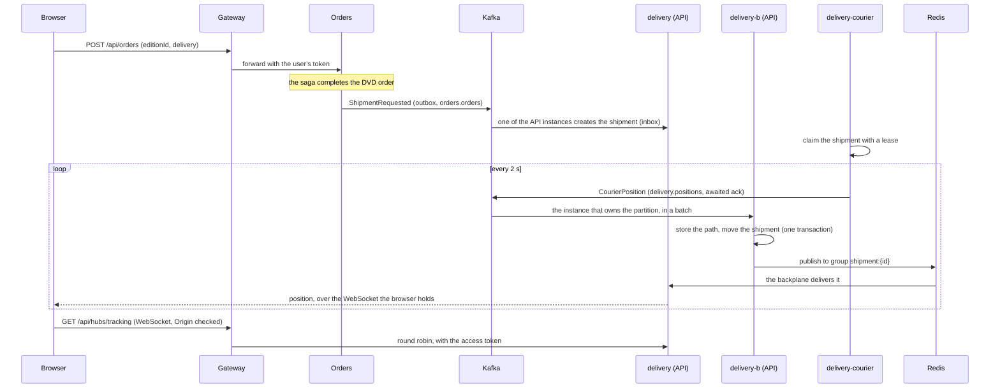

# Phase 3: Delivery Tracking Implementation Plan

> **For agentic workers:** REQUIRED SUB-SKILL: Use superpowers:subagent-driven-development to implement this plan task-by-task. The `code-writer` agent (`~/.claude/agents/code-writer.md`) builds each task, and the main session reviews it before the owner sees the pull request. The tasks run in four waves, up to three at a time, each in its own git worktree and branch; see "Running tasks at once". Steps use checkbox (`- [ ]`) syntax for tracking.

**Goal:** A buyer of a DVD types an address and drops a pin at checkout; once the order is paid, a simulated courier drives from the warehouse to the pin in about five minutes, and the buyer watches it move live on a map until Delivered, while Delivery runs as two instances behind the gateway.

**Architecture:** Orders stores the address on the order and, when the saga completes a DVD order, publishes `ShipmentRequested` through the outbox. Delivery is a new service with three containers from one project: two API instances (shipments, the REST API, the SignalR hub) and a courier. The courier claims shipments with a lease in Delivery's database, computes each position from the time the trip started, and produces it straight to the Kafka stream `delivery.positions`. The API instances consume that stream in batches without the inbox, store the path, and push each new position to the buyer's SignalR group; a Redis backplane carries the push to a browser connected to the other instance. The browser connects through the gateway with WebSockets only, so the two instances need no sticky sessions, and the gateway checks the upgrade's `Origin` instead of the CSRF header.

**Tech Stack:** as Phase 2, plus ASP.NET Core SignalR with `Microsoft.AspNetCore.SignalR.StackExchangeRedis` 10.0.15, `Microsoft.AspNetCore.SignalR.Client` 10.0.15 (tests), and in the web app `leaflet` 1.9.4, `@types/leaflet` 1.9.22 and `@microsoft/signalr` 10.0.11.

**Spec:** `.superpowers/sdd/2026-11-24-phase-3-delivery/phase-3-design.md` (a working file, ignored by git and deleted when the phase ends) and [`README.md`](../../README.md): Requirements D-1, D-2, D-3 and L-1, Architecture, and the Phases table row 3. Also [`AGENTS.md`](../../AGENTS.md). The owner delegated every Phase 3 decision on 2026-11-24 («решай все сам»). This plan's pull request moves the design's decisions into the README ("Decisions so far", "The checkout flow", Services, Repository layout) and the project-wide rules into AGENTS.md, so after it merges the README and AGENTS.md are what to argue from. The owner can change any decision in this pull request.

All paths below are relative to the newstore repository root, `example/newstore/`.

## What the design left open

| Input | Where it goes |
|---|---|
| Decision 1: the address on the order, `ShipmentRequested` on `orders.orders` | Task 2. The format is known only from Inventory's reserve answer, so the format check comes after the reservation (see below). |
| Decision 2: Delivery, its tables, its REST API, the warehouse | Task 3. Its one migration, `Initial`, creates every table and column Tasks 4 and 5 use. |
| Decision 3: the courier, the lease, the timeline | Task 4. The timeline's rounding is fixed in Global Constraints. |
| Decision 4: the stream path in `NewStore.Messaging` | Task 1, ADR 0022. Task 5 writes Delivery's handler. |
| Decision 5: the hub, the Redis backplane, `CloseOnAuthenticationExpiration` | Task 5, ADR 0023 |
| Decision 6: the gateway's routes, two destinations, CSRF by Origin | Task 5, ADR 0023. Two refinements, below. |
| Decision 7: the web app | Task 6, against the contracts fixed below |
| Decision 8: done | Task 7 |
| "The plan picks the exact shape" of the delivery cluster's configuration | `Services:Delivery` is a list (`Services:Delivery:0`, `:1`); every other cluster keeps one URL. |
| "The plan picks" the warehouse | Tempelhof, Berlin (Global Constraints). Any point works: every trip takes the same time. |
| "Check Inventory's seed first" for a DVD edition | Checked: `src/Services/Inventory/Seed/sample-editions.json` has 12 Dvd editions, among them video `00000000-0000-7000-8001-000000000014` ("Hot Sauce for Dulled Taste", channel `orbital-kitchen`) with 100 copies. No seed change; the e2e test buys that edition. |
| The tile policy | Global Constraints quotes it. |
| Stage 3 roadmap topics | Written 2026-11-24 in `~/Dev/stdy/roadmap/stage-3-delivery-tracking/`: 01 real-time and SignalR, 02 scaling SignalR, 03 high-frequency events. Each task names the one to read. |
| #92, the move to .NET 11 | Still waits; Phase 3 stays on .NET 10. |

Found while writing this plan, and checked:

- **Orders learns the edition's format only from Inventory's reserve answer** (`ReservationInfo.Format` in `src/Services/Orders/Clients/InventoryClient.cs`). So Orders validates the address's shape before it reserves, and compares the format after: a mismatch releases the reservation it just made (`InventoryClient.ReleaseAsync`, safe to repeat) and answers 400, keeping no order. A buyer with an open order who buys again gets that order back, as today, whatever the second request carries.
- **The gateway has no WebSockets middleware, so `HttpContext.WebSockets.IsWebSocketRequest` is always false there.** That flag comes from `IHttpWebSocketFeature`, which `WebSocketMiddleware` adds "if the request is a valid WebSocket request" ([WebSocketMiddleware](https://learn.microsoft.com/dotnet/api/microsoft.aspnetcore.websockets.websocketmiddleware?view=aspnetcore-10.0)); `src/Gateway/Program.cs` never calls `UseWebSockets`, because YARP tunnels the upgrade itself. Task 5 therefore tells an upgrade by its headers (`GET`, `Upgrade: websocket`, `Connection` containing `Upgrade`), not by the flag. This departs from the design's wording, not its rule.
- **The Angular dev server sends its own Origin.** `web/proxy.conf.json` forwards `/api` to the gateway with `changeOrigin: false`, so a WebSocket opened from `ng serve` arrives with `Origin: http://localhost:4200`. One allowed origin would break `npm start`; the setting is a list, `Gateway:PublicOrigins`, as Media's CORS origins are a list.
- **Round robin to a stopped instance fails half the requests.** The owner's manual check stops `delivery` during a trip. The `delivery` cluster gets YARP's active health check on `/health/ready`, so an instance that stops answering drops out of the rotation; the probe's `Interval` defaults to 15 s and the `ConsecutiveFailures` policy's threshold to 2 ([YARP destination health checks](https://learn.microsoft.com/aspnet/core/fundamentals/servers/yarp/dests-health-checks?view=aspnetcore-10.0)). The probes go through the same HTTP client as proxied requests, so the gateway's tests, whose forwarder is a stub, switch them off except in one test.
- **Payments and Delivery share `orders.orders`, and each sees the other's event.** `KafkaConsumerService` logs a Warning for a type with no handler ("which has no handler on this topic; skipped", `src/Shared/Messaging/MessagingLog.cs`), so Payments would warn on every `ShipmentRequested` and Delivery on every `RefundRequested`. Task 1 adds `AddIgnoredType<TEvent>(topic)`: a declared type is skipped at Debug. An undeclared one still warns.
- **SignalR's server can refuse every transport but WebSockets** (`HttpConnectionDispatcherOptions.Transports`), so the server enforces what the browser client is told to do. Task 5 sets it.
- **A courier position for a shipment Delivery doesn't have** would fail a foreign key and, with the stream's retry-forever rule, stop the partition. Task 5's handler drops such positions and logs them.
- **Package versions, checked 2026-11-24:** `Microsoft.AspNetCore.SignalR.StackExchangeRedis` and `Microsoft.AspNetCore.SignalR.Client` both have 10.0.15 as their newest 10.0.x on nuget.org; npm has `leaflet` 1.9.4 (`latest`; 2.0 is beta), `@types/leaflet` 1.9.22 (`latest`) and `@microsoft/signalr` 10.0.11 (the newest 10.0.x; `latest` is 11.0.0).

## Global Constraints

`AGENTS.md` binds every step. This section adds what is specific to Phase 3.

- **Every walkthrough has at least one Mermaid diagram** of the flow the task adds or changes, with a few sentences under it, and **ends with three interview questions** its code answers; each task names both. **Each task names the roadmap topic** to read before reviewing it, in `~/Dev/stdy/roadmap/stage-3-delivery-tracking/`: `01-real-time-and-signalr.md`, `02-scaling-signalr.md`, `03-high-frequency-events.md`.
- **Packages,** added to `Directory.Packages.props` by Task 5: `Microsoft.AspNetCore.SignalR.StackExchangeRedis` `10.0.15` and `Microsoft.AspNetCore.SignalR.Client` `10.0.15`. Both follow AGENTS.md's rule that the Microsoft.AspNetCore.* packages move with the runtime. `Testcontainers.Redis` `4.17.0` is already there. No other new package.
- **npm,** pinned exactly in `web/package.json` by Task 6: `leaflet` `1.9.4`, `@microsoft/signalr` `10.0.11` (the 10.x line matches the .NET 10 server), and in `devDependencies` `@types/leaflet` `1.9.22`.
- **Images:** none new. Tests that need Redis use `redis:8.10.3`, Compose's tag.
- **.NET stays on 10:** SDK 10.0.404, runtime 10.0.15.
- **Ports:**

  | Port | What |
  |---|---|
  | 8107, 5107 | Delivery in Compose (`delivery`), Delivery with `dotnet run` |
  | none | `delivery-b`, the second API instance, and `delivery-courier` publish no port; Compose probes their `/health/ready` inside the container |

- **Memory limits:** `delivery` 512m, `delivery-b` 512m, `delivery-courier` 256m, the one-shot `delivery-migrate` 512m. The long-lived services' limits come to 10 GiB (8.75 GiB today plus 1.25 GiB). A task that measures more raises a limit only with the main session, and never past 12 GB in all.
- **ADR numbers,** assigned here: 0022 Task 1 (positions are a stream), 0023 Task 5 (live tracking and CSRF by Origin).
- **Sign-in:** the realm's `gateway` client gets an `audience-delivery` mapper, shaped like `audience-media` (Task 3). Delivery's `Auth:Audience` is `delivery` and its `Auth:UserClients` is `["gateway"]`. Delivery calls no service, so it has no Keycloak client, no `Auth:ClientId` and no readiness warm-up (Catalog doesn't have one either).
- **Problems** keep the rule: `type` is `urn:newstore:problem:<slug>`. New slugs: `delivery-required` and `delivery-not-allowed` (Orders, 400). Delivery answers `not-found` (404) for a missing shipment and for someone else's.
- **Data:** IDs from `Guid.CreateVersion7()`, enums stored as strings, every "now" from `TimeProvider` cut to whole microseconds (Delivery gets its own `TimeProviderExtensions.GetUtcNowToMicrosecond`, as each service has). A SQL statement that compares with "now" takes it as a parameter, never `now()`. Coordinates are `double` (`double precision`).
- **The warehouse** (`Delivery:Warehouse`): name `newstore warehouse, Tempelhof, Berlin`, latitude `52.4836`, longitude `13.3897` (the former Tempelhof airport building). Compose, tests and the web app all use it; the web app reads it from `GET /api/delivery/warehouse`.
- **Kafka:**

  | Topic | Partitions | Key | Produced by | Consumed by |
  |---|---|---|---|---|
  | `orders.orders` (`OrderEvents.Topic`) | 3 | order id | Orders, outbox: `RefundRequested`, `ShipmentRequested` | Payments (`RefundRequested`; ignores `ShipmentRequested`), Delivery's API role (`ShipmentRequested`; ignores `RefundRequested`) |
  | `delivery.positions` (`CourierPosition.Topic`) | 6 | shipment id | `delivery-courier`, `IStreamProducer` | Delivery's API role, consumer group `NewStore.Delivery.delivery.positions`. No dead-letter topic. |

  `Messaging:ClientId` defaults to the application name, `NewStore.Delivery`, in all three containers, so `delivery` and `delivery-b` share one consumer group for events and one for the stream.
- **Settings:**

  | Setting | Default | Notes |
  |---|---|---|
  | `Delivery:Role` | `All` | `All`, `Api` or `Courier`. Compose: `Api` for `delivery` and `delivery-b`, `Courier` for `delivery-courier`. `All` is for `dotnet run` and tests. |
  | `Delivery:Warehouse:Name`, `:Latitude`, `:Longitude` | as above | name 1–100 characters, latitude in [-90, 90], longitude in [-180, 180] |
  | `Delivery:Courier:PrepareTime` | 00:00:30 | ≥ 0. CI's e2e overlay: 00:00:05 |
  | `Delivery:Courier:TravelTime` | 00:04:30 | > 0. CI's e2e overlay: 00:00:25 |
  | `Delivery:Courier:TickInterval` | 00:00:02 | > 0 |
  | `Delivery:Courier:Lease` | 00:00:30 | at least 3 × `LeaseRenewInterval` |
  | `Delivery:Courier:LeaseRenewInterval` | 00:00:10 | > 0 |
  | `Delivery:Courier:ClaimsPerTick` | 5 | ≥ 1. Keeps the first courier to start from taking every shipment, so two couriers split them. |
  | `Delivery:Courier:MaxShipments` | 200 | ≥ 1, per courier container |
  | `Delivery:Tracking:ConsumePositions` | `true` | `false` only in the two-host test, for the host that must not consume |
  | `ConnectionStrings:Redis` (Delivery) | unset | Compose: `redis:6379`. Unset means SignalR runs without a backplane and Delivery logs a Warning at startup. |
  | `Messaging:StreamBatchSize` | 200 | ≥ 1 |
  | `Messaging:StreamBatchWindow` | 00:00:00.200 | > 0 |
  | `Services:Delivery:0`, `:1` (gateway) | none, required | Compose `http://delivery:8080`, `http://delivery-b:8080`; `appsettings.Development.json` `:0` = `http://localhost:5107` |
  | `Gateway:PublicOrigins` | none, required, at least one | absolute `http`/`https` origins with no path. Compose `http://localhost:8100` and `http://localhost:4200`; Development `http://localhost:5100` and `http://localhost:4200`; tests `http://localhost` |
  | `Gateway:DestinationHealthChecks:Enabled` | `true` | the gateway's tests set `false`, except one |
  | `Gateway:DestinationHealthChecks:Interval` | 00:00:05 | the probe's timeout is 2 s |

  Delivery's options classes carry these defaults, and its `appsettings.json` lists the same values, as Media's does.
- **The timeline** (Task 4 implements, Task 7's overlay relies on it). With `P` = `PrepareTime`, `T` = `TravelTime`, `k` = `TickInterval`, and the trip's start `s` (`courier_started_at`):
  - `LastSeq = ceil((P + T) / k)`; the point with seq `n` is at time `t = n × k`, recorded at `s + t`.
  - `t < P`: `Preparing`, at the warehouse. `n == ceil(P / k)`: `PickedUp`. `n == LastSeq`: `Delivered`, exactly at the pin (it wins over `PickedUp` if both match). Every other `n`: `InTransit`.
  - From `PickedUp` on, the position is `from + f × (to − from)` for latitude and longitude separately, with `f = clamp((t − P) / T, 0, 1)`.
  - `SeqAt(now) = clamp(floor((now − s) / k), 0, LastSeq)`.
  - Defaults: `LastSeq` 150, `PickedUp` at seq 15, 151 positions. The e2e overlay: `LastSeq` 15, `PickedUp` at seq 3.
- **OpenStreetMap's tiles.** The [tile usage policy](https://operations.osmfoundation.org/policies/tiles/) asks to "Show OpenStreetMap licence attribution clearly on the map (typically bottom-right)", says that "heavy or inappropriate use harms others' ability to edit and view the map", that "Bulk downloading is any pre-emptive fetching of tiles other than those a user is actively viewing", and, for websites, "ensure the Referer header is present and accurate end-to-end". The app uses `https://tile.openstreetmap.org/{z}/{x}/{y}.png` with Leaflet's attribution control showing `© OpenStreetMap contributors` linked to `https://www.openstreetmap.org/copyright`, fetches only what the map shows, and sets no `Referrer-Policy` that would strip the Referer. The e2e test fulfils every tile request with a 1x1 PNG, so CI never fetches a tile.
- **No browser on the Mac** for tests: Playwright runs in CI only. The owner's manual check uses the owner's own browser.

## Contracts

Fixed here so that Tasks 4, 5 and 6 can run at once. A task that finds one of these unworkable stops and asks the main session; it doesn't change the shape on its own.

**`NewStore.Messaging` (Task 1):**

```csharp
namespace NewStore.Messaging;

/// JSON with System.Text.Json's defaults (as the outbox), header `type` = typeof(TMessage).FullName, and `traceparent` when an
/// activity is current. Completes when Kafka acknowledged the message; throws ProduceException<string, string> when it did not
/// within Messaging:ProduceTimeout. Uses the service's one idempotent, acks=all producer (KafkaProducer).
public interface IStreamProducer
{
    Task ProduceAsync<TMessage>(string topic, string key, TMessage message, CancellationToken cancellationToken) where TMessage : class;
}

public interface IStreamHandler<TMessage> where TMessage : class
{
    Task HandleAsync(IReadOnlyList<TMessage> batch, CancellationToken cancellationToken);
}

// MessagingBuilder gains:
public MessagingBuilder AddStreamHandler<TMessage, THandler>(string topic)
    where TMessage : class where THandler : class, IStreamHandler<TMessage>;
public MessagingBuilder AddIgnoredType<TEvent>(string topic) where TEvent : IIntegrationEvent;

// MessagingOptions gains: int StreamBatchSize = 200; TimeSpan StreamBatchWindow = TimeSpan.FromMilliseconds(200).
```

**`NewStore.Contracts.Orders` (Task 2):**

```csharp
public sealed record ShipmentRequested : IIntegrationEvent   // on OrderEvents.Topic, key = OrderId
{
    required Guid EventId; required DateTimeOffset OccurredAt; required Guid OrderId; required Guid BuyerId;
    required Guid EditionId; required Guid VideoId; required int CopyNumber;
    required string Address; required double Latitude; required double Longitude;
}
```

**Orders' API (Task 2):** `POST /orders` takes

```json
{ "editionId": "…", "delivery": { "address": "Alexanderplatz 1, 10178 Berlin", "latitude": 52.5219, "longitude": 13.4132 } }
```

`delivery` is required for a `Dvd` edition and refused for any other format. `CopyResponse` loses `DeliveryStatus`.

**Delivery, namespace `NewStore.Delivery` (Task 3 creates all of these):**

```csharp
public enum DeliveryRole { All, Api, Courier }
public enum ShipmentStatus { Preparing, PickedUp, InTransit, Delivered }   // NewStore.Delivery.Shipments; stored and sent as names

// NewStore.Delivery.Tracking. Produced by the courier (Task 4), consumed by the API role (Task 5). It stays in Delivery while
// Delivery is its only producer and consumer (AGENTS.md, Streams).
public sealed record CourierPosition
{
    public const string Topic = "delivery.positions";
    public const int Partitions = 6;
    required Guid ShipmentId; required int Seq; required string Status;   // a ShipmentStatus name
    required double Latitude; required double Longitude; required DateTimeOffset RecordedAt;
}

// NewStore.Delivery.Shipments: the REST API's and the hub's answers. JSON is camelCase (ASP.NET Core's and SignalR's defaults;
// Task 5 pins SignalR's with a test).
public sealed record GeoPoint(double Latitude, double Longitude);
public sealed record WarehouseResponse(string Name, double Latitude, double Longitude);
public sealed record PositionResponse(int Seq, string Status, double Latitude, double Longitude, DateTimeOffset RecordedAt);
public sealed record ShipmentSummary(Guid Id, Guid OrderId, int CopyNumber, Guid VideoId, string Status,
    DateTimeOffset CreatedAt, DateTimeOffset? DeliveredAt);
public sealed record ShipmentDetails(Guid Id, Guid OrderId, int CopyNumber, Guid VideoId, string Status, string Address,
    GeoPoint Destination, WarehouseResponse Warehouse, PositionResponse? LastPosition, IReadOnlyList<PositionResponse> Path,
    DateTimeOffset CreatedAt, DateTimeOffset? PickedUpAt, DateTimeOffset? DeliveredAt);
// Warehouse is the row's copy (name and coordinates as they were when the shipment was created). Path is every stored position,
// oldest first; LastPosition is its last element, or null before the first one.

// Scoped. The endpoints (Task 3) and the hub (Task 5) both read through it. Null when the shipment is missing or not the buyer's.
public sealed class ShipmentReader(DeliveryDbContext db)
{
    public Task<ShipmentDetails?> GetAsync(Guid shipmentId, Guid buyerId, CancellationToken ct);
    public Task<IReadOnlyList<ShipmentSummary>> ListAsync(Guid buyerId, CancellationToken ct);   // newest first
}
```

**Routes:**

| Gateway | Delivery | Policy | Route id |
|---|---|---|---|
| `GET /api/me/shipments` | `GET /me/shipments` → `ShipmentSummary[]` | signed-in | `my-shipments` |
| `GET /api/shipments/{id}` | `GET /shipments/{id}` → `ShipmentDetails`, or 404 `not-found` | signed-in | `shipments-read` |
| `GET /api/delivery/warehouse` | `GET /delivery/warehouse` → `WarehouseResponse` from configuration | anonymous | `delivery-warehouse` |
| `GET /api/hubs/tracking`, a WebSocket upgrade | `/hubs/tracking` | signed-in | `hubs-tracking` |

**The hub,** `NewStore.Delivery.Tracking.TrackingHub` at `/hubs/tracking`:

- `Task<ShipmentDetails> Track(Guid shipmentId)`: a stranger's or a missing shipment throws `HubException("not-found")`. Otherwise the connection joins group `shipment:{id}` and gets the snapshot.
- `Task Untrack(Guid shipmentId)` leaves the group.
- Server to client: method `position`, one argument with `CourierPosition`'s fields, in camelCase: `shipmentId`, `seq`, `status`, `latitude`, `longitude`, `recordedAt`.

**The web app's types** (Task 6, `web/src/app/api/models.ts`):

```ts
export type ShipmentStatus = 'Preparing' | 'PickedUp' | 'InTransit' | 'Delivered';
export interface DeliveryDetails { address: string; latitude: number; longitude: number; }
export interface GeoPoint { latitude: number; longitude: number; }
export interface Warehouse { name: string; latitude: number; longitude: number; }
export interface Position { seq: number; status: ShipmentStatus; latitude: number; longitude: number; recordedAt: string; }
export interface PositionMessage extends Position { shipmentId: string; }
export interface ShipmentSummary { id: string; orderId: string; copyNumber: number; videoId: string; status: ShipmentStatus;
  createdAt: string; deliveredAt: string | null; }
export interface ShipmentDetails { id: string; orderId: string; copyNumber: number; videoId: string; status: ShipmentStatus;
  address: string; destination: GeoPoint; warehouse: Warehouse; lastPosition: Position | null; path: Position[];
  createdAt: string; pickedUpAt: string | null; deliveredAt: string | null; }
// MyCopy loses deliveryStatus.
```

**`data-testid`s** Task 6 adds and Task 7's e2e test relies on:

- Checkout: `delivery-form`, `delivery-address`, `delivery-map`, `delivery-pin`, `confirm-buy`, `cancel-buy`. The existing `buy` button opens the form for a `Dvd` edition and posts at once for any other.
- Order page: `track-link` (a link to `/shipments/{id}`), `shipment-pending`.
- My copies: `delivery-status` (a cell), `track-link`.
- Tracking page `/shipments/:id`: `tracking-map`, `tracking-status` (with `data-status`, the `ShipmentStatus` name), `tracking-step` ×4 (with `data-step`, the name, and `data-state`: `done`, `current` or `todo`), `courier-position` (with `data-seq`, `data-lat`, `data-lng`), `tracking-address`, `tracking-connection` (shows "Reconnecting…" while the hub reconnects), `tracking-not-found`.

## Running tasks at once

| Wave | Tasks, at the same time | Owns the Compose stack on the Mac | Issues |
|---|---|---|---|
| A | 1 Messaging streams ‖ 2 Orders: the address and `ShipmentRequested` | Task 2 | #155, #156 |
| B | 3 The Delivery service | Task 3 | #157 |
| C | 4 The courier ‖ 5 Live tracking ‖ 6 The web app | Task 5 | #158, #159, #160 |
| D | 7 Phase 3 done | Task 7 | #161 |

The design's waves stand. The one refinement: Payments' `AddIgnoredType<ShipmentRequested>` needs both Task 1's method and Task 2's record, which merge in parallel, so it moves to Task 3.

- A wave starts when every task of the previous wave has merged. Each task starts from that `main`, in its own worktree, on branch `phase-3/<slug>`. The slugs are `streams`, `orders-delivery`, `delivery-service`, `courier`, `live-tracking`, `web-tracking` and `done-3`.
- **Merge order inside a wave:** any. In wave C, Task 6's unit tests need no running service, and Tasks 4 and 5 touch different lines of Delivery's `Program.cs`.
- **Shared files.** Tasks add lines to these and change nothing else in them:
  - `NewStore.slnx`, `Directory.Packages.props`, `compose.yaml`, `deploy/compose/postgres/init.sql`, `deploy/compose/keycloak/newstore-realm.json`, `.github/workflows/ci.yml`;
  - Delivery's `Program.cs` (Tasks 4 and 5 each replace the comment marked for them in Task 3);
  - `tests/Delivery.Tests/NewStore.Delivery.Tests.csproj` and `AssemblyFixtures.cs`;
  - `AGENTS.md` and the README's Repository layout.
- **Migrations.** Task 3's `Initial` migration creates every Delivery table, index and column, the courier's and the positions' included, so no two parallel tasks generate a migration for one context. Task 2's Orders migration is the only other one.
- **After each merge,** the other tasks of the wave run `git merge origin/main`, resolve the additive conflicts, build, test and push. No rebase and no force-push. The main session diffs every shared file for removed lines after such a merge.
- **The Compose stack.** Only the task named above runs `docker compose` on the Mac. The others verify through Testcontainers, CI's `compose-smoke` verifies their Compose changes, and a task whose project references change runs `docker compose build <service>`, which builds without starting the stack.
- **Docker memory.** Wave C runs three Testcontainers suites at once: two with PostgreSQL and Kafka, one also with Redis. Task 6 needs no container. That fits beside the stack.

## Review Focus

1. **The buyer's connection drops in the middle of a trip:** the token behind it expires (Keycloak's access tokens last minutes, so this happens on every trip), Wi-Fi blinks, or an instance stops. The page reconnects, tracks again, fills the gap from the snapshot, and never draws an older position after a newer one. Tests: `Reconnected_client_tracks_again_and_the_snapshot_has_what_it_missed` and `Connection_closes_when_the_token_expires` (Task 5), `Tracking_page_tracks_again_after_a_reconnect_and_merges_the_snapshot` and `Tracking_page_ignores_positions_it_has_already_shown` (Task 6).
2. **One Delivery instance is stopped during a trip** (the owner's manual check). New connections and REST calls go only to the instance that answers, and the page keeps reconnecting until one succeeds. Tests: `Unready_delivery_destination_gets_no_requests` (Task 5), `Tracking_client_keeps_reconnecting_until_stopped` (Task 6).
3. **The courier container restarts mid-trip.** The trip carries on from where its clock says, not from the warehouse; repeated seqs change nothing; the last position is not lost. Tests: `Lost_lease_is_taken_over_and_the_seqs_repeat`, `Claim_sets_started_at_once_and_keeps_it_on_a_takeover` and `Delivered_waits_for_the_ack_before_the_run_is_finished` (Task 4).
4. **A message on the stream that can never be applied:** bytes that aren't JSON, or a position for a shipment Delivery doesn't have (a topic replayed after a database reset). The stream keeps flowing. Tests: `Undeserializable_message_is_skipped` (Task 1), `Positions_for_an_unknown_shipment_are_dropped` (Task 5).
5. **A buyer sends a DVD order with a bad pin or no address, or a digital order with an address** (an old tab, a hand-made request). It is refused, before the reservation when the shape is wrong and right after it when the format is wrong, and in the second case the copy goes back on sale at once instead of after 10 minutes. Tests: `Invalid_delivery_is_400_without_reserving`, `Dvd_buy_without_delivery_is_400_and_releases_the_reservation`, `Digital_buy_with_delivery_is_400_and_releases_the_reservation` (Task 2).

## File Structure

```
newstore/
├── compose.yaml                     + delivery-migrate, delivery, delivery-b (3); delivery-courier (4); Redis env, gateway → delivery (5)
├── compose.e2e.yaml                 the short timeline for CI's e2e job (7)
├── deploy/compose/postgres/init.sql + delivery (3)
├── deploy/compose/keycloak/newstore-realm.json   + gateway audience-delivery (3)
├── src/Shared/Messaging/            + Streams/ IStreamProducer.cs  IStreamHandler.cs  StreamProducer.cs  KafkaStreamConsumer.cs;
│                                      MessagingBuilder, MessagingRegistry, MessagingOptions, KafkaConsumerService (ignored types) (1)
├── src/Shared/Contracts/Orders/ShipmentRequested.cs   (2)
├── src/Services/Orders/             BuyRequest's delivery, the format check, the saga's ShipmentRequested, migration DeliveryAddress (2)
├── src/Services/Payments/Program.cs + AddIgnoredType<ShipmentRequested> (3)
├── src/Services/Delivery/           (3, then 4 and 5)
│   NewStore.Delivery.csproj  Program.cs  Dockerfile  appsettings*.json  Properties/launchSettings.json
│   DeliveryDbContext.cs  DeliveryOptions.cs  Problems.cs  TimeProviderExtensions.cs
│   Shipments/  Shipment.cs  ShipmentPosition.cs  ShipmentStatus.cs  ShipmentContracts.cs  ShipmentReader.cs
│               ShipmentRequestedHandler.cs  ShipmentEndpoints.cs  ShipmentExtensions.cs (3)
│   Courier/    CourierTimeline.cs  CourierLeases.cs  CourierRunner.cs  CourierService.cs  CourierExtensions.cs (4)
│   Tracking/   CourierPosition.cs (3); CourierPositionHandler.cs  TrackingHub.cs  TrackingExtensions.cs (5)
├── src/Gateway/                     Proxy/ProxyExtensions.cs, Auth/CsrfMiddleware.cs, Auth/GatewayOptions.cs (5)
├── web/src/app/                     maps/ delivery/ shipments/, and the video, order and copies pages (6)
├── tests/Messaging.Tests/StreamTests.cs, IgnoredTypeTests.cs   (1)
├── tests/Orders.Tests/DeliveryBuyTests.cs, ShipmentSagaTests.cs  (2)
├── tests/Delivery.Tests/            fixture and shipment tests (3); courier tests (4); tracking, hub and two-host tests (5)
├── tests/Gateway.Tests/TrackingRouteTests.cs   (5)
├── tests/e2e/delivery.spec.ts       (7)
└── docs/adr/0022, 0023
```



The browser can hold its WebSocket on either API instance, and either instance can consume a given shipment's positions; Redis joins the two. Kafka carries one event per order and one stream message per tick per shipment; only the event goes through the outbox and the inbox.

---

### Task 1: Messaging streams

Branch `phase-3/streams`. Issue #155. Read: topic 03 (high-frequency events) and Stage 1's outbox and idempotent-consumer topics.

**Files:**
- Create: `src/Shared/Messaging/Streams/IStreamProducer.cs`, `IStreamHandler.cs`, `StreamProducer.cs`, `KafkaStreamConsumer.cs`; `tests/Messaging.Tests/StreamTests.cs`, `IgnoredTypeTests.cs`; `docs/adr/0022-positions-are-a-stream.md`
- Modify: `src/Shared/Messaging/MessagingBuilder.cs`, `MessagingRegistry.cs`, `MessagingOptions.cs`, `MessagingExtensions.cs`, `MessagingLog.cs`, `Kafka/KafkaConsumerService.cs`, `Telemetry/MessagingTelemetry.cs`; the README's layout line for `Messaging/` ("…, topics, and streams")

**Interfaces:**
- **Produces:** the Contracts section's `IStreamProducer`, `IStreamHandler<TMessage>`, `AddStreamHandler`, `AddIgnoredType` and the two options.
- **The registry** keeps streams apart from events: `MessagingRegistry.Streams` (`StreamRegistration(string Topic, Type MessageType)`), never in `HandledTopics`, so `TopicCreator` makes no dead-letter topic for a stream and `KafkaConsumerService` never subscribes to one. `AddIgnoredType` adds `(topic, typeof(TEvent).FullName)` to a set; `KafkaConsumerService.Process` checks it before the "unknown type" warning, logs `IgnoredType` at Debug and stores the offset. No inbox row.
- **`StreamProducer`** (internal, registered as `IStreamProducer` by `AddMessaging` in every service) wraps the existing `KafkaProducer`.
- **`KafkaStreamConsumer<TMessage>`** (internal `BackgroundService`), one per `AddStreamHandler` call, registered as `IHostedService` with its topic:
  - its own consumer, `GroupId = $"{ClientId}.{topic}"`, `EnableAutoCommit = false`, `AutoOffsetReset = Earliest`, on a `LongRunning` thread as `KafkaConsumerService` does;
  - it gathers a batch until it holds `StreamBatchSize` messages or `StreamBatchWindow` has passed since the batch's first message;
  - a message whose `type` header isn't `typeof(TMessage).FullName` is skipped at Debug; one that doesn't deserialize (a `JsonException`, or null) is skipped with a Warning naming topic, partition and offset;
  - it resolves `IStreamHandler<TMessage>` in a new scope per batch and passes the stop token;
  - after the handler returns it commits, for each partition in the batch, its highest offset + 1. A failed commit is logged and the batch is not repeated: the next commit includes it, and a re-read is harmless by the handler's contract;
  - a handler that throws is logged (`StreamBatchFailed`, Warning, with the attempt), every partition of the batch is sought back to its first offset in the batch, and the consumer pauses `TransientPauseFor(attempt)`, then polls again, without a limit. The attempt count resets after a success;
  - when a rebalance revokes partitions, the gathered messages of those partitions are dropped unhandled (their new owner reads them);
  - one span per batch, `process <topic>`, `ActivityKind.Consumer`, with `messaging.batch.message_count`.

- [x] **Step 1: Failing tests**

`StreamTests`, with `MessagingHost.CreateBuilder` on the assembly's Kafka and PostgreSQL, a recorded `record Ping(int N)`, and a `PingRecorder` singleton that the test's `IStreamHandler<Ping>` appends each batch to. Each test uses its own topic (6 partitions) and client id.
- `Stream_producer_awaits_the_ack_and_writes_the_type_header`: after `ProduceAsync` returns, a plain consumer reads the message with header `type` = `typeof(Ping).FullName` and no `message-id` header.
- `Stream_producer_throws_when_kafka_does_not_ack`: in a class with its own paused `KafkaServer` and `ProduceTimeout` 1 s, `ProduceAsync` throws `ProduceException<string, string>` within 5 s.
- `Stream_handler_gets_batches_up_to_the_batch_size`: 450 messages; every batch has at most 200, and the batches hold 450 in all.
- `Stream_handler_gets_a_partial_batch_after_the_window`: 3 messages produced together arrive in batches within 2 s.
- `Stream_uses_its_own_consumer_group_and_no_dead_letter_topic`: the admin client lists group `<clientId>.<topic>`, and `<topic>.dlt` doesn't exist.
- `Committed_batches_are_not_read_again_after_a_restart`: handle 10, stop the host, start a new one with the same client id, produce 1. The new host gets only the new message.
- `Throwing_batch_is_retried_then_committed`: the handler throws on its first two calls; the third gets the same messages, and after a restart nothing is read again.
- `Undeserializable_message_is_skipped` (Review Focus 4): raw `not json` with the right `type` header, then a good `Ping`. The handler gets the `Ping`, and the log has the Warning.
- `Message_of_another_type_is_skipped`
- `Two_hosts_in_one_group_share_the_partitions`: 60 messages over 6 partitions with two hosts on one client id. Each host gets some, and together all 60 (at least once).

`IgnoredTypeTests`, with the existing event fixtures (`Scenario`, `TestModel`):
- `Ignored_type_is_skipped_without_a_warning_or_an_inbox_row`
- `Unknown_type_still_warns`

Run `dotnet test --project tests/Messaging.Tests`. Expected: the new tests fail to compile, then fail.

- [x] **Step 2: Implement, then run the tests**

Expected: Messaging.Tests pass, and so does the whole solution (`dotnet test --solution NewStore.slnx`): `AddMessaging`'s new registrations must not change any existing service. Commit: `feat(messaging): streams, consumed in batches without the inbox`, then `feat(messaging): declare event types a consumer ignores on a shared topic`.

- [x] **Step 3: ADR 0022, pull request**

1. **ADR 0022, positions are a stream.**
   - Context: a position every 2 s per shipment, regenerated from the timeline at any moment; Delivery's own courier is the producer.
   - Decision: the producer side (idempotent, `acks=all`, awaited; the last point marks the run finished only after its ack) and the consumer side (batches, its own group, offsets after the handler, no inbox, no dead-letter topic, idempotent by a natural key, retried without a limit).
   - Alternatives: the outbox for positions (a database write and a relay hop per position, about 0.5 a second per shipment, for data nobody needs protected); the inbox for consumption (one transaction per message, where the `last_seq < seq` guard already makes a repeat harmless); sharing the events' consumer group (one slow event handler would hold every position, and one position batch would hold events); Kafka transactions. Each claim cites the page it rests on: ADR 0008 for the outbox's costs, and librdkafka's [CONFIGURATION.md](https://github.com/confluentinc/librdkafka/blob/master/CONFIGURATION.md) for `enable.idempotence` and `acks` (the task quotes the lines it relies on, or leaves the claim out).
   - Consequences: a crash can lose positions, replaced on the next tick; a handler bug stalls the stream until it is fixed, because a batch is retried without a limit (Phase 4's consumer-lag dashboard is how it shows); the handler must never throw for one bad message.
   - It cites ADR 0008 (the rule it is the exception to) and ADR 0020 (the lease the courier reuses).
2. **AGENTS.md:** already carries the Streams rules from the plan's pull request. Change them only if the code made one wrong, and say so.
3. **Walkthrough, deep (the idempotent consumer's high-frequency sibling).** Diagram: a flowchart of one poll loop: gather, window or size, handle, commit, and the two failure paths (seek back and pause; skip and log). Suggest one change for the owner: set `StreamBatchSize` to 5 in `Two_hosts_in_one_group_share_the_partitions` and read the batch sizes in the output. Interview questions:
   - "When is it right to produce to Kafka without an outbox, and what makes it safe here?"
   - "At-least-once without an inbox: what makes a repeated message harmless?"
   - "Why does the stream get its own consumer group?"

---

### Task 2: Orders: the delivery address and `ShipmentRequested`

Branch `phase-3/orders-delivery`. Issue #156. Owns the Compose stack in wave A. Advances D-1. Read: Stage 1's sagas topic, and topic 03's "stream versus event".

**Files:**
- Create: `src/Shared/Contracts/Orders/ShipmentRequested.cs`; a migration, `DeliveryAddress`; `tests/Orders.Tests/DeliveryBuyTests.cs`, `ShipmentSagaTests.cs`
- Modify: `src/Services/Orders/Orders/OrderContracts.cs`, `Orders/Order.cs`, `Orders/OrderEndpoints.cs`, `OrdersDbContext.cs`, `Problems.cs`, `Saga/PaymentEventHandlers.cs`; `tests/Orders.Tests/Stubs.cs` (`InventoryStub.Format`), `tests/Orders.Tests/SagaTests.cs` (the copies tests read no `deliveryStatus`)

**Interfaces:**
- **Produces:** `ShipmentRequested` (Contracts), the `POST /orders` body (Contracts).
- **The request:**

  ```csharp
  public sealed record BuyRequest(Guid EditionId, DeliveryDetails? Delivery);
  // Nullable members, so a missing latitude is a 400, not 0.
  public sealed record DeliveryDetails(string? Address, double? Latitude, double? Longitude);
  public static class EditionFormats { public const string Dvd = "Dvd"; }   // Inventory's EditionFormat name
  ```

- **`Order`** gains `string? DeliveryAddress` (max 200), `double? DeliveryLatitude`, `double? DeliveryLongitude`; the migration adds three nullable columns.
- **`Problems.BadRequest(string slug, string title)`**: 400 with type `urn:newstore:problem:<slug>`.
- **`BuyAsync`, in order:**
  1. `editionId` missing: 400 `validation`, as today.
  2. `delivery` present: `address` trimmed is 1–200 characters, `latitude` in [-90, 90], `longitude` in [-180, 180], each present. Otherwise 400 `validation` with keys `delivery.address`, `delivery.latitude` and `delivery.longitude`, before any call to Inventory.
  3. The open-order shortcut, as today.
  4. Reserve, as today.
  5. Format `Dvd` without `delivery`: release the reservation and answer 400 `delivery-required` ("A DVD needs a delivery address and a pin."). Any other format with `delivery`: release, 400 `delivery-not-allowed` ("Only a physical copy is delivered."). The release runs with `CancellationToken.None`; a `TransientFailureException` from it is logged and swallowed, because Inventory frees the copy after 10 minutes anyway. No order is kept.
  6. Otherwise the order is saved with the three fields (null for a digital order).
- **The saga,** in `PaymentSucceededHandler`'s `Confirmed` branch, after the status change:
  - A `Dvd` order with an address enqueues `ShipmentRequested` with `IOutbox.Enqueue(…, OrderEvents.Topic, order.Id.ToString())`. `EventId` is a new v7 id, `OccurredAt` is `now`, the other fields come from the order and `confirmed.CopyNumber`.
  - A `Dvd` order without an address (bought before this change) completes without a shipment and logs a Warning naming the order.
  - The refund branches enqueue nothing new.
- **`CopyResponse`** drops `DeliveryStatus`, and `CopiesAsync` its `null` argument.
- **`InventoryStub`** gains `public string Format { get; set; } = "Digital";`, used by its reservation body instead of `"Hd"` and restored by `Reset()`.

- [x] **Step 1: Failing buy tests**

`DeliveryBuyTests`, on `OrdersFixture`:
- `Dvd_buy_with_delivery_stores_the_address`: `Format = "Dvd"`. 201, and the order row has the trimmed address and both coordinates.
- `Dvd_buy_without_delivery_is_400_and_releases_the_reservation` (Review Focus 5): 400 `urn:newstore:problem:delivery-required`; the stub received a release for the reservation it reserved; no order row.
- `Digital_buy_with_delivery_is_400_and_releases_the_reservation` (Review Focus 5): 400 `delivery-not-allowed`, a release, no order.
- `[Theory] Invalid_delivery_is_400_without_reserving` (Review Focus 5): address `"  "`, 201 characters, latitude `90.0001`, latitude `-91`, longitude `180.5`, latitude missing. Each is 400 `validation` with the matching key, and the stub saw no reserve request.
- `Boundary_coordinates_are_accepted`: latitude `-90`, longitude `180`, and an address of exactly 200 characters give 201.
- `Release_failure_still_answers_400`: the stub's release answers 503 every time; the buy answers 400 `delivery-required` and keeps no order.
- `Digital_buy_without_delivery_is_unchanged`

Expected: they fail.

- [x] **Step 2: Implement buy, generate the migration, run**

`ASPNETCORE_ENVIRONMENT=Development dotnet ef migrations add DeliveryAddress --project src/Services/Orders`. Check that it adds three nullable columns and nothing else. Expected: Orders.Tests pass. Commit: `feat(orders): a DVD order takes a delivery address and a pin`.

- [x] **Step 3: Failing saga tests, then code**

`ShipmentSagaTests`, with `KafkaServer.PublishAsync` as `SagaTests` does:
- `Completed_dvd_order_enqueues_ShipmentRequested_with_the_address`: one outbox row of type `NewStore.Contracts.Orders.ShipmentRequested`, topic `orders.orders`, key = order id; its JSON has the order's ids, the copy number and the three delivery fields.
- `Completed_digital_order_enqueues_no_shipment`
- `Duplicate_PaymentSucceeded_enqueues_one_shipment`
- `Late_payment_for_a_dvd_order_refunds_and_requests_no_shipment`
- `Dvd_order_without_an_address_completes_without_a_shipment`: insert a `Paying` `Dvd` order with null delivery fields straight into the database. It completes, nothing is enqueued, and the log has the Warning.
- `My_copies_has_no_delivery_status`: the JSON of `/me/copies` has no `deliveryStatus` property.

Expected: they pass after the change. Commit: `feat(orders): the saga requests a shipment for a completed DVD order`.

- [x] **Step 4: The stack, pull request**

1. `docker compose build orders`, then `docker compose up -d --wait`. `orders-migrate` applies `DeliveryAddress`, and `curl -s http://localhost:8103/health/ready` is `Healthy`. Payments logs a Warning for each `ShipmentRequested` until Task 3 adds the ignore line; the walkthrough says so.
2. **Walkthrough diagram:** the saga's state diagram with the new step marked: `Paying → Completed` now also enqueues `ShipmentRequested` for a DVD, in the same transaction; plus a flowchart of `POST /orders`'s checks (shape before the reservation, format after, release on mismatch). Interview questions:
   - "Why does the address travel in Orders' event instead of Delivery asking Orders for it?"
   - "Why is the format check after the reservation, and what does a mismatch cost?"
   - "What guarantees that a paid DVD order always leads to exactly one shipment?"

---

### Task 3: The Delivery service

Branch `phase-3/delivery-service`. Issue #157. Owns the Compose stack in wave B. Advances D-1 and L-1. Read: topic 01's first half (what the hub will need from the REST API) and Stage 1's idempotent-consumer topic.

**Files:**
- **Create:**
  - `src/Services/Delivery/` as in File Structure, except the files marked (4) and (5), with launch settings on 5107 (`OTEL_SERVICE_NAME` `delivery`), and the `migrate` command of ADR 0005 (no seeder)
  - a migration, `Initial`, with every table below
  - `src/Services/Delivery/Dockerfile`: a `build` stage like Media's, copying the `.csproj` of ServiceDefaults, Messaging, Contracts and Delivery before `dotnet restore`, then one runtime stage `FROM mcr.microsoft.com/dotnet/aspnet:10.0.15`
  - `tests/Delivery.Tests/`: `NewStore.Delivery.Tests.csproj`, `AssemblyFixtures.cs` (`PostgresServer`, `KafkaServer`), `DeliveryFixture.cs`, `Api.cs`, `DeliveryStartupTests.cs`, `ShipmentRequestedTests.cs`, `ShipmentApiTests.cs`, `DeliveryOptionsTests.cs`
- **Modify, adding lines only:**
  - `NewStore.slnx` (both projects), `compose.yaml` (`delivery-migrate`, `delivery`, `delivery-b`), `deploy/compose/postgres/init.sql` (role and database `delivery`, as `media`'s three lines), `newstore-realm.json` (the `gateway` client's `audience-delivery` mapper), `ci.yml` (compose-smoke)
  - `src/Services/Payments/Program.cs`: `.AddIgnoredType<ShipmentRequested>(OrderEvents.Topic)` after its handler
  - the README's Repository layout: `tests/Delivery.Tests/`

**Interfaces:**
- **Produces:** everything in the Contracts section under "Delivery", `DeliveryDbContext`, the options classes and `DeliveryFixture`.
- **Options,** in `DeliveryOptions.cs`, with the Global Constraints' defaults and checks, validated on start:

  ```csharp
  public sealed class WarehouseOptions { string Name; double Latitude; double Longitude; }                 // "Delivery:Warehouse"
  public sealed class CourierOptions { TimeSpan PrepareTime; TimeSpan TravelTime; TimeSpan TickInterval;   // "Delivery:Courier"
      TimeSpan Lease; TimeSpan LeaseRenewInterval; int ClaimsPerTick; int MaxShipments; }
  public sealed class TrackingOptions { bool ConsumePositions = true; }                                     // "Delivery:Tracking"
  // Binds and validates all three in every role, and returns Delivery:Role (default All).
  public static DeliveryRole AddDeliveryOptions(this IHostApplicationBuilder builder);
  ```

- **The model,** snake case, every table in `Initial`, with `modelBuilder.AddOutbox()` and `AddInbox()` (the outbox stays empty; `AddMessaging` needs it):

  ```csharp
  public sealed class Shipment
  {
      Guid Id; Guid OrderId; Guid BuyerId; Guid EditionId; Guid VideoId; int CopyNumber;
      string Address (max 200); double Latitude; double Longitude;
      string WarehouseName (max 100); double WarehouseLatitude; double WarehouseLongitude;   // copied at creation
      ShipmentStatus Status; DateTimeOffset CreatedAt; DateTimeOffset? PickedUpAt; DateTimeOffset? DeliveredAt;
      int LastSeq = -1; double? LastLatitude; double? LastLongitude; DateTimeOffset? LastPositionAt;
      string? CourierLockedBy (max 100); DateTimeOffset? CourierLockedUntil; DateTimeOffset? CourierStartedAt; DateTimeOffset? CourierFinishedAt;
  }
  // unique ix on order_id; ix (buyer_id, created_at); ix_shipments_courier_open on (created_at) WHERE courier_finished_at IS NULL

  public sealed class ShipmentPosition { Guid ShipmentId; int Seq; double Latitude; double Longitude; ShipmentStatus Status;
      DateTimeOffset RecordedAt; }
  // primary key (shipment_id, seq); foreign key to shipments, on delete cascade
  ```

- **`ShipmentRequestedHandler`** (`IIntegrationEventHandler<ShipmentRequested>`): one statement, `INSERT INTO shipments (…) VALUES (…) ON CONFLICT (order_id) DO NOTHING`, status `Preparing`, `last_seq` −1, the warehouse from `IOptions<WarehouseOptions>`, `created_at` from `TimeProvider`. It runs in the inbox transaction.
- **Endpoints** (`MapShipmentEndpoints`): the three REST routes of the Contracts table. The two signed-in ones use `Policies.SignedIn` and `User.UserId()`; a null from `ShipmentReader.GetAsync` is 404 `not-found`, for a stranger as for a missing id (ADR 0016's rule). The warehouse route is `AllowAnonymous` and reads `IOptions<WarehouseOptions>`.
- **`Program.cs`.** Tasks 4 and 5 replace the comments marked for them:

  ```csharp
  var builder = WebApplication.CreateBuilder(args);
  builder.AddServiceDefaults();
  builder.AddPostgresDatabase<DeliveryDbContext>("Delivery");
  var role = builder.AddDeliveryOptions();
  builder.Services.TryAddSingleton(TimeProvider.System);
  var api = role is DeliveryRole.All or DeliveryRole.Api;
  builder.AddMessaging<DeliveryDbContext>(m =>
  {
      m.AddTopic(OrderEvents.Topic, OrderEvents.Partitions);
      m.AddTopic(CourierPosition.Topic, CourierPosition.Partitions);
      if (api)
      {
          m.AddHandler<ShipmentRequested, ShipmentRequestedHandler>(OrderEvents.Topic);
          m.AddIgnoredType<RefundRequested>(OrderEvents.Topic);
          // Task 5: if (builder.Configuration.GetValue("Delivery:Tracking:ConsumePositions", true))
          //             m.AddStreamHandler<CourierPosition, CourierPositionHandler>(CourierPosition.Topic);
      }
  });
  if (api)
  {
      builder.AddNewStoreAuth();
      builder.AddShipments();                  // ShipmentReader
      // Task 5: builder.AddTracking();        // SignalR, WebSockets only, the Redis backplane when ConnectionStrings:Redis is set
  }
  // Task 4: builder.AddCourier(runCourier: role is DeliveryRole.All or DeliveryRole.Courier);
  var app = builder.Build();
  if (await app.RunDatabaseCommandsAsync<DeliveryDbContext>(args) is { } exitCode) return exitCode;
  app.MapDefaultEndpoints();
  if (api)
  {
      app.UseAuthentication();
      app.UseAuthorization();
      app.MapShipmentEndpoints();
      // Task 5: app.MapTrackingHub();
  }
  app.Run();
  return 0;
  ```

- **`DeliveryFixture`** (for Tasks 4 and 5): a `NewStoreAppFactory<Program>` on `PostgresServer` and `KafkaServer`, `IAsyncLifetime`, with:
  - `FakeTimeProvider Clock`, started a few 100 ns ticks past a whole microsecond, as `MediaFixture`'s is;
  - `protected virtual DeliveryRole Role => DeliveryRole.Api` and `protected virtual void ConfigureSettings(Dictionary<string, string?> settings)` for subclasses (courier times, Redis, `ConsumePositions`);
  - `public string ConnectionString { get; }` and `public virtual string ClientId` (default `delivery-<fixture class>-<new GUID>`), so Task 5's second host can share both;
  - `HttpClient BuyerClient(Guid buyerId)` (a `TestTokens.User(buyerId, "delivery")` bearer), `Task<Shipment> CreateShipmentAsync(Guid? buyerId = null, double latitude = 52.5219, double longitude = 13.4132)` (inserts as the handler does), `Task<T> QueryAsync<T>(Func<DeliveryDbContext, Task<T>>)`, `static Task WaitAsync(Func<Task<bool>> condition, string what, TimeSpan? timeout = null)`;
  - `MigrateBeforeStart<DeliveryDbContext>()`.
- **Compose:**
  - `delivery-migrate`: image `newstore/delivery:local`, `command: ["migrate"]`, the database env, 512m, `init: true`, depends on postgres.
  - `delivery`: `Delivery__Role: Api`, `127.0.0.1:8107:8080`, 512m. Env: `ConnectionStrings__Delivery`, `Messaging__BootstrapServers`, `Auth__Issuer`, `Auth__MetadataAddress`, `Auth__RequireHttpsMetadata: "false"`, `OTEL_*` (`OTEL_SERVICE_NAME: delivery`). Depends on postgres, delivery-migrate (completed), kafka, keycloak and otel-collector. The health check like the others.
  - `delivery-b`: the same, with no `ports`.
- **CI `compose-smoke`:** Delivery is ready (`curl --fail … --retry 30 … http://localhost:8107/health/ready`), and `delivery-b` is healthy, in the loop that checks `media` and `media-worker`.

- [x] **Step 1: The service starts**

`DeliveryStartupTests`:
- `Delivery_is_ready_with_its_tables`: `/health/ready` is 200, and `shipments`, `shipment_positions`, `outbox_messages` and `inbox_messages` exist.
- `Warehouse_is_anonymous_and_comes_from_configuration`: `GET /delivery/warehouse` without a token answers the Global Constraints' values.

`DeliveryOptionsTests`:
- `[Theory] Invalid_settings_fail_startup`: a latitude of 91, a `TickInterval` of 0, and a `Lease` of 20 s with a 10 s renew interval each make the host fail to start, naming the setting.

Write the project so these pass. Commit: `feat(delivery): the Delivery service with its database and warehouse`.

- [x] **Step 2: Failing tests for shipments and the API**

`ShipmentRequestedTests`, with `KafkaServer.PublishAsync`:
- `ShipmentRequested_creates_a_preparing_shipment_with_the_warehouse`: every field from the event, status `Preparing`, `last_seq` −1, the warehouse's three values copied.
- `Repeated_ShipmentRequested_makes_one_shipment` (the design's first test): the same event twice gives one shipment and one inbox row.
- `Second_event_for_the_same_order_makes_no_second_shipment`: a new `EventId` for the same `OrderId` leaves one row.
- `RefundRequested_on_the_topic_is_ignored`: published to `orders.orders`, it leaves no inbox row and no Warning.

`ShipmentApiTests`:
- `My_shipments_lists_the_callers_newest_first`: two of the caller's and one of another buyer's.
- `Shipment_details_have_the_destination_the_warehouse_and_an_empty_path`: `lastPosition` null, `path` empty.
- `Shipment_details_list_the_path_oldest_first`: positions inserted out of order come back by `seq`, and `lastPosition` is the highest.
- `Someone_elses_shipment_is_404_like_a_missing_one`: both are 404 `urn:newstore:problem:not-found`, with the same body.
- `Shipment_endpoints_need_a_signed_in_user`: no token is 401 and a service token (`TestTokens.Client("orders", "delivery")`) is 403, for both routes.

Expected: they fail.

- [x] **Step 3: Implement, run**

Expected: Delivery.Tests pass. Commit: `feat(delivery): shipments from Orders' event, and the shipments API`.

- [x] **Step 4: Payments, Compose, realm, CI, pull request**

1. Payments' ignore line. `dotnet test --project tests/Payments.Tests` passes.
2. Compose, `init.sql`, the realm mapper. A Mac stack from before this change needs `docker compose down -v` once (a new database role and a realm change, AGENTS.md); the walkthrough says so. Run `docker compose build delivery`, then `docker compose up -d --wait`. Check:
   - `curl -s http://localhost:8107/health/ready` is `Healthy`, and `docker inspect` shows `delivery-b` healthy;
   - `curl -s http://localhost:8107/delivery/warehouse` answers the warehouse.

   The whole path from a paid order to a shipment on the stack needs the checkout pin of Task 6, so Task 7's e2e test is its first proof; this task's proof is its Testcontainers tests. The walkthrough says so.
3. CI `compose-smoke`, from Interfaces.
4. **Walkthrough diagram:** a sequence diagram from Orders' outbox to the `shipments` row: relay, `orders.orders`, the inbox, `ON CONFLICT (order_id) DO NOTHING`; and the state diagram of a shipment, `Preparing → PickedUp → InTransit → Delivered`, with "Task 5 moves it" on the arrows. Interview questions:
   - "Two defences against a duplicate here, the inbox and `ON CONFLICT (order_id)`: why both?"
   - "Why does each shipment copy the warehouse's coordinates instead of reading the configuration?"
   - "Why is someone else's shipment a 404 and not a 403?"

---

### Task 4: The courier

Branch `phase-3/courier`. Issue #158. Advances D-2. Read: topic 03 (idempotency by seq) and Stage 2's topic 02 ("Захват задачи с арендой"). The courier gets a deep walkthrough, as the hard part "the courier's live updates": the lease and the timeline step by step, the test that proves a takeover repeats the seqs, and one change for the owner (set `Delivery:Courier:Lease` to 10 s and `LeaseRenewInterval` to 3 s in Compose, `docker compose kill delivery-courier` mid-trip, start it again and compare the seqs on the topic with `kafka-console-consumer.sh`).

**Files:**
- Create: `src/Services/Delivery/Courier/CourierTimeline.cs`, `CourierLeases.cs`, `CourierRunner.cs`, `CourierService.cs`, `CourierExtensions.cs`; `tests/Delivery.Tests/CourierTimelineTests.cs`, `CourierLeaseTests.cs`, `CourierTests.cs`, `CourierFixture.cs`, `PositionsTopic.cs` (a test helper that reads `delivery.positions` from the start with a plain consumer)
- Modify: Delivery's `Program.cs` (the line marked Task 4), `compose.yaml` (`delivery-courier`), `ci.yml` (`delivery-courier` healthy, in the same loop)

**Interfaces:**
- **Consumes:** `IStreamProducer` (Task 1), `Shipment`, `CourierOptions`, `CourierPosition`, `GeoPoint`, `ShipmentStatus` (Task 3).
- **Produces:**

  ```csharp
  namespace NewStore.Delivery.Courier;

  public sealed record TimelinePoint(int Seq, ShipmentStatus Status, GeoPoint Position, DateTimeOffset RecordedAt);
  public static class CourierTimeline   // pure; the rules are Global Constraints' "The timeline"
  {
      public static int LastSeq(CourierOptions options);
      public static int SeqAt(DateTimeOffset now, DateTimeOffset startedAt, CourierOptions options);
      public static TimelinePoint At(int seq, DateTimeOffset startedAt, GeoPoint from, GeoPoint to, CourierOptions options);
  }

  public sealed record ClaimedShipment(Guid Id, DateTimeOffset StartedAt, GeoPoint From, GeoPoint To);
  public sealed class CourierLeases(DeliveryDbContext db, TimeProvider time, IOptions<CourierOptions> options)   // scoped
  {
      public Task<ClaimedShipment?> ClaimAsync(string courierId, CancellationToken ct);
      public Task<IReadOnlyList<Guid>> RenewAsync(string courierId, IReadOnlyCollection<Guid> shipmentIds, CancellationToken ct);  // those still held
      public Task<bool> FinishAsync(Guid shipmentId, string courierId, CancellationToken ct);  // false: no longer this courier's
      public Task ReleaseAsync(string courierId, CancellationToken ct);
  }

  public sealed class CourierRunner   // singleton; a test makes a second one with ActivatorUtilities
  {
      public string CourierId { get; }            // "<machine name>-<8 hex characters>"
      public IReadOnlyCollection<Guid> Held { get; }
      public Task TickAsync(CancellationToken ct);
      public Task ReleaseAsync(CancellationToken ct);
  }
  public sealed class CourierService : BackgroundService;   // a PeriodicTimer on TickInterval over TimeProvider, calling TickAsync
  // AddCourier(bool runCourier) registers CourierLeases and CourierRunner in every role (tests drive a runner by hand),
  // and CourierService only when runCourier is true.
  ```

- **The claim,** one statement (the ADR 0020 pattern):

  ```sql
  UPDATE shipments SET courier_locked_by = @courier, courier_locked_until = @now + @lease,
         courier_started_at = COALESCE(courier_started_at, @now)
  WHERE id = (SELECT id FROM shipments
              WHERE courier_finished_at IS NULL AND (courier_locked_until IS NULL OR courier_locked_until < @now)
              ORDER BY created_at LIMIT 1 FOR UPDATE SKIP LOCKED)
  RETURNING id, courier_started_at, warehouse_latitude, warehouse_longitude, latitude, longitude;
  ```

  Every other change is guarded by `courier_locked_by = @courier`. `FinishAsync` sets `courier_finished_at = @now` and clears both lock columns. `ReleaseAsync` sets `courier_locked_until = @now` on this courier's unfinished shipments, so another courier claims them on its next tick.
- **`TickAsync`,** in order. A failure in one step is logged and the next tick starts over.
  1. Renew, if `LeaseRenewInterval` has passed since the last renewal; drop from `Held` what `RenewAsync` didn't return.
  2. Claim up to `ClaimsPerTick` shipments, while `Held` is under `MaxShipments`.
  3. For each held shipment, `seq = SeqAt(now)`. If it is above the last seq this runner produced for it, produce `At(seq)` as a `CourierPosition` (key = shipment id), every shipment's message at once (`Task.WhenAll`). A failed produce is logged and leaves the last seq as it was.
  4. A shipment whose produced seq is `LastSeq`, with the ack received, gets `FinishAsync` and leaves `Held`. A crash between the ack and `FinishAsync` re-sends the same seq after the takeover, which is harmless.
- **`CourierService`'s stop** calls `ReleaseAsync` with a 5-second budget.
- **Compose `delivery-courier`:** the `delivery` image, `Delivery__Role: Courier`, the database, Kafka and `OTEL_*` env (`OTEL_SERVICE_NAME: delivery-courier`), no ports, no `Auth__*`, the health check, 256m. Depends on postgres, delivery-migrate (completed), kafka and otel-collector.

- [ ] **Step 1: The timeline, failing tests, then code**

`CourierTimelineTests`, with the defaults (from (0, 0) to (1, 2) for easy arithmetic):
- `Before_the_prepare_time_the_courier_is_at_the_warehouse_preparing`: seqs 0 and 14.
- `Pickup_is_the_first_tick_after_the_prepare_time`: seq 15 is `PickedUp` at the warehouse.
- `In_transit_moves_along_the_straight_line`: seq 82 is `InTransit` at `f = 134 / 270`, latitude `f × 1`, longitude `f × 2`.
- `Last_tick_is_delivered_at_the_pin`: `LastSeq` is 150, and seq 150 is `Delivered` at exactly (1, 2).
- `Seq_is_whole_ticks_clamped_to_the_last`: 3.9 s gives 1, an hour gives 150, a `now` before the start gives 0.
- `Times_that_are_not_whole_ticks_still_end_at_the_pin`: `PrepareTime` 5 s and `TravelTime` 25 s give `PickedUp` at seq 3 and `Delivered` at seq 15.
- `Recorded_at_follows_the_seq_not_the_clock`: seq 7's `RecordedAt` is `startedAt + 14 s`.

Commit: `feat(delivery): the courier's timeline, a pure function of the start time`.

- [ ] **Step 2: The lease, failing tests, then code**

`CourierLeaseTests`, on `DeliveryFixture` (role `Api`, so no courier runs) and its fake clock:
- `Claim_sets_started_at_once_and_keeps_it_on_a_takeover` (Review Focus 3): claim as `a`, move 31 s, claim as `b`. Same shipment, same `courier_started_at`, locked by `b`.
- `Two_couriers_never_claim_the_same_shipment`: 20 shipments, four claimers in parallel, 20 different claims.
- `Finished_shipment_is_never_claimed_again`
- `Renew_returns_only_the_shipments_still_held`
- `Release_lets_another_courier_claim_at_once`

Commit: `feat(delivery): couriers claim shipments with a lease`.

- [ ] **Step 3: The courier end to end, failing tests, then code**

`CourierFixture : DeliveryFixture` sets `PrepareTime` 4 s, `TravelTime` 6 s, `TickInterval` 2 s (so `LastSeq` is 5, and `PickedUp` is seq 2), `Lease` 9 s, `LeaseRenewInterval` 3 s, and keeps role `Api`, so no `CourierService` runs and the tests drive runners `a` and `b` by hand (`ActivatorUtilities.CreateInstance<CourierRunner>(Services)`). `RunningCourierFixture : CourierFixture` has role `Courier`, so its `CourierService` ticks on the fake clock. `CourierTests` read the topic with `PositionsTopic`:
- `Courier_reports_a_position_every_tick_until_delivered`: in `RunningCourierFixture`, advance the clock 2 s at a time. The topic gets seqs 0 to 5 for the shipment, with statuses `Preparing`, `Preparing`, `PickedUp`, `InTransit`, `InTransit`, `Delivered`, and `courier_finished_at` is set.
- `Lost_lease_is_taken_over_and_the_seqs_repeat` (Review Focus 3): runner `a` ticks to seq 2 and then stops ticking, without releasing. Move the clock past the lease; runner `b` ticks. `b`'s message for its seq equals `CourierTimeline.At(seq, …)` for `a`'s start time, field for field, and the topic has no seq whose two copies differ.
- `Delivered_waits_for_the_ack_before_the_run_is_finished` (Review Focus 3): in a class with its own paused `KafkaServer` and `ProduceTimeout` 1 s, move past the end and tick. `courier_finished_at` stays null. Unpause and tick: it is set, and seq 5 `Delivered` is on the topic.
- `Two_couriers_split_new_shipments`: 10 shipments, `ClaimsPerTick` 2, runners `a` and `b` ticking in turn. Each holds some, and together all 10.
- `Stopping_the_courier_releases_its_leases`: stop a `RunningCourierFixture` host mid-trip. `courier_locked_until` is at most the clock's now.
- `Courier_role_serves_no_api`: in `RunningCourierFixture`, `GET /me/shipments` is 404 and `/health/ready` is 200.

Expected: they pass after `CourierRunner` and `CourierService` are written. Commit: `feat(delivery): the courier produces each position straight to Kafka`.

- [ ] **Step 4: Compose, CI, pull request**

1. The `delivery-courier` service and the CI check. `docker compose build delivery` succeeds. This task doesn't run the stack (Task 5 owns it in wave C); CI's `compose-smoke` proves the container starts.
2. **Walkthrough, deep: one trip from claim to `Delivered`, and a courier that dies.** Diagrams: a sequence diagram of claim, ticks, renewals, the awaited ack and `FinishAsync`; a timeline chart (a Mermaid `gantt` or a flowchart) of seq against status for the defaults, with the takeover marked. Interview questions:
   - "How does a second courier continue a trip without knowing what the first one sent?"
   - "Why is the position computed from the start time instead of moved a step on each tick?"
   - "What happens if the courier crashes after Kafka acknowledged `Delivered` but before it wrote `courier_finished_at`?"

---

### Task 5: Live tracking

Branch `phase-3/live-tracking`. Issue #159. Owns the Compose stack in wave C. Advances D-3. Read: topics 01 and 02 (all of them) and topic 03's batching section. Live tracking gets a deep walkthrough, as "the courier's live updates": the batch handler, the hub's snapshot, the backplane, and the two-host test, step by step, with one change for the owner (in `TwoHostTests`, remove the Redis connection string from both hosts and watch the test fail, then read why in the walkthrough's diagram).

**Files:**
- **Create:**
  - `src/Services/Delivery/Tracking/CourierPositionHandler.cs`, `TrackingHub.cs`, `TrackingExtensions.cs`
  - `src/Gateway/Auth/GatewayOptions.cs`
  - `tests/Delivery.Tests/CourierPositionHandlerTests.cs`, `PositionStreamTests.cs`, `TrackingHubTests.cs`, `TwoHostTests.cs`, `HubClient.cs`, `RecordingHubContext.cs`, `RedisFixture.cs`
  - `tests/Gateway.Tests/TrackingRouteTests.cs`
  - `docs/adr/0023-live-tracking-and-csrf-by-origin.md`
- **Modify:**
  - Delivery's `Program.cs` (the lines marked Task 5); `Directory.Packages.props` (the two packages); Delivery's `.csproj` (`Microsoft.AspNetCore.SignalR.StackExchangeRedis`); `tests/Delivery.Tests/NewStore.Delivery.Tests.csproj` (`Microsoft.AspNetCore.SignalR.Client`, `Testcontainers.Redis`)
  - `src/Gateway/Proxy/ProxyExtensions.cs`, `Auth/CsrfMiddleware.cs`, `appsettings.Development.json`; `tests/Gateway.Tests/GatewayApp.cs` (the new settings), `Browser.cs` (`SendAsync` gains a last parameter, `IReadOnlyDictionary<string, string>? headers = null`, added to the request), `ProxyTests.cs` (`Internal_paths_are_not_routed` gains `POST /api/hubs/tracking/negotiate`)
  - `compose.yaml`: `ConnectionStrings__Redis` and a redis dependency on `delivery` and `delivery-b`; the gateway's `Services__Delivery__0/1`, `Gateway__PublicOrigins__0/1` and its dependency on both; `ci.yml` (compose-smoke)
  - `web/proxy.conf.json`: `"ws": true` on `/api`, so `npm start` forwards the hub's WebSocket ([Angular, proxying to a backend server](https://angular.dev/tools/cli/serve#proxying-to-a-backend-server); the task checks the option there). Task 6 owns the rest of `web/`.

**Interfaces:**
- **Consumes:** `IStreamHandler`, `AddStreamHandler` (Task 1); `ShipmentReader`, `CourierPosition`, `ShipmentDetails`, `DeliveryFixture` (Task 3).
- **Produces:** the hub and routes of the Contracts section.
- **`CourierPositionHandler : IStreamHandler<CourierPosition>`** (`DeliveryDbContext db`, `IHubContext<TrackingHub> hub`, `ILogger`). For one batch:
  1. In one transaction:
     - Keep the positions whose shipment exists (`SELECT id FROM shipments WHERE id = ANY(@ids)`); log the others once per batch at Warning, with their count, and drop them (Review Focus 4).
     - `INSERT INTO shipment_positions (…) SELECT * FROM unnest(@shipment_ids, @seqs, @latitudes, @longitudes, @statuses, @recorded_ats) ON CONFLICT DO NOTHING RETURNING shipment_id, seq`: those are the new positions.
     - For each shipment, with the batch's highest seq: `UPDATE shipments SET status = @status, last_seq = @seq, last_latitude, last_longitude, last_position_at = @recorded_at, picked_up_at = COALESCE(picked_up_at, CASE WHEN @status <> 'Preparing' THEN @recorded_at END), delivered_at = COALESCE(delivered_at, CASE WHEN @status = 'Delivered' THEN @recorded_at END) WHERE id = @id AND last_seq < @seq`.
  2. After the commit, send each new position, by shipment and seq, with `hub.Clients.Group(TrackingHub.Group(id)).SendAsync(TrackingHub.PositionMethod, position)`. A failed send is logged and doesn't fail the batch: the rows are stored, and the snapshot gives them to the browser later.
- **`TrackingHub(ShipmentReader shipments) : Hub`**, `[Authorize(Policies.SignedIn)]`, with `const string Path = "/hubs/tracking"`, `const string PositionMethod = "position"`, `static string Group(Guid id) => $"shipment:{id}"`, and `Track` and `Untrack` as in Contracts. `Track` checks the shipment with `ShipmentReader.GetAsync(id, Context.User.UserId())` (null throws `HubException("not-found")`), then adds the connection to the group, then reads the snapshot with a second `GetAsync`. A position stored between the join and the read then arrives twice instead of never, and the client drops the repeat by seq.
- **`AddTracking()`:** `AddSignalR()`; when `ConnectionStrings:Redis` is set, `.AddStackExchangeRedis(o => { o.Configuration = ConfigurationOptions.Parse(cs); o.Configuration.AbortOnConnectFail = false; o.Configuration.ChannelPrefix = RedisChannel.Literal("newstore-delivery"); })` ([Redis backplane](https://learn.microsoft.com/aspnet/core/signalr/redis-backplane?view=aspnetcore-10.0)), else a startup Warning "no Redis: SignalR runs without a backplane".
- **`MapTrackingHub()`:** `MapHub<TrackingHub>(TrackingHub.Path, o => { o.Transports = HttpTransportType.WebSockets; o.CloseOnAuthenticationExpiration = true; })` ([HttpConnectionDispatcherOptions](https://learn.microsoft.com/dotnet/api/microsoft.aspnetcore.http.connections.httpconnectiondispatcheroptions.closeonauthenticationexpiration)). The token arrives in the `Authorization` header that the gateway's `AccessTokenTransform` sets on the upgrade, so Delivery reads no `access_token` query string. If `Connection_closes_when_the_token_expires` shows that JwtBearer leaves the ticket's `ExpiresUtc` empty, Delivery sets it in its own `JwtBearerEvents.OnTokenValidated` from the token's `ValidTo`, and the walkthrough says so.
- **The gateway:**
  - `GatewayOptions` (`"Gateway"`): `List<string> PublicOrigins` (required, each an absolute `http`/`https` origin without a path), `DestinationHealthCheckOptions DestinationHealthChecks { bool Enabled = true; TimeSpan Interval = 5 s; }`, validated on start.
  - The four routes of the Contracts table. A `delivery` cluster from `Services:Delivery` read as a list (`GetSection("Delivery").Get<string[]>()`, at least one URL, else the startup error names `Services:Delivery:0`), destinations `d0`, `d1`, …, `LoadBalancingPolicy = LoadBalancingPolicies.RoundRobin` ([YARP load balancing](https://learn.microsoft.com/aspnet/core/fundamentals/servers/yarp/load-balancing?view=aspnetcore-10.0)), and, when enabled, `HealthCheck.Active = { Enabled = true, Interval, Timeout = 2 s, Policy = HealthCheckConstants.ActivePolicy.ConsecutiveFailures, Path = "/health/ready" }`. The other clusters keep one URL.
  - **CSRF by Origin,** in `UseCsrfHeader`. A guarded cookie request that is a WebSocket upgrade to a path under `/api/hubs/` passes when its `Origin` equals one of `PublicOrigins` (ordinal, ignoring case, without a trailing `/`), whether or not it carries `X-CSRF`. Another Origin, or none, is 403 `csrf`. An upgrade means: method `GET`, an `Upgrade` header equal to `websocket` (ignoring case), and a `Connection` header that contains `Upgrade` (ignoring case). Every other request keeps today's rule.

- [x] **Step 1: The handler, failing tests, then code**

`CourierPositionHandlerTests` resolve the handler from the fixture's scope and call it with batches; a `RecordingHubContext` replaces `IHubContext<TrackingHub>` and records every send.
- `Batch_stores_positions_and_moves_the_shipment_to_the_newest`
- `Batch_with_duplicates_and_stale_seqs_changes_nothing` (the design's test): after seqs 1 to 5, a batch of seqs 3, 3 and 4 adds no row, leaves `last_seq` at 5, and sends nothing.
- `Pickup_and_delivery_times_are_set_once`: a later `InTransit` doesn't move `picked_up_at`, and a repeated `Delivered` doesn't move `delivered_at`.
- `Positions_for_an_unknown_shipment_are_dropped` (Review Focus 4): a batch with a known and an unknown shipment stores the known one's and doesn't throw.
- `Only_new_positions_are_sent`: the recorder holds each new seq once, in order.
- `Failed_send_does_not_fail_the_batch`: the recorder throws; the rows are stored and the handler returns.

`PositionStreamTests`, through Kafka with `IStreamProducer`:
- `Positions_on_the_topic_reach_the_database`
- `Consume_positions_off_leaves_the_topic_alone`: with `Delivery:Tracking:ConsumePositions=false`, there is no consumer group `<ClientId>.delivery.positions` after 5 s.

Commit: `feat(delivery): store courier positions in batches, idempotent by seq`.

- [x] **Step 2: The hub, failing tests, then code**

`HubClient.ConnectAsync(DeliveryFixture app, string? token)` builds a `HubConnection` to `app.Server.BaseAddress + "hubs/tracking"` with `Transports = WebSockets`, `SkipNegotiation = true`, and a `WebSocketFactory` that connects through `app.Server.CreateWebSocketClient()` with the bearer header in `ConfigureRequest`. The task checks this setup against the SignalR client's `HttpConnectionOptions` API before relying on it.

`TrackingHubTests`:
- `Track_returns_the_snapshot_then_streams_new_positions`
- `Stranger_and_missing_shipment_both_get_not_found`: on the client both throw `HubException` whose message ends with `not-found` (SignalR passes a `HubException`'s message to the caller, prefixed with its own text; the task checks the exact form), and the connection is in no group: a later position for that shipment doesn't reach it.
- `Hub_refuses_a_connection_without_a_user_token`: no token fails the handshake with 401, and a service token with 403.
- `Untrack_stops_the_messages`
- `Reconnected_client_tracks_again_and_the_snapshot_has_what_it_missed` (Review Focus 1): connect and track, stop the connection, store seqs 3 to 5, connect again and track. The snapshot's path holds 3 to 5.
- `Connection_closes_when_the_token_expires` (Review Focus 1): a token that lives 5 s (`TestTokens.User(…, lifetime: …)`); the client's `Closed` fires within 20 s. ([authn and authz](https://learn.microsoft.com/aspnet/core/signalr/authn-and-authz?view=aspnetcore-10.0)).
- `Position_message_has_camel_case_fields`: the raw `position` argument, read as `JsonElement`, has `shipmentId`, `seq`, `status`, `latitude`, `longitude` and `recordedAt`.
- `Server_refuses_long_polling`: a `HubConnection` with `Transports = LongPolling` fails to start.

Commit: `feat(delivery): the tracking hub, WebSockets only`.

- [x] **Step 3: Two hosts, failing test, then code**

`RedisFixture` (a class fixture) starts `new RedisBuilder("redis:8.10.3")`. `TwoHostTests` start host A and host B from `DeliveryFixture` subclasses on one database, one Kafka and one `ClientId`; A has `ConsumePositions=false`. A starts first and migrates; B starts after A is ready and does not call `MigrateBeforeStart`, so the two never run migrations at once.
- `Position_consumed_by_host_b_reaches_a_client_on_host_a` (the design's test): with Redis on both, a client tracks on A; a position produced to the topic is stored by B (the row appears) and arrives at A's client within 10 s.
- `Without_redis_a_client_on_the_other_host_misses_the_position`: the same with no Redis. The row appears and A's client gets nothing within 5 s. This proves the backplane is what carries it.

Commit: `test(delivery): a position consumed by one host reaches a browser on the other`.

- [x] **Step 4: The gateway, failing tests, then code**

`GatewayApp` sets `Services:Delivery:0` = `http://delivery-a.test`, `Services:Delivery:1` = `http://delivery-b.test`, `Gateway:PublicOrigins:0` = `http://localhost` (`GatewayKeycloak.GatewayOrigin`) and `Gateway:DestinationHealthChecks:Enabled` = `false`. In TestServer YARP sees no upgrade feature and forwards the upgrade as a plain GET, so these tests prove the gateway's decisions; Step 5 and Task 7's e2e prove the tunnel. `TrackingRouteTests`:
- `[Theory] Delivery_routes_reach_delivery_with_the_users_token`: `GET /api/me/shipments` and `GET /api/shipments/{id}` reach `delivery-a.test` or `delivery-b.test` on the path without `/api`, with a bearer token and no cookie.
- `Warehouse_route_is_anonymous`: forwarded with no `Authorization` header.
- `Delivery_cluster_round_robins_between_its_two_destinations`: four calls alternate between the two hosts.
- `Unready_delivery_destination_gets_no_requests` (Review Focus 2): health checks on, interval 1 s. The stub's `On(HttpMethod.Get, "/health/ready", …)` reply reads `RequestUri.Host`: 503 for `delivery-a.test`, 200 for `delivery-b.test`. After 3 s, four calls to `/api/me/shipments` all reach `delivery-b.test` (the test counts only the non-probe requests).
- `Hub_upgrade_with_the_gateways_origin_is_forwarded_without_the_csrf_header`: signed in, `Origin: http://localhost` and the upgrade headers, no `X-CSRF`. The stub got the request, with a bearer token and no cookie.
- `Hub_upgrade_from_another_origin_is_403_csrf`: `Origin: http://evil.test`. 403 `urn:newstore:problem:csrf`, nothing forwarded.
- `Hub_upgrade_without_an_origin_is_403_csrf`
- `Plain_get_to_the_hub_without_the_csrf_header_is_still_403`: no upgrade headers.
- `Upgrade_headers_do_not_exempt_other_api_paths`: `GET /api/me/shipments` with upgrade headers and the right Origin, no `X-CSRF`: 403.
- `Anonymous_hub_upgrade_is_401`
- `Gateway_refuses_to_start_without_public_origins`

Expected: Gateway.Tests and Delivery.Tests pass. Commit: `feat(gateway): route Delivery round robin, and accept the hub's WebSocket by its Origin`.

- [x] **Step 5: The stack, CI, ADR 0023, pull request**

1. Compose from Files. Run `docker compose build delivery gateway`, then `docker compose up -d --wait`. Check:
   - `curl -s http://localhost:8100/api/delivery/warehouse` answers the warehouse;
   - an anonymous upgrade through the real Kestrel and YARP, `curl -si --http1.1 -H 'Connection: Upgrade' -H 'Upgrade: websocket' -H 'Sec-WebSocket-Version: 13' -H 'Sec-WebSocket-Key: dGhlIHNhbXBsZSBub25jZQ==' http://localhost:8100/api/hubs/tracking`, is `401`;
   - `docker compose stop delivery`, wait 15 s, and ten `curl -s -o /dev/null -w '%{http_code}\n' http://localhost:8100/api/delivery/warehouse` all print `200` (the health check took `delivery` out); then `docker compose start delivery`.

   A signed-in WebSocket through the gateway needs the browser's session cookie, so Task 7's e2e test is the proof of the tunnel; the walkthrough says so.
2. **CI `compose-smoke`:** the warehouse through the gateway (`jq -e '.name | length > 0'`) and the anonymous upgrade's 401.
3. **ADR 0023, live tracking and CSRF by Origin.**
   - Decision: one hub, WebSockets only with `skipNegotiation`, the Redis backplane, two instances behind the gateway with round robin and an active health check, no sticky sessions; `CloseOnAuthenticationExpiration` with re-tracking on reconnect; CSRF for the hub's upgrade by Origin at the gateway, `SameSite=Strict` as the second layer.
   - It cites: the [scale page's sticky-sessions section](https://learn.microsoft.com/aspnet/core/signalr/scale?view=aspnetcore-10.0#sticky-sessions), the [Redis backplane page](https://learn.microsoft.com/aspnet/core/signalr/redis-backplane?view=aspnetcore-10.0) (messages sent while Redis is down are lost), the [groups page](https://learn.microsoft.com/aspnet/core/signalr/groups?view=aspnetcore-10.0) (membership isn't kept on reconnect), the [authn and authz page](https://learn.microsoft.com/aspnet/core/signalr/authn-and-authz?view=aspnetcore-10.0) and the [`CloseOnAuthenticationExpiration` API](https://learn.microsoft.com/dotnet/api/microsoft.aspnetcore.http.connections.httpconnectiondispatcheroptions.closeonauthenticationexpiration), YARP's `HttpForwarder.cs` "Step 7-A" for the tunnel, the [ASP.NET Core CSRF page's fetch-metadata section](https://learn.microsoft.com/aspnet/core/security/anti-request-forgery?view=aspnetcore-10.0) (`Origin` is a forbidden header), the [WebSocketMiddleware page](https://learn.microsoft.com/dotnet/api/microsoft.aspnetcore.websockets.websocketmiddleware?view=aspnetcore-10.0) (why the gateway reads headers), and the YARP [load-balancing](https://learn.microsoft.com/aspnet/core/fundamentals/servers/yarp/load-balancing?view=aspnetcore-10.0) and [health-check](https://learn.microsoft.com/aspnet/core/fundamentals/servers/yarp/dests-health-checks?view=aspnetcore-10.0) pages.
   - Alternatives: sticky sessions with negotiate and fallback transports; long polling or SSE as a fallback; the token in the `access_token` query string (it would show in logs); `UseWebSockets` with `WebSocketOptions.AllowedOrigins` ([WebSockets in ASP.NET Core](https://learn.microsoft.com/aspnet/core/fundamentals/websockets?view=aspnetcore-10.0#configure-the-middleware), which allows every origin by default) instead of the check in `CsrfMiddleware`; checking the Origin in Delivery instead of at the front door.
   - Consequences: no fallback for a network that blocks WebSockets; a connection lives at most as long as one access token, and the page reconnects about that often; a broadcast sent while Redis is down is lost, and the snapshot on the next `Track` covers it.
4. **Walkthrough, deep.** Diagrams: the sequence diagram of one position from B's batch to A's browser through Redis, beside the same without Redis (the second test); a sequence diagram of a reconnect after the token expired (close, the gateway refreshes, upgrade, `Track`, the snapshot fills the gap); a flowchart of the gateway's CSRF decision. Interview questions:
   - "When does SignalR need sticky sessions, and how does this design avoid them?"
   - "A user's token expires during a WebSocket connection: what happens, and how does the client recover without losing positions?"
   - "Why can't the hub's WebSocket use the `X-CSRF` header, and what protects it instead?"

---

### Task 6: The web app

Branch `phase-3/web-tracking`. Issue #160. Advances D-1, D-3 and L-1 in the browser. Read: topic 01 (the client side) and topic 02 ("Переподключение и группы"). Middle depth, except the tracking client's reconnect, which gets a deep walkthrough.

**Files:**
- **Create:** `web/src/app/maps/leaflet-map.ts` (`createMap(element: HTMLElement, center: GeoPoint, zoom: number): L.Map` with the OSM tile layer and attribution, `L.Icon.Default.imagePath = 'leaflet/'`), `web/src/app/delivery/delivery-form.component.ts`, `web/src/app/shipments/tracking-client.ts`, `web/src/app/shipments/tracking-page.component.ts`, `web/src/app/shipments/shipment-status.ts` (labels `Preparing`, `Picked up`, `In transit`, `Delivered`, and the four steps), `web/src/app/shipments/tracking.spec.ts`
- **Modify:** `web/package.json` and the lock file; `web/angular.json` (`node_modules/leaflet/dist/leaflet.css` in `styles`, and an asset entry copying `node_modules/leaflet/dist/images` to `leaflet/`; the task checks both against [Leaflet's download page](https://leafletjs.com/download.html) and the [Angular workspace configuration](https://angular.dev/reference/configs/workspace-config)); `api/models.ts`; `app.routes.ts` (`shipments/:id`, behind `signedInGuard`); `videos/video-page.component.ts`; `orders/order-page.component.ts`; `copies/my-copies.component.ts`; `pages.spec.ts`; the README layout (`web/src/app`: `maps/`, `delivery/`, `shipments/`)

**Interfaces:**
- **Consumes:** the Contracts section's routes, hub, types and `data-testid`s.
- **`TrackingClient`** (`providedIn: 'root'`):

  ```ts
  export interface TrackingHandlers {
    snapshot(details: ShipmentDetails): void;
    position(message: PositionMessage): void;
    connection(state: 'connected' | 'reconnecting'): void;
  }
  export interface TrackingSubscription { stop(): Promise<void>; }
  /** Connects, calls Track, and calls it again after every reconnect. Resolves after the first snapshot. */
  track(shipmentId: string, handlers: TrackingHandlers): Promise<TrackingSubscription>;
  ```

  - `new HubConnectionBuilder().withUrl('/api/hubs/tracking', { transport: HttpTransportType.WebSockets, skipNegotiation: true })`, then `.withAutomaticReconnect({ nextRetryDelayInMilliseconds: c => [0, 1000, 2000, 5000][c.previousRetryCount] ?? 5000 })`. The policy never returns `null`, so it never gives up ([JavaScript client](https://learn.microsoft.com/aspnet/core/signalr/javascript-client?view=aspnetcore-10.0)).
  - `onreconnecting` reports `reconnecting`, and `onreconnected` calls `Track` again and reports `connected`.
  - `onclose` (the server closed it, for example when the token expired) starts a new connection after 2 s, unless `stop()` was called.
  - The browser sends the session cookie with the upgrade on its own; the client adds no header, since it can't on a WebSocket.
- **Checkout** (`DeliveryFormComponent`, used by the video page):
  - `buy` on a `Dvd` edition opens `delivery-form`: `delivery-address` (`maxlength` 200), `delivery-map` (it starts on the warehouse from `GET /api/delivery/warehouse` at zoom 12), `delivery-pin` ("Click the map to drop a pin", then the coordinates to 5 decimals), and `confirm-buy` and `cancel-buy`.
  - A click on the map moves one marker there. `confirm-buy` is enabled when the trimmed address is 1–200 characters and a pin is set, and it posts `{ editionId, delivery }`.
  - A problem answer shows its title in `buy-error`, as today. `buy` on any other format posts at once, as today.
- **Order page:** a `Completed` order whose `format` is `Dvd` reads `/api/me/shipments` and shows `track-link` for the one with its `orderId`. Until it appears, `shipment-pending` ("Preparing your shipment…") shows and the page asks again every 2 s, for at most 60 s.
- **My copies:** reads `/api/me/copies` and `/api/me/shipments` and joins them by `orderId`. A physical copy's `delivery-status` shows its status label and a `track-link`; a digital copy shows `—`. A failed shipments call leaves the copies listed, with `—`.
- **Tracking page** (`/shipments/:id`):
  - It loads `GET /api/shipments/{id}` (a 404 shows `tracking-not-found`) and draws the warehouse, the destination, the courier and the path as a polyline, then calls `track`.
  - It keeps the path by seq. A snapshot is merged by seq; a `position` is applied only when its seq is above the highest shown.
  - The status is that of the highest seq. The steps are `done` before it, `current` at it, and all `done` at `Delivered`.
  - At `Delivered`, or when the component is destroyed, it stops the subscription.
  - `courier-position` carries the latest seq and coordinates as `data-*` attributes for the e2e test.

- [ ] **Step 1: The tracking client and page, failing tests, then code**

In `tracking.spec.ts`, with `vi.mock('@microsoft/signalr')` and `vi.mock('leaflet')` (as `pages.spec.ts` mocks `hls.js`), `HttpTestingController` and fake timers:
- `Tracking_client_connects_with_websockets_only_and_skips_negotiation`
- `Tracking_client_keeps_reconnecting_until_stopped` (Review Focus 2): the retry policy gives 0, 1000, 2000, 5000, then 5000 at retry 50; after `onclose` a new connection starts 2 s later, and after `stop()` none does.
- `Tracking_page_loads_the_shipment_then_tracks_it`
- `Tracking_page_ignores_positions_it_has_already_shown` (Review Focus 1): seqs 5, 4 and 5 again after 5 draw one point.
- `Tracking_page_tracks_again_after_a_reconnect_and_merges_the_snapshot` (Review Focus 1)
- `Tracking_page_shows_the_four_steps`: at `InTransit`, the first two are `done`, the third `current`, the last `todo`.
- `Tracking_page_stops_at_delivered_and_on_destroy`
- `Tracking_page_shows_not_found_for_a_404`
- `Map_shows_the_openstreetmap_attribution`: the tile layer's URL is `https://tile.openstreetmap.org/{z}/{x}/{y}.png`, and its attribution contains `OpenStreetMap` and the copyright link.

Add the packages, implement. Expected: `npm test -- --watch=false` passes. Commit: `feat(web): the tracking page with live positions`.

- [ ] **Step 2: Checkout, order page and my copies, failing tests, then code**

In `pages.spec.ts`:
- `Dvd_buy_asks_for_an_address_and_a_pin_before_posting`: no request to `/api/orders` until confirm.
- `Checkout_map_starts_on_the_warehouse`
- `Map_click_drops_the_pin_and_enables_confirm`
- `Confirm_posts_the_order_with_the_delivery`
- `Address_over_200_characters_keeps_confirm_disabled`
- `Digital_buy_posts_without_delivery`
- `Delivery_problem_shows_its_title`: a 400 `delivery-required` shows its title.
- `Order_page_links_a_completed_dvd_order_to_its_tracking_page`: the first `/api/me/shipments` is empty, the next one (2 s later) has the shipment.
- `Order_page_shows_no_track_link_for_a_digital_order`
- `My_copies_shows_each_physical_copys_status_and_a_track_link` (the existing `My_copies_lists_each_copy` loses `deliveryStatus` from its fixture)

Expected: they pass, and `npm run build` succeeds within the budgets in `angular.json` (initial bundle error at 1 MB). If the initial bundle passes the 500 kB warning, the tracking page is loaded lazily (`loadComponent`); the walkthrough reports the size. Commit: `feat(web): a pin at checkout, and delivery status in my copies`.

- [ ] **Step 3: The image, pull request**

1. `docker compose build gateway`: the image's `npm ci` installs the new packages, and the build copies Leaflet's images.
2. **Walkthrough diagram:** a sequence diagram from the browser's side: load the shipment, connect, `Track`, positions, a reconnect with `Track` again and the merge by seq, `Delivered`, stop. Interview questions:
   - "Why does the client re-subscribe after every reconnect?"
   - "How does the page avoid drawing a position twice or out of order?"
   - "What does OpenStreetMap's tile policy ask of an app, and how does the browser test respect it?"

---

### Task 7: Phase 3 done

Branch `phase-3/done-3`. Issue #161. Owns the Compose stack. Closes D-1, D-2, D-3 and L-1. Read: topics 01 to 03 again, for the mock interview.

**Files:**
- Create: `compose.e2e.yaml`, `tests/e2e/delivery.spec.ts`
- Modify: `tests/e2e/playwright.config.ts` (the `chromium` project's `testMatch` becomes `['checkout.spec.ts', 'delivery.spec.ts']`), `.github/workflows/ci.yml` (`e2e`, `compose-smoke`), `AGENTS.md` (Commands), the README (status line; layout: `compose.e2e.yaml`, the e2e line), `docs/getting-started.md` (the Phase 3 row)

**Interfaces:**
- **`compose.e2e.yaml`**, an overlay for CI's e2e job only: `delivery-courier` gets `Delivery__Courier__PrepareTime: "00:00:05"` and `Delivery__Courier__TravelTime: "00:00:25"`, so a trip takes 30 s (`LastSeq` 15). Nothing else changes; `delivery` and `delivery-b` both run.
- **CI `e2e`:** starts the stack with `docker compose -f compose.yaml -f compose.e2e.yaml up --build --detach --wait --wait-timeout 240`, uses both files in every later `docker compose` command of the job, and adds "Delivery is ready" (`http://localhost:8107/health/ready`) beside the other readiness steps.
- **`delivery.spec.ts`**, "a new buyer buys a DVD with a pin and watches the courier deliver it", with `test.setTimeout(180_000)`:
  1. `page.route('https://tile.openstreetmap.org/**', r => r.fulfill({ status: 200, contentType: 'image/png', body: <a 1x1 PNG> }))` before any navigation.
  2. Register a new buyer as `checkout.spec.ts` does.
  3. Search `hot sauce` and open "Hot Sauce for Dulled Taste". Expect the `Dvd` edition within 30 s (Catalog learns it through Kafka) and click its `buy`.
  4. Fill `delivery-address` with `Alexanderplatz 1, 10178 Berlin`, click `delivery-map` at `{ x: 200, y: 150 }`, expect `delivery-pin` to show coordinates, and click `confirm-buy`.
  5. `pay`, then `fakepay-pay`. Expect `copy-number` within 30 s and `track-link` within 30 s, and click it.
  6. Poll `courier-position`'s `data-lat` and `data-lng` once a second, and expect at least three different pairs while `tracking-status` is `InTransit` (`expect.poll`, 40 s).
  7. Expect `tracking-status` with `data-status="Delivered"` within 60 s, and all four `tracking-step`s `done`.
  8. Open `my-copies-link`: the copy's `delivery-status` says `Delivered`.
- **CI `compose-smoke` gains:** `delivery`, `delivery-b` and `delivery-courier` all healthy, in one loop, if Tasks 3 to 5 left any out.

- [ ] **Step 1: The browser test**

Write the overlay, the spec, the project and the CI steps. Type-check without a browser: `cd tests/e2e && npm ci && npx tsc --noEmit`. Run it in CI only. Expected: green; if it fails, read the trace and the stack logs the job uploads, and stop and report if the cause is outside this task. Commit: `test(e2e): a buyer watches the courier deliver a DVD`.

- [ ] **Step 2: Docs, pull request**

1. **README:** the status line says Phase 3 is done, waiting for the owner's checks; the layout gets `compose.e2e.yaml`, and the e2e line adds "a buyer of a DVD watches the courier deliver it".
2. **AGENTS.md, Commands:** "`delivery.spec.ts` also runs in Chromium. CI's `e2e` job starts the stack with `compose.e2e.yaml`, which shortens the courier's trip to 30 s; use the overlay for that test only."
3. **`docs/getting-started.md`:** the Phase 3 row says done, with the date.
4. **Walkthrough:** what each check proves. Diagram: a flowchart from a pull request through `build-test`, `web`, `compose-smoke` and `e2e`, with the delivery checks marked. The body closes the issues of D-1, D-2, D-3 and L-1 and this task's issue. Interview questions:
   - "What does the end-to-end test prove that the two-host integration test can't, and the other way round?"
   - "How do you test something that takes five minutes in CI without waiting five minutes?"
   - "How would you prove that tracking survives losing one of two instances?"

---

## Phase 3 is done when

1. **In CI:** on `main`, `build-test`, `web`, `compose-smoke` and `e2e` are green.
   - `e2e` has a new buyer buy the DVD edition with a pin, open the tracking page, see the courier marker move at least three times, and see the status reach Delivered, with `delivery` and `delivery-b` both running.
   - `build-test` includes the two-host test: a client connected to host A receives a position that host B consumed, through Redis, and misses it without Redis.
   - `compose-smoke` finds `delivery`, `delivery-b` and `delivery-courier` ready, and the anonymous warehouse endpoint answering through the gateway.
2. **On a clean clone, on the Mac:** `docker compose up -d --wait` (after `docker compose down -v` once, for the new database role and realm mapper), then the owner, in their own browser:
   - signs in at http://localhost:8100, buys the DVD edition of "Hot Sauce for Dulled Taste" with an address and a pin, and pays on FakePay;
   - follows the order page's Track link and watches the courier move from Tempelhof to the pin, through Preparing, Picked up and In transit;
   - runs `docker compose stop delivery` during the trip, and the map keeps moving through `delivery-b` (a "Reconnecting…" of a few seconds is expected);
   - sees Delivered, and the copy's delivery status in "my copies".
3. **Owner:** sprint 5 ends with the five-question mock interview on Stage 3's topics, and the Review and Retro sections of `docs/sprints/sprint-05.md`.
