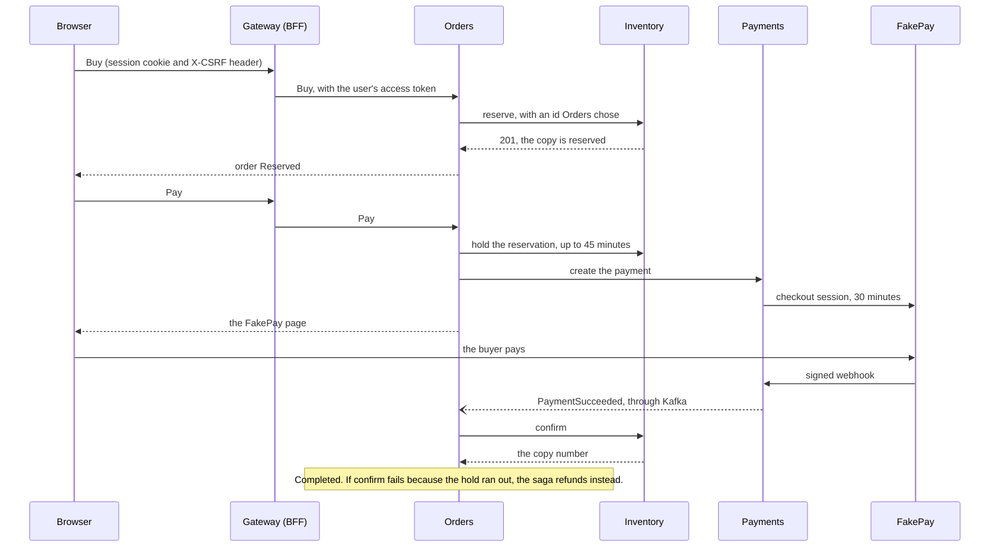

# Sprint 3

**Dates:** 2026-11-10 to 2026-11-23

**Goal:** Phase 1b: a signed-in buyer buys a copy in the browser, and the last-copy k6 test passes through the gateway, both in CI.

Sprint 2 ended early, on 2026-11-09, because its goal was reached and the follow-ups were merged. Its review and retro, and the Phase 1a mock interview, followed on 2026-11-11 (see [`sprint-02.md`](sprint-02.md)).

## Plan

The tasks of [the Phase 1b plan](../plans/2026-11-09-phase-1b-checkout.md), in four waves. A wave starts when the previous one has merged; up to three tasks run at once.

| Wave | Issue | Task |
|---|---|---|
| A | #68 | 1 Messaging tells "not now" from "never" |
| A | #69 | 2 Sign-in groundwork |
| B | #70 | 3 Inventory for checkout |
| B | #71 | 4 Payments and FakePay |
| B | #72 | 5 The gateway as BFF |
| C | #73 | 6 Creators and channels |
| C | #74 | 7 Orders, the checkout saga |
| C | #75 | 8 The web app |
| D | #76 | 9 Phase 1b done |

### Changed after Sprint 2's retro

At the retro the owner asked for more weight on interview preparation: they learned most from the mock interview and haven't had time to read the code yet. The owner's interview notes (`docs/Interview Questions + AWS.pdf` in the roadmap workspace) also show that more than half of the real questions are C# basics that the roadmap doesn't cover, such as `virtual` versus `abstract`, value and reference types, and `IDisposable`. So this sprint changes in four ways:

1. **A question bank first.** `roadmap/interview-questions.md` lists every backend question from the interview notes, grouped by topic and sorted by how often it came up. Each has a short answer, a short example where it helps, and a link to the long topic.
2. **Short topics on the C# basics** that the roadmap doesn't cover yet: key ideas, one short example and the questions.
3. **Short mock interviews two or three times a week:** five questions, three new ones from the bank and two repeats of earlier gaps.
4. **Wave B waits for the question bank, then runs one pull request at a time.** Each walkthrough ends with three interview questions that its code answers. The review is answering them, using only the files the walkthrough names.

   **Changed on 2026-11-13:** the owner chose to run wave B's three tasks at once after all, like waves A and C, so the Plan table above is what happened. The interview questions at the end of each walkthrough stayed.

## Review

The goal was reached on 2026-11-13. In CI, a new buyer signs up, buys and sees the copy in a real browser (`e2e`), and the last-copy test runs through the gateway (`compose-smoke`). The owner also bought a copy by hand on a stack started from a clean clone. The sprint ended early.

How a purchase works now:

The browser only ever talks to the gateway and FakePay's page. The gateway keeps the tokens in Redis and gives the browser a cookie, so no token reaches JavaScript (ADR 0015). Orders runs the saga: the calls a person waits for are HTTP, and the payment's outcome comes back as an event (ADR 0017). Every step is safe to repeat, because the reservation id, the payment per order and every event handler are idempotent.

The Phase 1b mock interview ran on 2026-11-13, as short round 10:

| Question | Result |
|---|---|
| 1. A lost `201`, and the client retries the reserve with the same id | The right idea (the same id means it's already done), but the retry would have answered "sold out", the very bug Task 3's review found. |
| 2. The BFF: why no token in the browser, CSRF, what `SameSite=Strict` protects | Didn't know. |
| 3. Payment arrives after the hold ran out | Didn't know how this can happen. Explained: no shared transaction, events can be late, and the compensation is a refund, not a rollback. |
| 4. Observability, a re-check: 1 % of purchases take 5 s | Better than round 9: average hides the tail, find the slow trace and its logs by `TraceId`. Missed metrics as the first step, and named the maximum instead of p99. |
| 5. Testing, a re-check: how to test `POST /api/orders` | The right outline: three kinds, a real database for integration tests, parallel calls for the race. Missing the details: what each kind checks, why not InMemory, the exact invariant. |

The pattern: the re-checked topics improve, from no answer to the right outline. The new Phase 1b topics are "don't know", because the owner hasn't read those pull requests yet. The gaps per topic are in the roadmap's `what-to-study.md`.

## Retro

### What I learned

I didn't read the code closely this sprint.

### What was hard

Auth: how authentication and authorization work, how sessions work, and how all of it works across microservices and in multi-tenant systems.

### Open questions

How to build auth in microservices and in a multi-tenant system: which options there are, how to implement each, and their nuances.

### What to change in Sprint 4

More mock interviews. More diagrams (Mermaid) with explanations. Every pull request explains its logic with a diagram of what happens and what changes.

### Changes after Sprint 3's retro (Claude)

- **A diagram in every pull request.** `AGENTS.md`, "Teach while building", and the walkthrough list in `~/.claude/agents/code-writer.md` now ask for at least one Mermaid diagram of the flow the change adds or changes, with what changes marked and a few sentences that walk through it. The Review above has the first one.
- **Auth in microservices and multi-tenant systems** goes to the roadmap's `what-to-study.md` as a short topic with diagrams: the options, how each is built and its trade-offs, tied to what newstore does.
- **More mock interviews:** the next rounds re-ask the BFF and the saga, and observability every other round.

### What the sprint built (Claude)

All of it on 2026-11-09 and 2026-11-13. CI on `main` is green after the last merge (5ae5166), and on 2026-11-13 the owner bought a copy by hand on a stack started from a clean clone of `main` (check 3 of "Phase 1b is done when").

| Pull request | Issue | What |
|---|---|---|
| #77 | | The Phase 1b plan, with its decisions in the README |
| #78 | #68 | Wave A, Task 1: a transient handler failure is retried without a limit |
| #79 | #69 | Wave A, Task 2: the Keycloak realm, token validation and service clients |
| #80 | | A messaging test waits for the inbox row, not the handler probe |
| #94 | #70 | Wave B, Task 3: Inventory holds a reservation while the buyer pays, with a caller-supplied id |
| #95 | #72 | Wave B, Task 5: the gateway as a backend for the browser, with Keycloak sign-in |
| #96 | #71 | Wave B, Task 4: Payments and FakePay, with signed webhooks and refunds |
| #98, #100 | #97 | Reserve's p99 regressed after Task 3: fewer round trips, and CI's threshold stays at 3.5 s |
| #99 | #75 | Wave C, Task 8: the Angular app, served by the gateway |
| #103 | #73 | Wave C, Task 6: creators open a channel and manage only their own editions |
| #104 | #74 | Wave C, Task 7: the checkout saga in Orders |
| #105 | #101 | Payments treats a rate-limiter rejection from FakePay as transient |
| #106 | #76 | Wave D, Task 9: e2e in CI, and the load test through the gateway |
| #108 | #107 | The SDK, images and packages aligned on 10.0.404 / 10.0.15 |
| #85–#87, #109 | | Dependabot: k6 2.3.0, the OpenTelemetry Collector and minor package updates |

Still open: #102 (CI's load-test latency is noisy and two to three times the Mac's) and #92 (move to .NET 11 in one pull request).

### How the agent worked (Claude)

**Cost** at API prices: wave B about $28.75, twice the $10–15 I told you beforehand; wave C about $22.3, under the $30–40 estimate; the #97 fix about $24.1, most of it one Opus implementer whose context grew to about 456k tokens. Waves A and D aren't summed in the ledger. The reviews ran on Opus for the concurrency and security code, and on Sonnet for the web app and the scoped re-reviews.

**What the reviews and CI caught.** Unlike Phase 1a, most findings were in the code:

- A timestamp kept .NET's 100 ns ticks while PostgreSQL stores microseconds, so a Task 3 test passed on the Mac and failed on CI's Linux runner. It was reproduced on the Mac first, with a fixture clock below a microsecond, then fixed.
- Task 7's double-click test couldn't fail, and Polly's rate-limiter rejection wasn't treated as transient, because the earlier rule named only the open circuit and the timeout. Every service client now converts Polly's base `ExecutionRejectedException`; Payments' FakePay client followed in #101.
- Under the 1000-buyer burst, Task 9 saw 503s from the client's rate limiter and slow first requests. The fixes are a request queue, a larger listen backlog and a one-time warm-up that gates `/health/ready`.
- The pre-flight check of wave C's briefs against the merged code found eleven mismatches before any agent started, among them a latent bug on `main`: Catalog and Inventory refused the browser's tokens in Compose, hidden by the test factory's default. Task 6 fixed it.

**The main session's own mistakes:**

- **CI's p99 alone didn't catch a regression.** Task 3 added two database round trips to every losing reserve (five statements instead of three). On a quiet Mac that moved p99 from about 0.45 s to 0.7 s, but CI's numbers for one and the same code range from 1.3 to 3.0 s, so #94's own run passed and `main` went red after the merge. #97 went back to three statements, and a test now counts the database commands per sold-out reserve, which doesn't depend on the runner's noise. CI's threshold stays at 3.5 s as a guard against gross regressions only (#102).
- **A wrong Dependabot pattern.** The first ignore rule for the .NET images named `mcr.microsoft.com/dotnet/*`, but Dependabot matches the name without the registry, `dotnet/*`. The fix came from the names in Dependabot's own earlier pull requests (#81, #82). Its first run after #108 opened no .NET major-version pull request.
- **A cost estimate off by a factor of two** for wave B. Wave C's estimate was made from wave B's real numbers and held.
