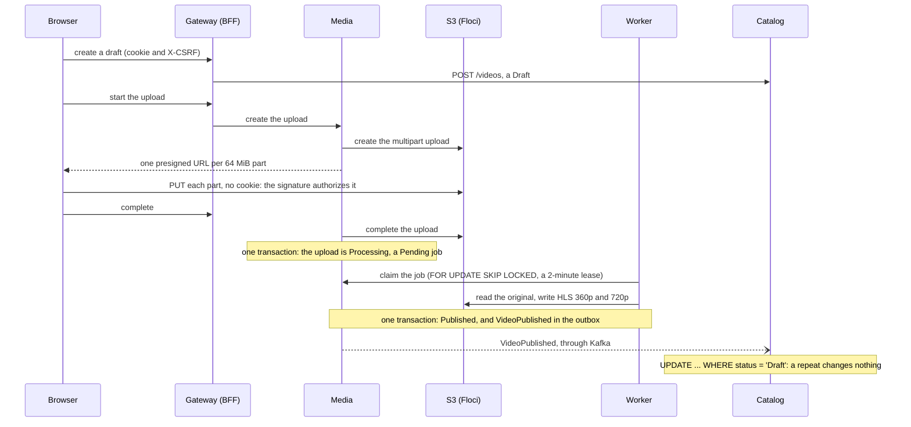

# Sprint 4

**Dates:** 2026-11-14 to 2026-11-27

**Goal:** Phase 2: an uploaded 1 GB video becomes playable and a broken file shows as Failed, in CI and on the Mac; the owner of a digital copy downloads the original.

Sprint 3 reached its goal on 2026-11-13, ahead of its end date, so this sprint starts the next day. Sprint 3's review and retro, with the Phase 1b mock interview, go in [`sprint-03.md`](sprint-03.md).

## Plan

The tasks of [the Phase 2 plan](../plans/2026-11-14-phase-2-video-pipeline.md), in four waves. A wave starts when the previous one has merged; up to three tasks run at once.

| Wave | Issue | Task |
|---|---|---|
| A | #115 | 1 The spike: local S3 and FFmpeg |
| B | #116 | 2 Media and resumable uploads |
| B | #117 | 3 Catalog: drafts and `VideoPublished` |
| B | #118 | 4 The gateway routes (merges after 2) |
| C | #119 | 5 The worker |
| C | #120 | 6 Downloads |
| C | #121 | 7 The web app |
| D | #122 | 8 Phase 2 done |

Task 1 is a spike: if the local S3 emulator fails one of its checks, the sprint stops there until the owner decides on the fallback.

### Changed after Sprint 3's retro

Every pull request's walkthrough has at least one Mermaid diagram of the flow it adds or changes, with a few sentences under it, as the owner asked at the retro. Each walkthrough still ends with three interview questions its code answers.

## Review

The goal is reached in CI, not yet on the Mac. All eight tasks merged on 2026-11-14 and 2026-11-15:

- CI's `e2e` job (`tests/e2e/video.spec.ts`) uploads a video in Chrome, watches it play, and sees a broken file shown as Failed with its reason.
- `compose-smoke` checks the stack: the seeded sample's HLS playlist is public and has 720p, the originals are private (403), the worker's FFmpeg is the expected build, and the gateway refuses an anonymous upload.
- A buyer's download of the original is proven by Media's integration tests (`DownloadTests`), not in a browser.
- The nightly job turns a 1 GB upload into HLS; the first run took 3 min 52 s (ADR 0020).

Check 3 of "Phase 2 is done when", the owner's run on the Mac, started on 2026-11-16 and was postponed on 2026-11-24 by the owner's choice. So Phase 2 isn't formally done, and Phase 3 waits for that run.

How an upload becomes a video viewers can watch:

The bytes never pass through our services: the browser sends them straight to S3 with URLs that Media signs (ADR 0018). After a reload, Media asks S3 which parts it already has, and the browser sends only the rest. Processing is a row in Media's database, claimed with a lease. A worker that dies loses its job when the lease runs out, and another worker takes it (ADR 0020). Media owns the upload's status and Catalog owns what viewers see. One event joins them, and Catalog's guarded update makes a repeat harmless (ADR 0019). A download is a 15-minute presigned link that only the owner of a copy can get (ADR 0021).

The Phase 2 mock interview ran on 2026-11-24, as short round 11 (`roadmap/mock-interviews-log.md`):

| Question | Result |
|---|---|
| V1. Why a 2 GB upload bypasses the API, and how a resumable multipart upload works | Nearly right. The part list is kept by S3 (`ListParts`), not by the client. |
| V2. A job that survives a restart, the lease and `SKIP LOCKED`, a worker that crashes | The right ideas, without the mechanism: the jobs table, the lease, the attempts. |
| V3. A 15-minute download link: who can use it, and does a download started at minute 14 stop at 15 | Wrong on both. A link is a bearer: the owner check happens when it is issued. S3 checks the expiry when a request starts. |
| V4. BFF and CSRF, re-asked from round 10 | Up from "don't know" to half: tokens on the server ✓, the `X-CSRF` header not named. |
| V5. Who owns a video's status, and a repeated `VideoPublished`, re-asked from round 10 | Didn't remember. |

The next round re-asks V3, V5 and the CSRF header.

## Retro

The owner skipped their part of this retro on 2026-11-24, and the manual run on the Mac (check 3) is postponed.

### What the sprint built (Claude)

The phase on 2026-11-14 and 2026-11-15. Then, on 2026-11-24, a round that fixed what had failed meanwhile. CI on `main` is green after the last merge (78d3139).

| Pull request | Issue | What |
|---|---|---|
| #123 | | The Phase 2 plan, with its decisions in the README |
| #126, #128 | #115 | Wave A, Task 1: the spike, local S3 (Floci) and FFmpeg, ADR 0018 |
| #131 | #116 | Wave B, Task 2: the Media service and resumable uploads |
| #130 | #117 | Wave B, Task 3: Catalog's drafts and `VideoPublished`, ADR 0019 |
| #129 | #118 | Wave B, Task 4: the gateway's routes for uploads, downloads and drafts |
| #134 | #119 | Wave C, Task 5: the worker turns uploads into HLS, ADR 0020 |
| #133 | #120 | Wave C, Task 6: owners of a digital copy download the original, ADR 0021 |
| #132 | #121 | Wave C, Task 7: the web app's studio, uploads, HLS player and downloads |
| #135 | #122, #11–#14 | Wave D, Task 8: Phase 2 done, with the browser test, the 1 GB test and compose-smoke |
| #137, #139 | | The final review's fixes, and the first nightly run's times in ADR 0020 |
| #149 | #138 | A draft's editions are hidden and refused, so a draft can't be sold |
| #150 | #136 | Every .NET service runs under an init, so a crash exits instead of spinning |
| #145–#148, #151 | #114 | Flaky tests and two real bugs found by them: Inventory's cleanup failing every 5 minutes, and offsets lost at a rebalance |
| #113, #124, #125 | #110, #102, #114 | Follow-ups from Phase 1b |
| #140–#144 | | Dependabot: Floci 2.5.0, k6 2.4.0, PostgreSQL 18.7, Testcontainers 4.17 and minor packages |

Still open: #152 (three more flaky tests, being worked on), #102 (CI's load-test latency) and #92 (.NET 11, blocked until Npgsql's EF Core provider ships a GA 11).

### How the agent worked (Claude)

**Cost:** not known for this sprint. The ledger didn't record each agent's usage, as the Phase 0 retro asked. That step is back in the routine from the next task.

**What the reviews caught before merge:**

- Floci doesn't apply S3's default Block Public Access to a new bucket. The plan's constraints had assumed it does. The seed now sets the four values, and a test checks them (Task 1).
- If the server lost an upload, `complete` answered 500 and left a row stuck in Uploading (Task 2).
- No test failed without FFmpeg's `-format_whitelist`. That option is what stops a crafted file from making FFmpeg read other files, so a test now proves it (Task 5).
- The final review found that a sample video's download was a 404, that WebM was refused by the file picker, and that an upload had no Cancel (#137). It also found that a draft's editions could be bought. That needed a design choice, so it was parked and fixed later in #149.

**What failed after merge, and why CI didn't catch it:**

- **A crashed migrate job hung `docker compose up --wait` on the Mac only (#136).** `dotnet` ran as PID 1, and on arm64 a .NET 10 process that is PID 1 spins after `abort()` instead of exiting ([dotnet/runtime#118049](https://github.com/dotnet/runtime/issues/118049)). CI's x64 runners exit normally, so they never showed it. The fix is `init: true`.
- **Flaky tests came out of full local runs, not CI.** Each was proven the same way: a forced condition makes the test fail every time with the original error, then the fix passes under it. Two were real bugs: Inventory's cleanup threw every 5 minutes, and the consumer lost its stored offsets at a rebalance. One was Kafka's metadata lag (#151).

**The main session's own mistakes:**

- **One agent ran `docker compose down -v` and wiped the owner's volumes.** The rules files now forbid `-v`.
- **The owner merged #126 before its fix round was pushed,** the same lesson as Phase 1a. The fixes went out as #128.
